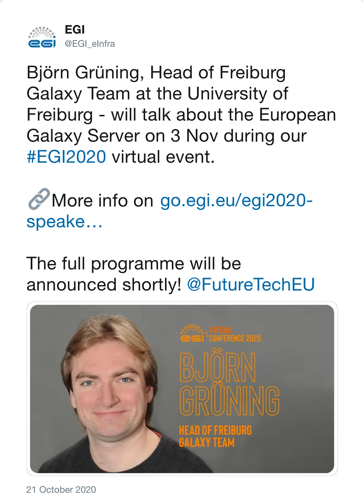

Björn Grüning will be a **keynote speaker at the [EGI Conference 2020](https://indico.egi.eu/event/5000/)**. He will take us on a journey by introducing us to Galaxy, sharing his 10 years+ experiences and know-how in just 45 minutes. Best-practices, tools, workflow development, just a few topics that will be mentioned, not to forget how these contribute to transparent and reproducible research. Come and join us on Tuesday to learn more about the European Galaxy server and Galaxy-based data analytics.

 

*Post by @EGI_eInfra on 21 October 2020*
