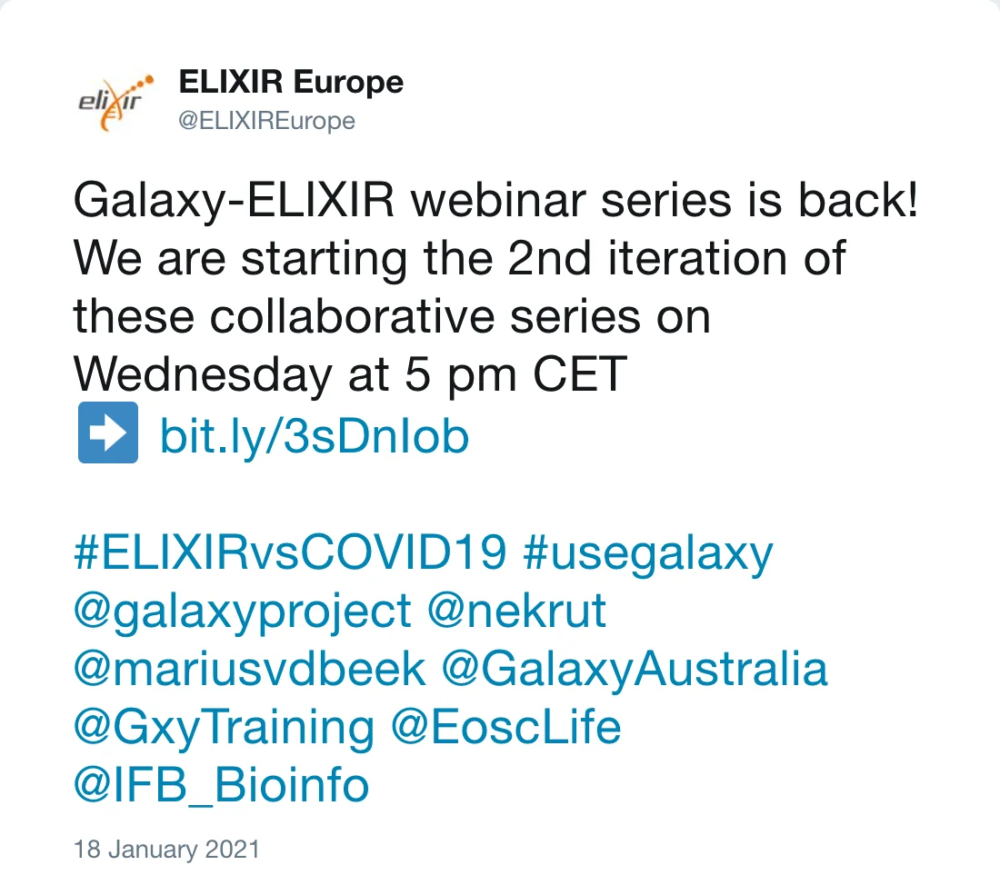

The Galaxy Community and ELIXIR organise a second webinar series to demonstrate how open software and public research infrastructures can be
used in analysing and publishing SARS-CoV2 data.

## 2nd Galaxy-ELIXIR webinar series: Open Data Infrastructures to tackle COVID-19 pandemic

<a href="https://us02web.zoom.us/webinar/register/WN_4SM_qg8sTkizTtODviMnNg"><button type="button" class="btn btn-primary btn-lg">Registration</button></a>

*Post by @ELIXIREurope on 18 January 2021*

### Session 1: COVID-19 analysis in Galaxy: Lessons learned and introduction to the series

**20 January 2020, 17.00-18.00 CET** (starts at 16.00 GMT, 11.00 EST, 8.00 PST)

The first session will summarise the developments in Galaxy the past eight months and introduce the latest tools for COVID-19 related research:

- WorkflowHub, Dockstore
- Single-tool view, simplified workflow run-form
- Scaling and performance improvements over the last 9 month
- Paper-Cut event(s)
- Galaxy plans for the next years 

#### Speakers

* Anton Nekrutenko
* Marius van den Beek

