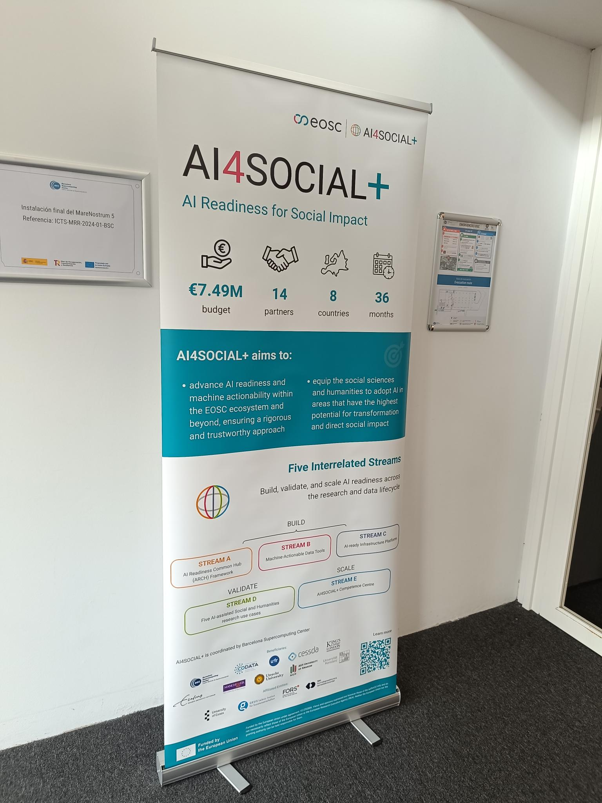
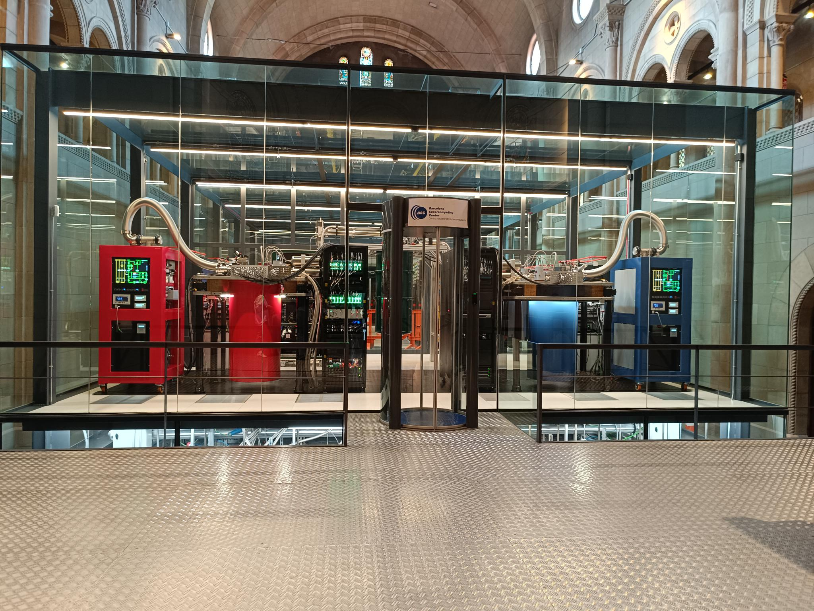

# Kicking off AI4SOCIAL+

## What is AI4SOCIAL+?
[AI Readiness for Social Impact](https://cordis.europa.eu/project/id/101292886) - or, in short, AI4SOCIAL+ is a project funded by the European Commission under the Horizon Europe Programme to support the AI transformation in the Humanities and Social Sciences.

## What was the meeting about?
Following the project's [online kick-off in October](https://galaxyproject.org/news/2026-10-01-ai4social/),  we met in the Barcelona Supercomputing Center (BSC) in Barcelona to meet up with all project partners in person.

  

The morning mostly consisted of input from various partners on standards, repositories, and synergies, including a panel on workflows and an introduction to Galaxy.
We also got a quick glance at Mare Nostrum, Spain's most powerful supercomputer.

  

The afternoon focused on interactive exchange of insights. We collected what **AI readiness** means to the different parties involved to set the tone for future discussions across the various streams and to start defining AI readiness within the project.
Afterwards, one of the core sessions for the Galaxy Team focused on identifying overlaps between the various use cases and the technological partners involved. 
The project's five use cases cover different topics from various social sciences and humanities domains. Those range from Handwritten text recognition of handwritten archival material on climate science to identifying citation cartels in academic literature.
The full day ended with the social dinner, where we continued our fruitful discussions. After this full and very rich day with loads of insights, well are well set us up for a successful continuation of the project.
