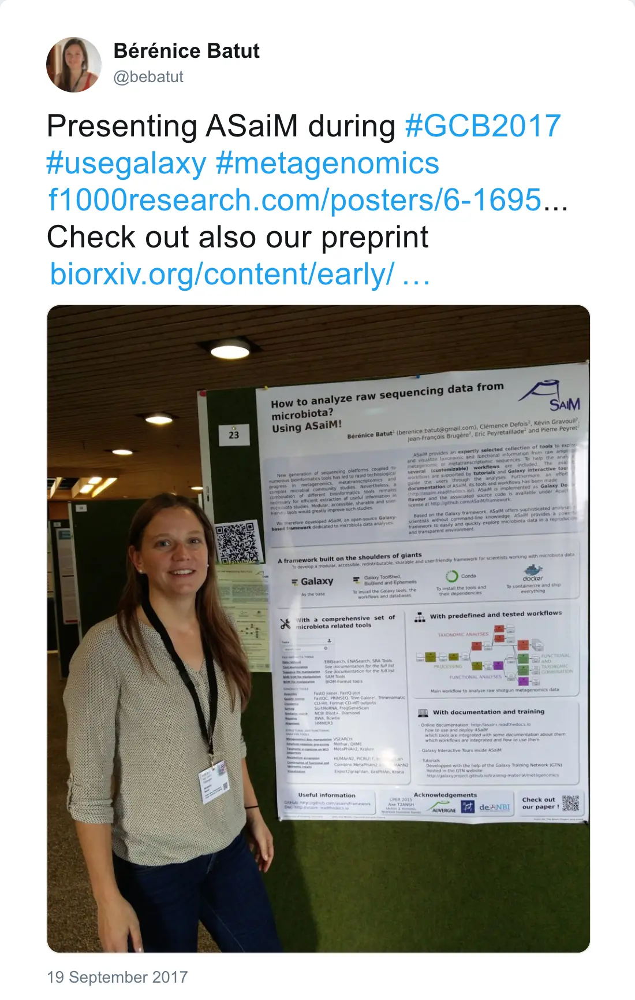

During the [German Conference on Bioinformatics](http://www.gcb2017.de/) in Tübingen, we presented (with [Milad Miladi](http://www.bioinf.uni-freiburg.de/~miladim/)) 3 posters related to Galaxy:

*Post by @bebatut on 19 September 2017*

- [Building an open, collaborative, online infrastructure for bioinformatics training](https://f1000research.com/posters/6-1694)

    

        <embed src="https://d1hiluowqo0t4b.cloudfront.net/posters/compressed/f1000research-178036.pdf" width="65%" height="700px" type='application/pdf'/>
    

- [How to analyze raw sequencing data from microbiota? Using ASaiM!](https://f1000research.com/posters/6-1695)

    

        <embed src="https://d1hiluowqo0t4b.cloudfront.net/posters/docs/f1000research-178037.pdf" width="65%" height="700px" type='application/pdf'/>
    

- [Scalable and accessible clustering of RNAs based on sequence and secondary structures](https://f1000research.com/posters/6-1884)

    

        <embed src="https://d1hiluowqo0t4b.cloudfront.net/posters/docs/f1000research-182067.pdf" width="65%" height="700px" type='application/pdf'/>
    

