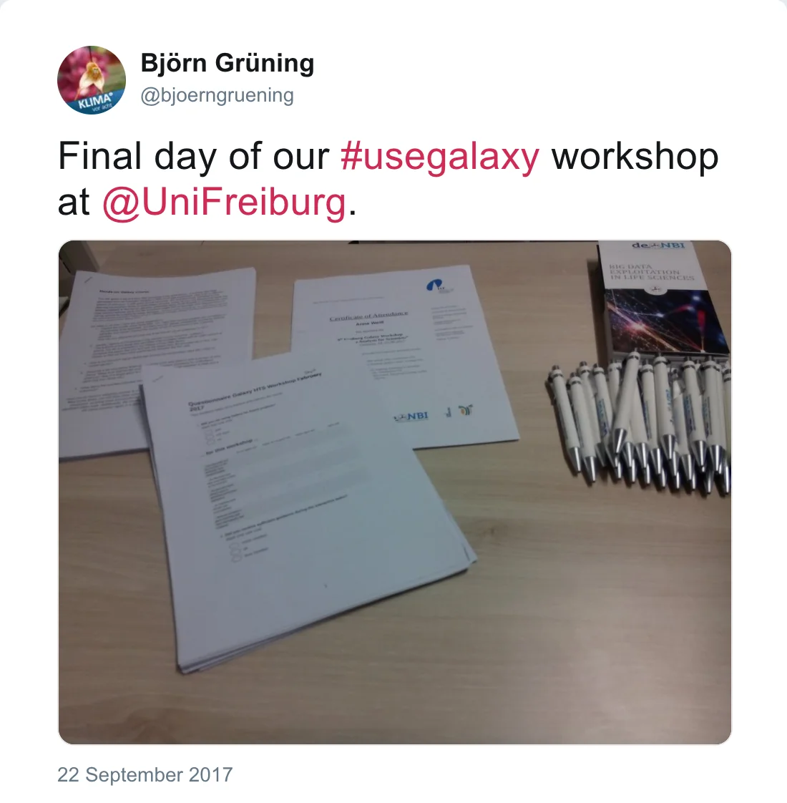

After 5 days, our HTS Galaxy workshop in Freiburg is over.

*Post by @bjoerngruening on 22 September 2017*

During this workshop, attendees learned:

- Day 1: Galaxy and how to use it to analyze biological HTS data
- Day 2: ChIP-seq
- Day 3: RNA-Seq
- Day 4: Exome-seq, MethylC-seq
- Day 5: Recap and exercises

This workshop was organized by the [Bioinformatics and Deep-Sequencing Unit at the MPI-IE Freiburg](https://www.ie-freiburg.mpg.de/bioinformaticsfac) and our team.

