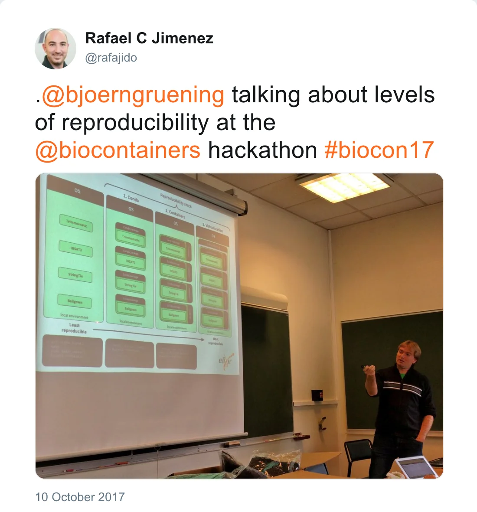
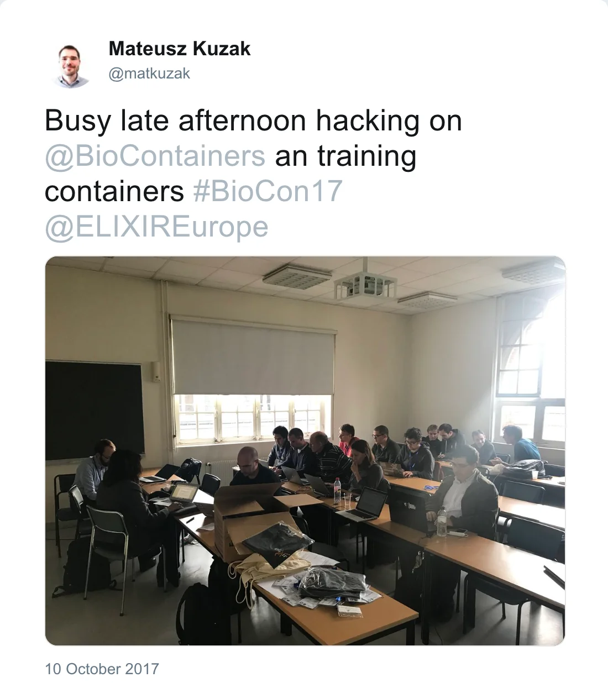

Björn, Yasset Perez-Riverol (EBI), and the French ELIXIR node organised a [BioContainer Hackathon](https://github.com/BioContainers/workshops/blob/master/README.md) in Paris.

*Post by @rafajido on 10 October 2017*

The purpose of this event was to consolidate the [BioContainers](https://biocontainers.pro/) platform as a service, and the integration with other ELIXIR initiatives like ([Bio.Tools](https://bio.tools/)).

During these two days, BioConda packages has been created (and with this Containers) and the
3,000 container threshold has been passed.
As planned, effort was put on integration of Bio.Tools with BioContainers.
Training (about using containers, Docker and Singularity) was also an important part of this successful hackathon.

*Post by @matkuzak on 10 October 2017*

