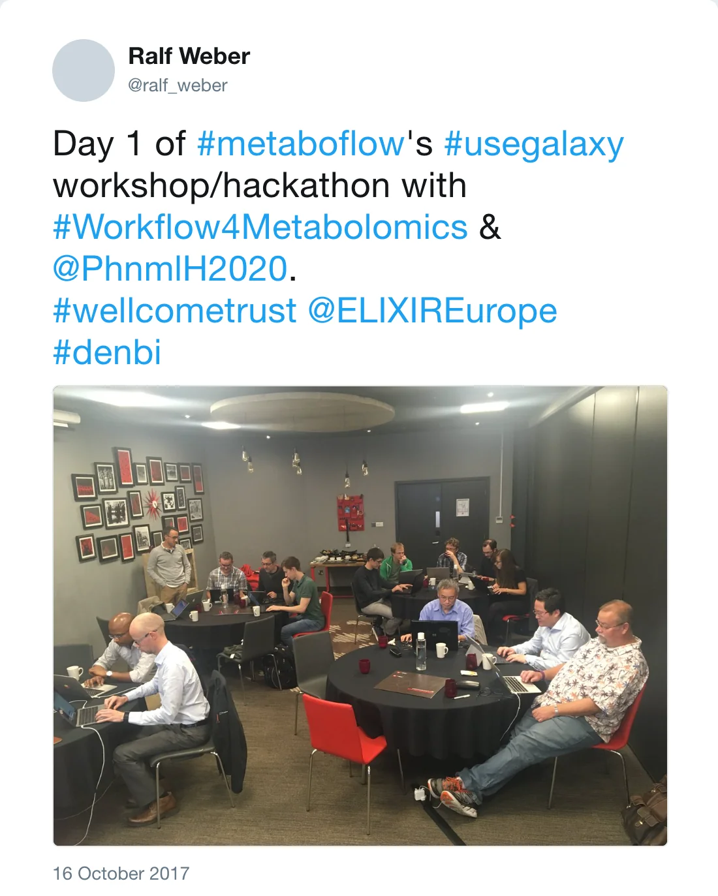

Björn participated to the Wellcome Trust funded MetaboFlow meeting (training and hackathon) in Birmingham.

*Post by @ralf_weber on 16 October 2017*

On the first day, he taught (helped by Gildas Le Corguillé and Ralf Weber) to attendees the basics of Galaxy platform and best practice guidelines for tool and workflow integration. After this training, during the second day, all the participants worked together to Galaxify existing metabolomics tools and workflows. 

