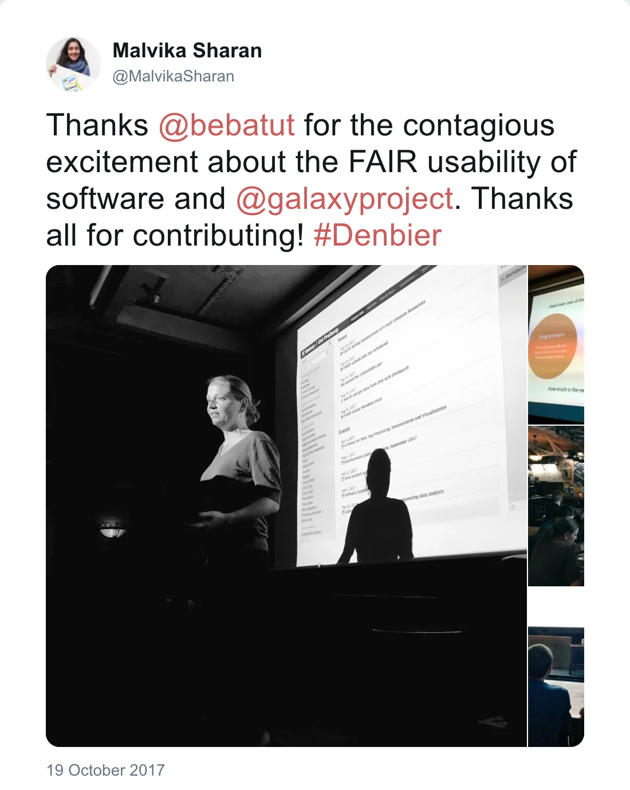

Bérénice was helping Toby Hodges, Malvika Sharan and the other instructors for the [Software Carpentry workshop](https://www.embl.de/training/events/2017/SWC17-01/) organized at EMBL in Heidelberg.

    

This workshop covered several basic concepts and tools for research computing skills:

- Python: introduction, use of Jupyter notebook, scientific data analyses particularly with Pandas library
- Unix shell: introduction and usage of cluster resources
- Git and GitHub
- Snakemake for pipeline management and Conda

On Thursday evening, Bérénice gave a talk at the [de.NBier event](https://www.denbi.de/events/435-denbier6) about Galaxy (tools, visualization, interactive environment, ...) and the Galaxy Training material infrastructure. The slides are available [online](https://bebatut-slides.github.io/de.NBIer_10_17/).

*Post by @MalvikaSharan on 19 October 2017*

## Credit

The picture of the Software Carpentry workshop was taken by Hugo Neves

