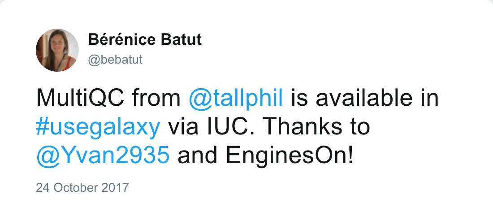

[MultiQC](https://multiqc.info/) is a tool that aggregate results from bioinformatics analyses across many samples into a single report. It is really a great and useful tool!

*Post by @bebatut on 24 October 2017*

A first integration of this tools into Galaxy was available thanks to Yvan Le Bras and EnginesOn.
However, since this first version of MultiQC support for more tools was added. 

We then worked on a new updated version to support the more modules, integrate more tests and move it under the [Intergalactic Utilities Commission (IUC)](https://galaxyproject.org/iuc/) umbrella.

MultiQC in Galaxy now supports reports from:

- Bamtools
- Bcftools
- Bismark
- Bowtie 2
- BUSCO
- Cutadapt/Trim Galore!
- FastQC
- featureCounts
- Flexbar
- GATK (BaseRecalibrator or VariantEval output)
- HISAT2
- HTSeq
- Kallisto
- Picard
- Prokka
- QUAST
- RSeQC (bam_stat, gene_body_coverage, infer_experiment, ...)
- Samblaster
- Samtools
- SortMeRNA
- STAR
- TopHat2
- Trimmomatic
- VCFTools

Try it now!

