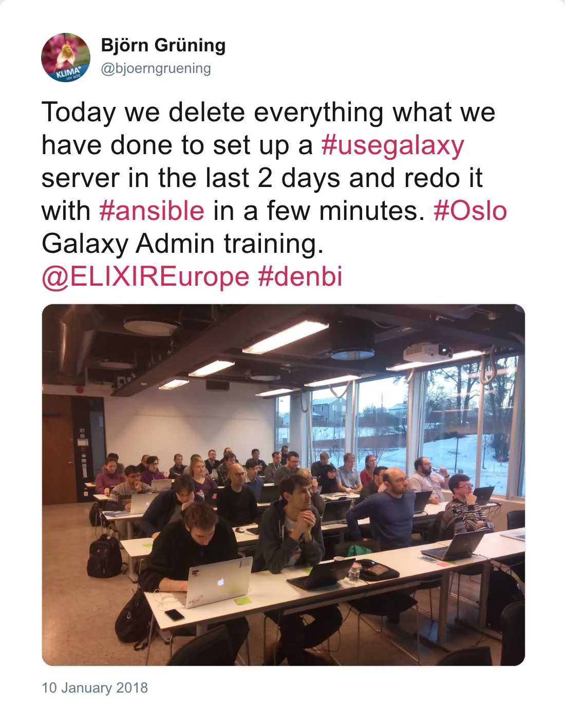

We had a very nice Galaxy Admin workshop in Oslo.

*Post by @bjoerngruening on 13 January 2018*

Over 30 participants from all over Europe learned how to setup a highly scalable Galaxy server and how to use
resource efficiently. We would like to thank the traininers Nicola Soranzo (GB), Marius van den Beek (FR), Enis Afghan (USA), Abdulrahman Azab (NO) and Björn Grüning (DE), as well
as our sponsors ELIXIR, de.NBI and the awesome host - the University of Oslo.

*Post by @bjoerngruening on 10 January 2018*

