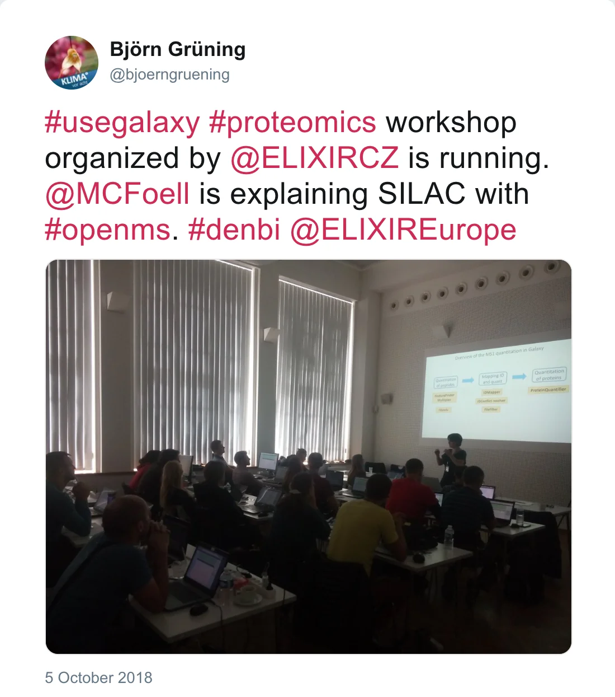

Together with members from the ELIXIR Czechia node, we have carried out a 2-days Galaxy Proteomics workshop from 4th to 5th of October in Prague, Czech Republic. We had 25 participants from the life science field and focused on proteomics tools available for Galaxy and development of workflows to combine processing steps.

Thanks to the local organizers and to our particpants!

*Post by @bjoerngruening on 5 October 2018*

