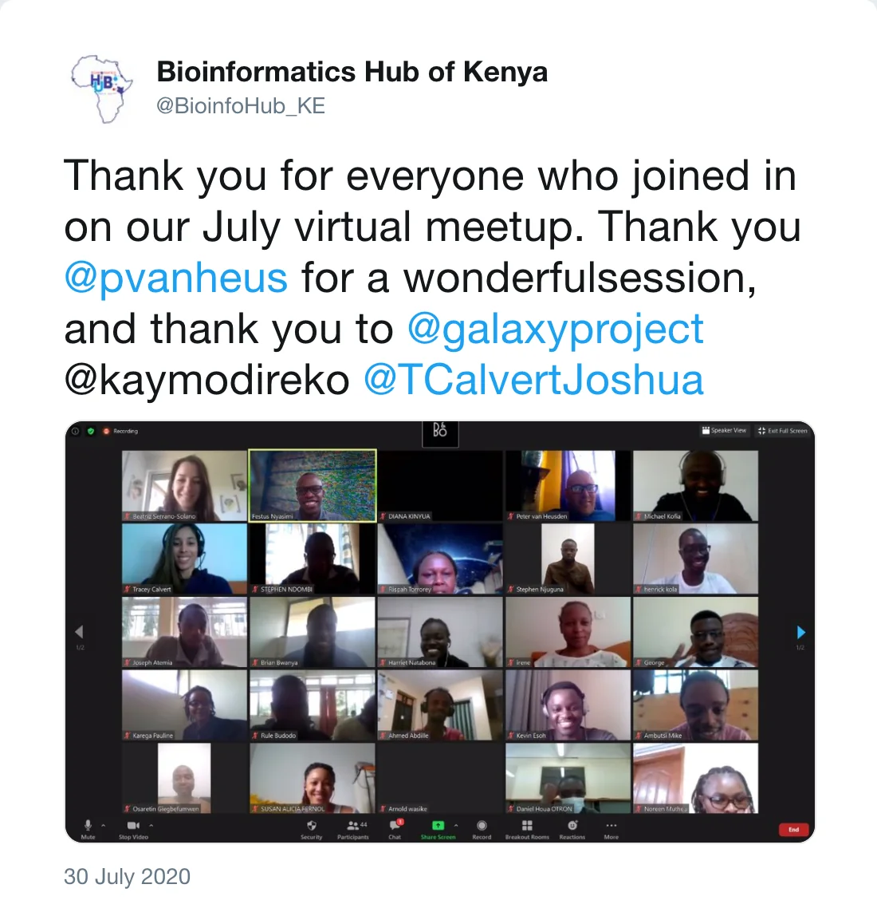

During the July virtual meet-up of the Bioinformatics Hub of Kenya (BHKi), a training on Galaxy was conducted by Peter van Heusden ([SANBI](https://www.sanbi.ac.za/)) with 72 attendees registered from many different countries: Cote d'Ivoire, India, Kenya, Mali, Saudi Arabia, South Africa, Sudan, Tanzania, Uganda, ...

For 2 hours, the participants were guided through an introduction to the Galaxy platform and a [tutorial to identify genomic variations in *M. tuberculosis*](https://training.galaxyproject.org/training-material/topics/variant-analysis/tutorials/tb-variant-analysis/tutorial.html). The assistants also had the chance to discuss and ask questions in breakout sessions.

*Post by @BioinfoHub_KE on 30 July 2020*

This workshop associates itself with the efforts to consolidate a strong Galaxy Africa community, together with the [Birds of a Feather session](https://bcc2020.sched.com/event/d4aG/bof-galaxy-africa-outreach-plans) during the BCC2020 conference in which the current status and plans for further development were discussed.

