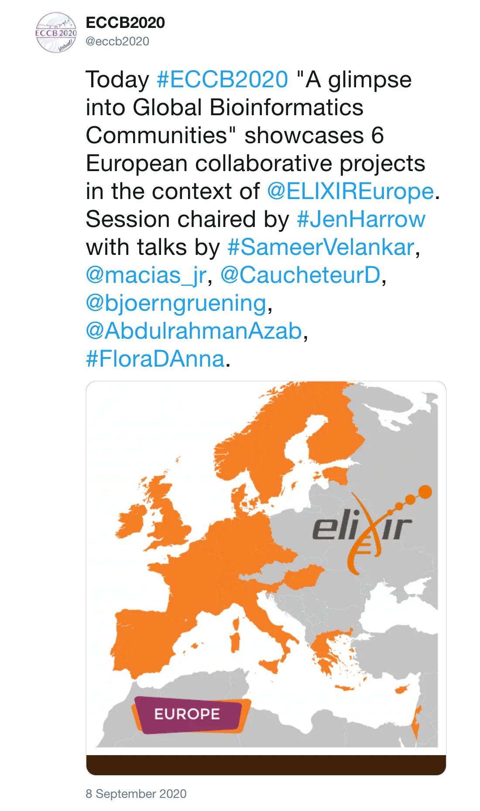

The 19th [European Conference on Computational Biology](https://eccb2020.info/) is now over. The research on COVID-19 that is being carried out since February was presented in the session “A glimpse into Global Bioinformatics Communities: Europe - ELIXIR”. 

This global effort involves different ELIXIR nodes and communities starting from the acquisition of new compute resources and followed by the packaging of software using conda and [BioContainers](http://biocontainers.pro), the registration of COVID-19 tools in [bio.tools](https://covid-19.bio.tools), their integration into Galaxy for the design of specific COVID-19 workflows, the registration of those workflows in [WorkflowHub](https://covid19.workflowhub.eu). And last but not least, the testing of workflows and the development of new [GTN training materials](https://training.galaxyproject.org/training-material/search?query=covid19).

Thank you to all the contributors for this great community effort!

*Post by @eccb2020 on 8 September 2020*

