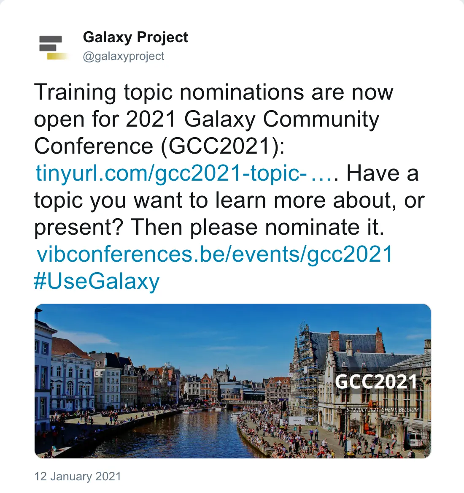

 
The training topic nominations for the [Galaxy Community Conference 2021](https://www.vibconferences.be/events/gcc2021) are now open. 

__If you have a training topic that you want to teach or learn, please [fill out the form](https://docs.google.com/forms/d/e/1FAIpQLSe-tfL-sD55RQcKU0W4wfglPbcpEZDbuwGQhGAeflhtgKqsew/viewform) with your preferences!__ Once all the preferences from the community are gathered, there will be a period to vote for topics and decide together on the training programme. 

 

*Post by @galaxyproject on 12 January 2021*

