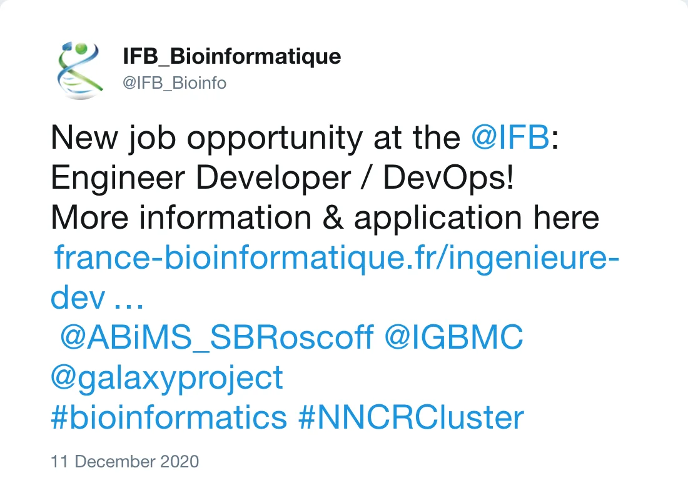

 
__New job opportunity at the [Institut Français de Bioinformatique (IFB)](https://www.france-bioinformatique.fr/) - Engineer Developer / DevOps!__ 
Located in Roscoff, Strasbourg or Rennes in France 
Duration of 1 year, extensible to 3 
More information and application here [Ingénieur(e) Développeur/DevOps](https://www.france-bioinformatique.fr/ingenieure-developpeur-devops/)

 

*Post by @IFB_Bioinfo on 11 December 2020*

