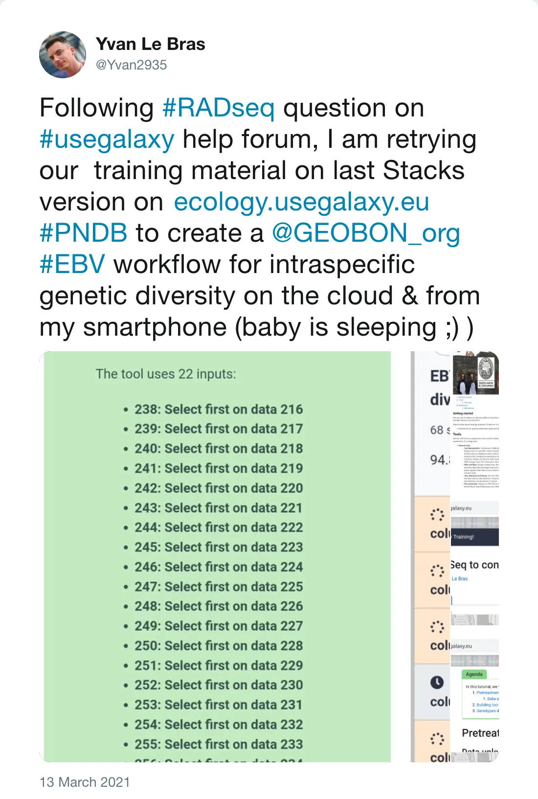
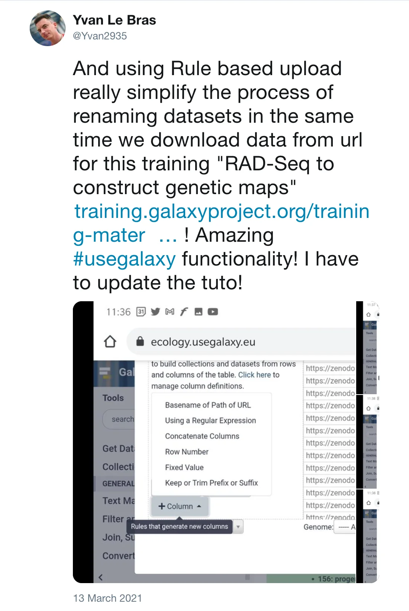
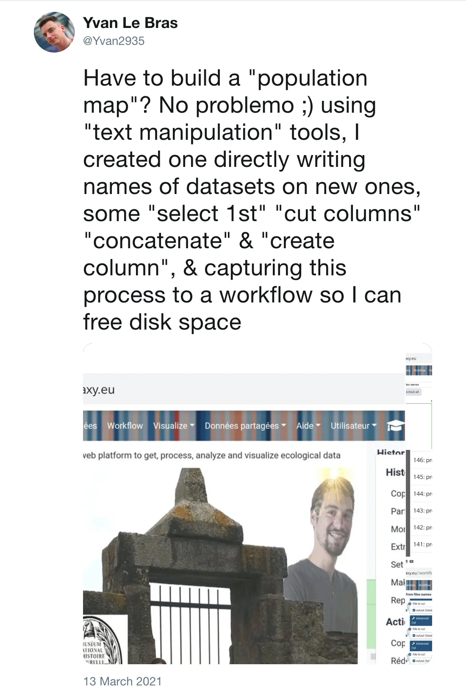
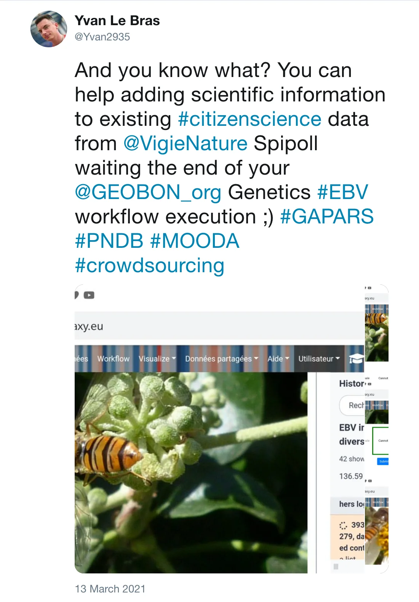
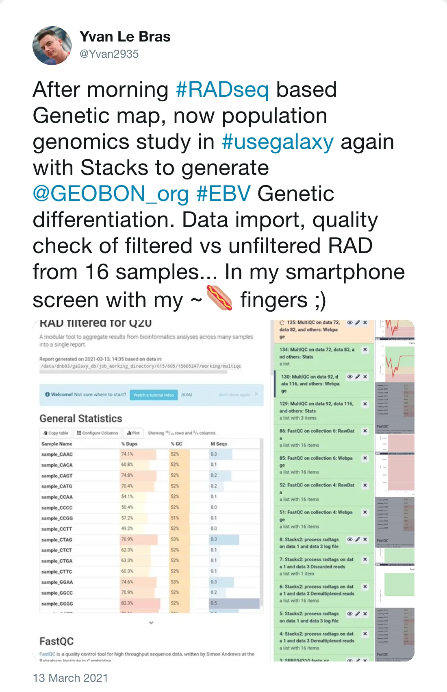
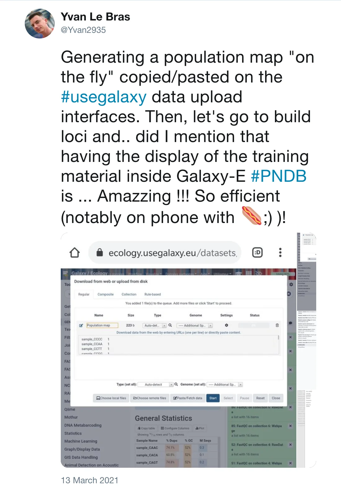

[Yvan Le Bras](https://twitter.com/Yvan2935) reminded us today that everyone can analyse RADseq data in Galaxy.

[RADSeq](https://doi.org/10.1093/bfgp/elq031) combines two simple molecular biology techniques with
Illumina sequencing: the use of restriction enzymes to cut DNA into fragments (as for RFLPs and AFLPs),
and the use of molecular identifiers (MID) to associate sequence reads to particular individuals.
This delivers high-resolution population genomic data — thousands of sequenced markers across many individuals — for any organism at reasonable costs.

Yvan and his team also created some training materials which you can find in the [Galaxy Training Network (GTN)](https://training.galaxyproject.org/training-material/search?query=RAD-seq).

*Post by @Yvan2935 on 13 March 2021*

*Post by @Yvan2935 on 13 March 2021*

*Post by @Yvan2935 on 13 March 2021*

*Post by @Yvan2935 on 13 March 2021*

*Post by @Yvan2935 on 13 March 2021*

*Post by @Yvan2935 on 13 March 2021*
