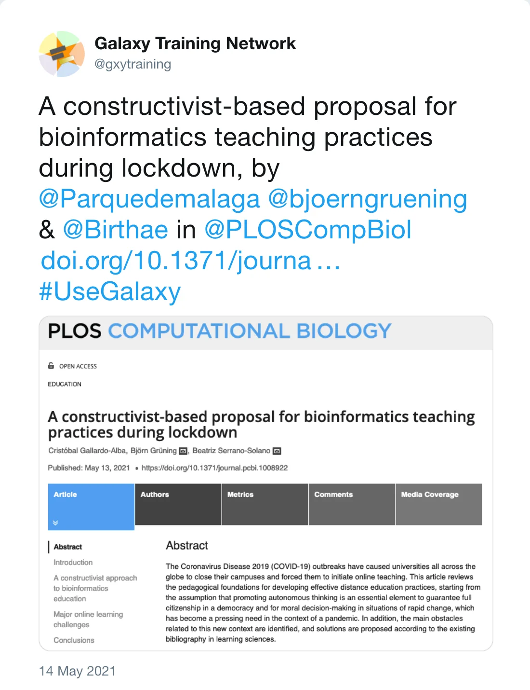
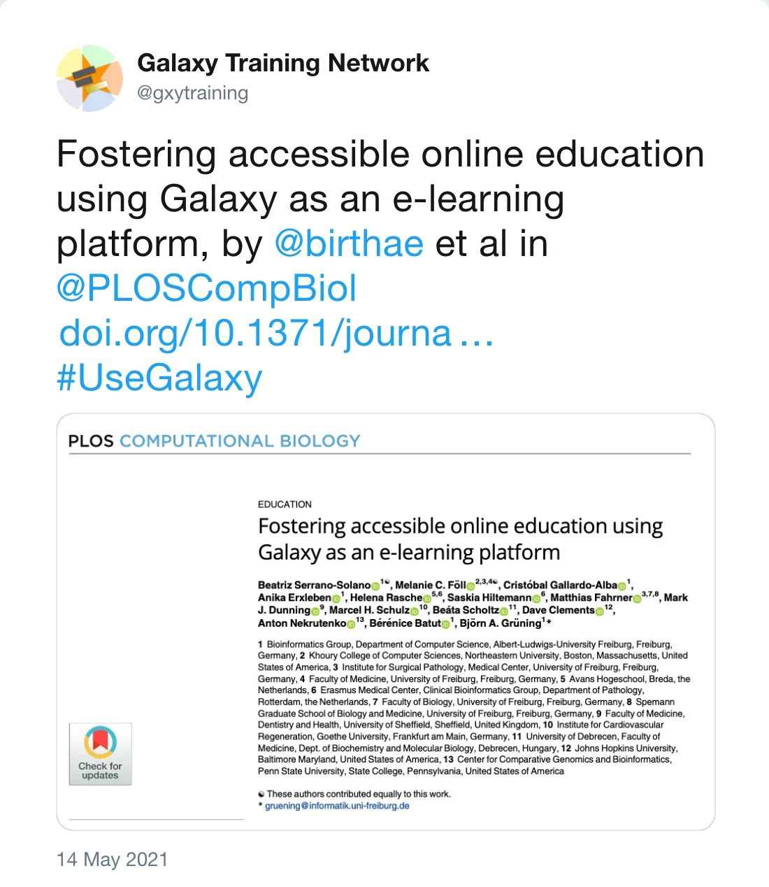

 
Two hand-in-hand teaching papers have been published this week using Galaxy as a teaching platform. The common frame encompassing both is the effects of the lockdown during the COVID-19 pandemic. University lessons and workshop have been forced to move to an online setting. 

The [first manuscript](https://journals.plos.org/ploscompbiol/article?id=10.1371/journal.pcbi.1008922), a review, sets the ground for bioinformatics teaching during the lockdown, proposing constructivism as an appropriate methodology for students to learn in an online context.
 

*Post by @gxytraining on 14 May 2021*

 
The [second manuscript](https://journals.plos.org/ploscompbiol/article?id=10.1371/journal.pcbi.1008923#sec003) describes how Galaxy can facilitate online teaching using the Galaxy Training Network materials, Training Infrastructure as a Service and many features such as data, history and workflow sharing, with a concrete proposed format to make the most of your training events.

 

*Post by @gxytraining on 14 May 2021*

 

Since the beginning of the pandemic, the Galaxy community has organised several massive and highly successful workshops: [Machine Learning](https://galaxyproject.eu/posts/2020/09/15/ML-lessons-learned/), [Galaxy Admin Training](https://gallantries.github.io/posts/2021/02/01/gat/), [GTN Smörgåsbord](https://gallantries.github.io/posts/2021/03/01/sm%C3%B6rg%C3%A5sbord/) and [Plant Transcriptome Analsis using Galaxy](https://galaxyproject.eu/posts/2021/05/03/plant-summary/).

Read our experiences and both manuscripts to get some practical tips for your next training!
