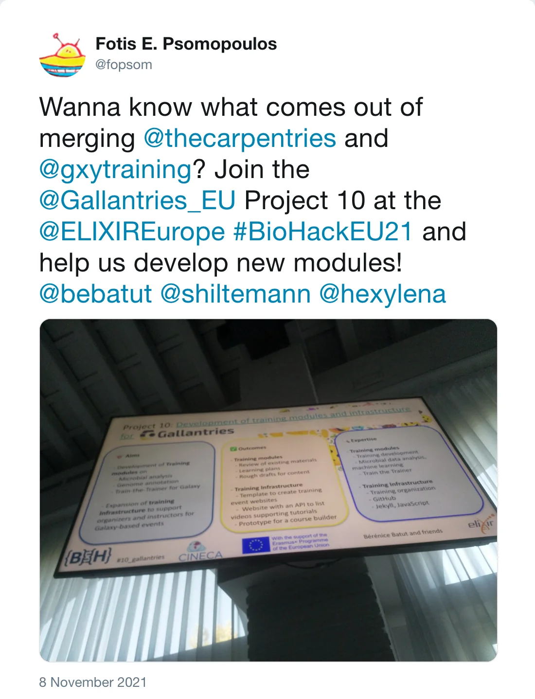
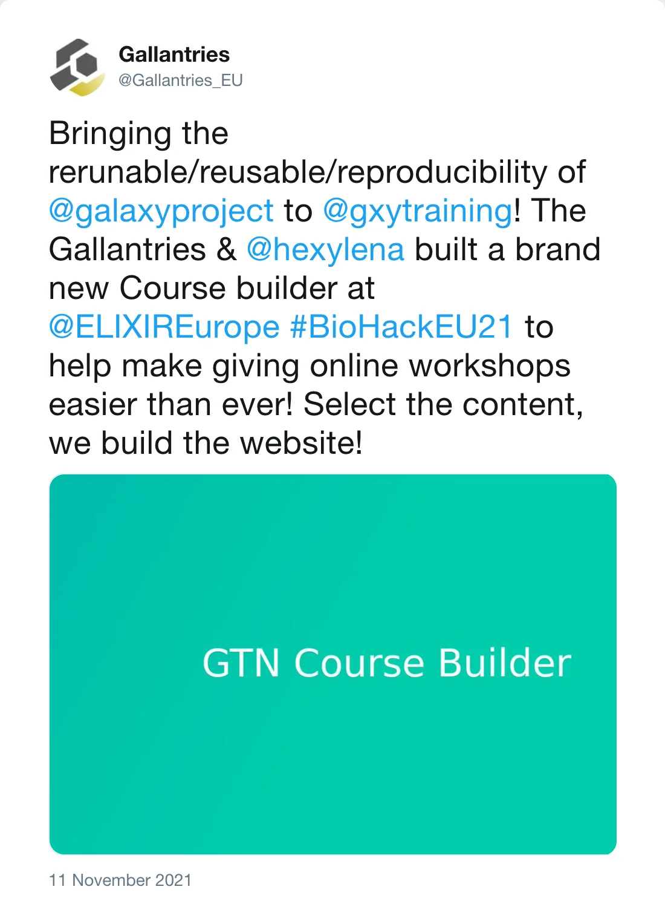
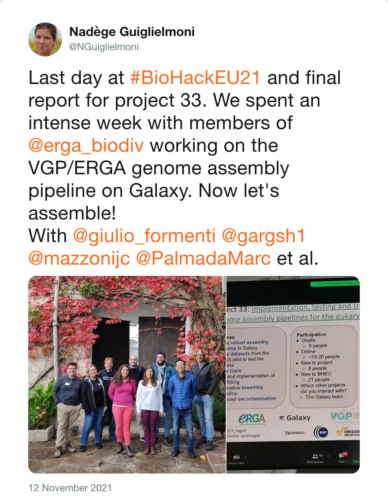
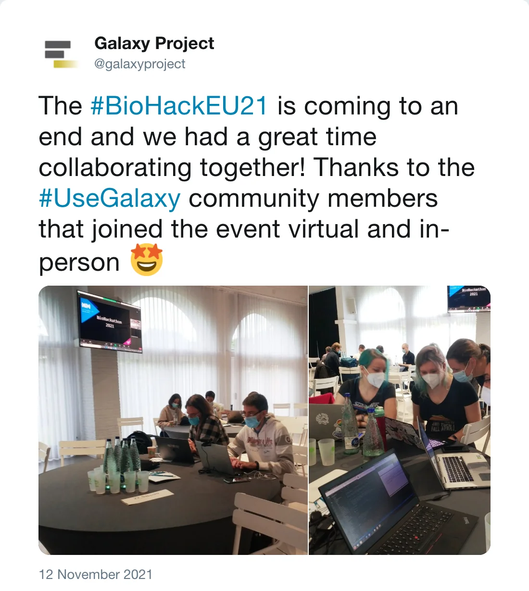

Last week we had the [BioHackathon Europe](https://elixir-europe.org/events/biohackathon-europe) 2021 in Barcelona, as a hybrid event and with participants from all over the world.
The Biohackathon had 38 [projects in total](https://biohackathon-europe.org/projects.html). The Galaxy community has participated in several of them:

### [Highlight your data management tools assembly in the RDMKit](https://github.com/elixir-europe/bioHackathon-projects-2021/tree/master/projects/4)

The ELIXIR Research Data Management Kit ([RDMkit](https://rdmkit.elixir-europe.org)) is an online guide containing good data management practices applicable to research projects from the beginning to the end. In this project, it was discussed and prototyped how Galaxy RDM capabilities can fit into the RDMkit.

### [Development of training modules for Gallantries](https://github.com/elixir-europe/bioHackathon-projects-2021/tree/master/projects/10)

The Galaxy Training Network had a project to work further on the GTN infrastructure and trainings. For example, the GTN got a cool [new API](https://training.galaxyproject.org/training-material/news/2021/11/10/api.html), the [Video Library](https://training.galaxyproject.org/training-material/news/2021/11/23/video-library.html) and the [GTN course builder](https://www.youtube.com/watch?v=a3FJiaCA8Kc) was developed.

*Post by @fopsom on 8 November 2021*

*Post by @Gallantries_EU on 11 November 2021*

### [Implementation, testing and training on reference genome assembly pipelines for the eukaryotic tree of life](https://github.com/elixir-europe/bioHackathon-projects-2021/tree/master/projects/33)

The [VGP](https://vertebrategenomesproject.org) an [ERGA](https://www.erga-biodiversity.eu/) project have joined forces with the Galaxy community to enhance the assembly
workflows, the Galaxy assembly and genome annotation tools and to start the [first documentation and training material](https://training.galaxyproject.org/training-material/topics/assembly/tutorials/vgp_genome_assembly/tutorial.html).
Please also check out [assembly.usegalaxy.eu](https://assembly.usegalaxy.eu) if you are interested in genome assembly.

*Post by @NGuiglielmoni on 12 November 2021*

### [Galaxy training resources for CNVs detection software](https://github.com/elixir-europe/bioHackathon-projects-2021/tree/master/projects/34)

The ELIXIR CNV community have improved the [training](https://training.galaxyproject.org/training-material/topics/variant-analysis/) material during the hackathon and
discussed extensively how to move forward and integate Beacon into the data flow.

### [Support for the Common Workflow Language version 1.2 in Galaxy](https://github.com/elixir-europe/bioHackathon-projects-2021/tree/master/projects/37)

This effort is a continuation of the work from the BioHackathon in 2018, 2019, 2020 and 2021. It is adding support for a large subset of CWL [v1.0.2](https://www.commonwl.org/v1.0/), [v1.1](https://www.commonwl.org/v1.1/) and [v1.2](https://www.commonwl.org/v1.2/). The results can be found in a [WIP-PR](https://github.com/galaxyproject/galaxy/pull/12909).

*Post by @galaxyproject on 12 November 2021*

