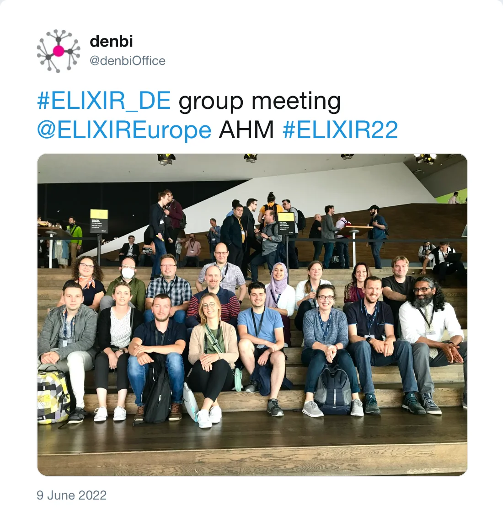
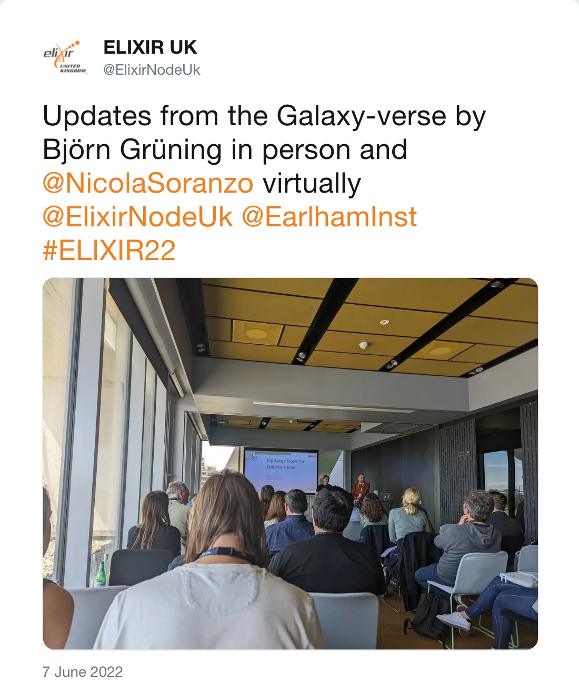
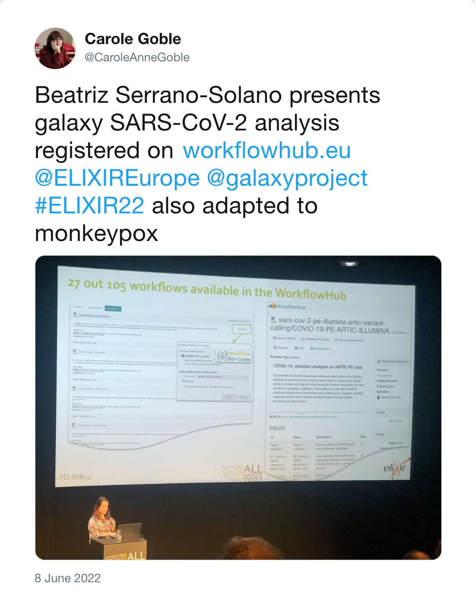
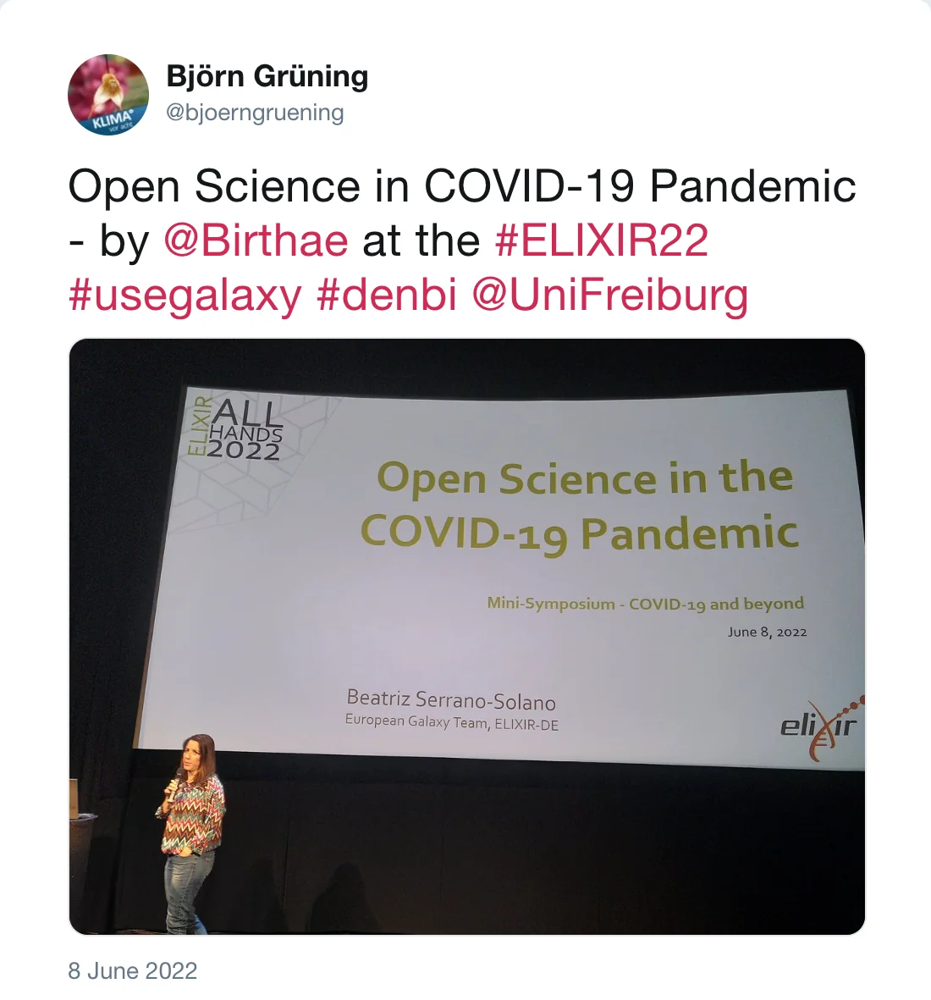
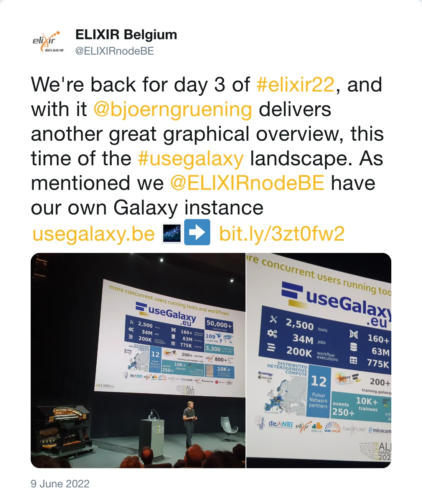
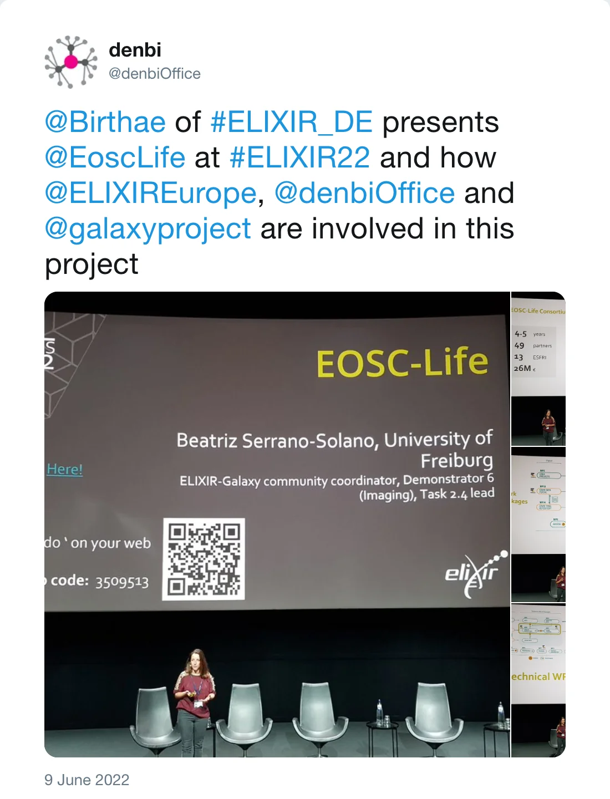
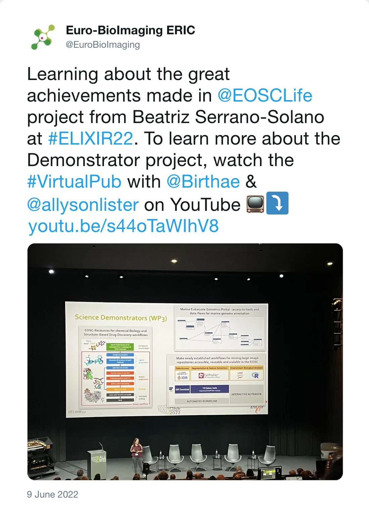

During 6-9th of June, members of the European Galaxy team travelled to Amsterdam to join the [**ELIXIR All Hands meeting 2022**](https://elixir-europe.org/all_hands_2022), where we joined other colleagues from ELIXIR-DE.

*Post by @denbiOffice on 9 June 2022*

There was a broad presence of Galaxy all over the 3 days of the meeting across the different workshops (parallel sessions) and plenary talks and discussions. We will highlight in this post some of the talks.

On the first day; the 7th of June, Anup Kumar, and Kaivan Kamali organised the workshop [*AI-powered data analysis within the European Galaxy*](https://docs.google.com/document/d/17IVSvLmnianF6VOLO7GQfwPFDTpm9DF95ShHXnaarNo/edit#heading=h.8yacamuak08k) and conducted a tutorial for [image classification](https://training.galaxyproject.org/training-material/topics/statistics/tutorials/CNN/tutorial.html), in which a convolutional neural network was trained to recognise handwritten digits using Galaxy Europe's deep learning tools. The steps included importing datasets, creating the architecture of the convolutional neural network, training it on imported train datasets and evaluating the trained model using test datasets and visualisation techniques.

On that same afternoon, the ELIXIR-Galaxy community organised a workshop on [*Earth Biodiversity*](https://docs.google.com/presentation/d/1YvJsPK0DAcl2_pFwfCcYx9KnEM0eRyMcI82uOVUCZVg/edit). The workshop topic is highly relevant at the moment thanks to initiatives like the [Vertebrate Genomes Project (VGP)](https://vertebrategenomesproject.org/) and [European Reference Genome Atlas (ERGA)](https://erga-online.eu/), which will sequence and assemble the genomes of thousands of species over the next few years. Moreover, the new [microGalaxy community](https://galaxyproject.org/community/#communities-of-practice) was presented, and how all these initiatives align with the other ELIXIR Communities and Focus Groups (e.g. Biodiversity, Federated Human Data, Human Copy Number Variation, Microbiome, ...). The workshop also included the latest updates about the Galaxy community SARS-CoV-2 efforts and how the experience gained can be transferred to other outbreaks and diseases. Finally, the audience got the latest updates on Galaxy features and use cases, together with a discussion about the next year's roadmap and future collaborations in light of the funded Implementation Studies and Commissioned Services.

Engy Nasr presented [*Microbiome data analysis with Galaxy: example of clouds*](https://docs.google.com/presentation/d/1YvJsPK0DAcl2_pFwfCcYx9KnEM0eRyMcI82uOVUCZVg/edit#slide=id.g130105c60be_0_61). Her presentation's goal was to show the ability of the Galaxy platform with all its tools and workflows to analyse microbial data, leading the audience to where and how they can find and use them for their biome analysis. In particular, the presentation showcased one of the Galaxy team’s ongoing projects on cloud and aerosol metagenomics and metatranscriptomics datasets.

In the same workshop, Björn Grüning (in collaboration with Nicola Soranzo) gave [updates from the Galaxy-verse](https://docs.google.com/presentation/d/1YvJsPK0DAcl2_pFwfCcYx9KnEM0eRyMcI82uOVUCZVg/edit#slide=id.g130105c60be_0_75).

*Post by @ElixirNodeUk on 7 June 2022*

In parallel to this workshop, Bérénice Batut presented the [outline of the  Galaxy Community with regards to Training](https://docs.google.com/presentation/d/10hMdBFX2x3pTc95HyEzG6xg0V0nKBtd0batf5M8SJYg/edit#slide=id.g1229a6b8fb8_0_50)
 at the [*Establishing a roadmap for the Communities towards a sustainable co-production model with the Training Platform workshop*](https://docs.google.com/document/d/1vlHODVnN9RFTp2fr2NCcLV4ujb8Js3EH6NqXHfP_F9E/edit#). She presented the efforts of the [Galaxy Training Network](https://training.galaxyproject.org/): the collection of >260 tutorials in 23 topics, the FAIRification of the training material, the work on developing learning paths, etc.

On the second day, the morning of the 8th of June, Björn Grüning (again in collaboration with Nicola Soranzo) presented in the [*ELIXIR Communities and Connectedness*](https://docs.google.com/document/d/194CPrabfk0qd9uTnxOFB2WNkppyiRfIPZxp1o6XYlg4/edit?usp=sharing) session. His topic was about [the Galaxy community: Gateway for integration across Communities](https://docs.google.com/presentation/d/1Ya-UDX5QuOVKEVQ1RuKZqdful4y425vh5qyap0QWoyU/edit?usp=sharing).

On the afternoon of the 8th of June, Galaxy was also present in the poster session. Anup Kumar summarised his work on [*An accessible artificial intelligence infrastructure using a docker-based Jupyterlab in Galaxy*](https://drive.google.com/file/d/1a96OvZpNjLEFK8UqFrNgt7SOof5NFyA6/view?usp=sharing), which showcases a few recent scientific use cases of GPU-enabled Jupyterlab, being used for creating end-to-end artificial intelligence projects running entirely on Galaxy Europe.

Also in the afternoon of the same day, Beatriz Serrano-Solano participated in the [*COVID-19* workshop](https://docs.google.com/document/d/1FKBYBxehpaxFT_vLURwq5TbyQjxI4sYiSKeULT0ioso/edit), presenting the [work done by the Galaxy community](https://docs.google.com/presentation/d/1scNZjk61eCZzk3qrKos96zKcBoFFJP6BdqRZ302iT5M/edit#slide=id.g128cc83e3ba_1_4) since the beginning of the pandemic and highlighting the importance of Open Science over the last two years.

*Post by @CaroleAnneGoble on 8 June 2022*

*Post by @bjoerngruening on 8 June 2022*

On the third and last day of the event, the 9th of June, several talks were given by Björn Grüning. In the morning, he presented at the [*Enabling Science at European Scale*](https://docs.google.com/document/d/1uqF_AogQ2N4hLstlzH1QGsRoWE0IHKmeLMKVBkYfSb0/edit) session, in which he talked about the different ways how to scale Galaxy. Just before lunch, Björn and others also gave a short talk in the [*Science driven improvements to tools ecosystems*](https://docs.google.com/document/d/1VA_9_1TOECPL26exs4Nyow_Y2V9RGzOnzF0WYcmLxyo/edit?usp=sharing) workshop about [*The freely accessible Galaxy-based global infrastructure for SARS-CoV-2 monitoring*](https://docs.google.com/presentation/d/1tawHFNttXOIHKiwaY_cR3CA7iXFMMkjXs6hJiDCjOzo/edit#slide=id.g1298f06212d_0_50). In the afternoon, Björn participated in the [*FAIR in single cell omics; Workflows and Benchmarking*](https://docs.google.com/document/d/13pOfy2nkajjzsjvlGV_ch_0EvB6say1LBdOKtbXyVsY/edit#) workshop were he talked about the [WorkflowHub](https://workflowhub.eu/).

*Post by @ELIXIRnodeBE on 9 June 2022*

On the last session before the closing of the All Hands meeting, Beatriz Serrano-Solano presented the [EOSC-Life consortium and the participation of the Galaxy community](https://docs.google.com/presentation/d/1Wv1teYk2Egww6fg5RbD5iq4s_5qkaVby2OXHmkaYVW4/edit#slide=id.g130fad382dc_0_0) in different aspects of the project, from the technical side (tools, workflows, infrastructure) to the use cases (chemoinformatics, marine biology, imaging, reference data, [food safety](/news/2021-12-08-pathogen-detection-eosc-life-grant/) and [SARS-CoV-2](/tags/covid-19/)), training and outreach. She also presented the Galaxy platform as the link between different EOSC projects, like [EOSC-Nordic](https://www.eosc-nordic.eu/) and [EOSC-Pillar](https://www.eosc-pillar.eu/).

*Post by @denbiOffice on 9 June 2022*

*Post by @EuroBioImaging on 9 June 2022*

The European Galaxy team would like to thank the Galaxy community for all the contributions that were presented and ELIXIR for the fantastic organisation of this meeting. We were very happy to attend (for some of us it was the first) in-person meeting and we are already looking forward to joining next year in Dublin! 

