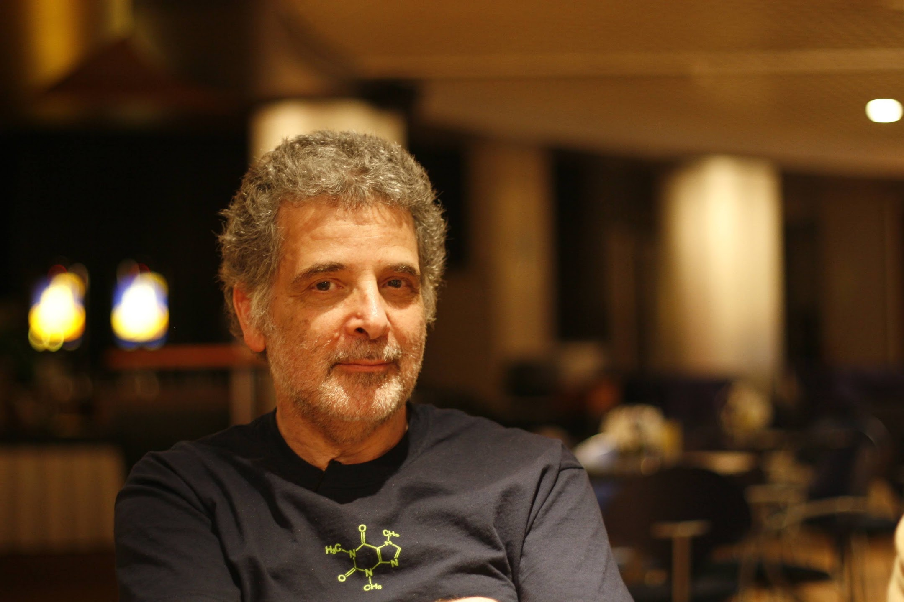
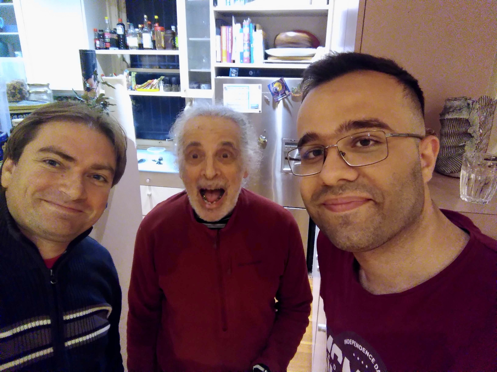

<center>
  
</center>

We lost a friend, mentor and a great human being this weekend. Ross Lazarus passed away peacefully on the morning of September 19, 2026, at home in Bondi, surrounded by family and bathed in love.

## Early career

Ross had been actively involved in health informatics and bioinformatics for more than 40 years since graduating from the Faculty of Medicine at the University of Melbourne in 1974.
He had 12 years of experience teaching undergraduate, graduate and postgraduate medicine, clinical epidemiology and public health, at the University of Sydney before moving to [Harvard Medical School](https://hms.harvard.edu) in 2000 where he was Director of Bioinformatics at the Channing Laboratory.

## The Galaxy years

This was the time he discovered the very early version of Galaxy, back then without a workflow editor, a web application to run bioinformatics applications in a reproducible and transparent way.
Ross was one of the first Galaxy power users, pushing boundaries of this new Galaxy project. But Ross was more than a user, he became quickly involved in the project, contributed tools, ideas and advice.
He became a mentor for the very young Anton Nekrutenko and his new group at Penn State University. With the advice and help of Ross the Galaxy project was able to get its first Galaxy grants and laid out the foundation of the Galaxy
project that is serving now more than 500,000 scientists around the world.

After his stay at Harvard Medical School Ross went back to Australia and served as Head of Computational Biology at the [Baker Heart and Diabetes Institute](https://baker.edu.au) in Melbourne until 2015.
During this time the [IUC](https://galaxyproject.org/iuc/) was founded and Ross was one of the founding members. Without his help and advice the IUC would not be what it is today - a community of more than 400 contributors working on more than 2000 Galaxy tools.
Ross authored and maintained a lot of computational tools, pipelines, and Galaxy wrappers, many of them still in use. For example the early RNA STAR wrapper, back then when STAR was really new. The RNA STAR tool in Galaxy
alone has more than 1 million executions.

## Retirement and return

In 2015 Ross retired and enjoyed life in Bondi Beach together with Sarah and his two kids. I remember that we missed him deeply and his spot-on comments and unique and always scientific humor, so we reached out and wanted to know
where we would need to organise a GCC to get him back. He responded in a very funny email which he ended with:

> Sorry to have drifted off but I seem to be moving out of that Galaxy and into another...

Indeed, he was swimming and hiking a lot. Just enjoying life. Wonderful.

In 2017 we had an Admin training in Melbourne with the Australian Galaxy community and he invited us to his place where we had a wonderful time. Learning about flying foxes and philosophizing about science.

With the sudden death of [James Taylor](/jxtx/) in early 2020 the community was mourning and Ross contacted us. He knew that the loss of James would be a challenge for the community and he was there to help.
We built a more sustainable community governance model and Ross was always there to advise us. During that hard time and during the Pandemic, Ross was back helping in various roles and Galaxy boards.

In 2023, we had our first [GCC in Australia](https://galaxyproject.org/events/gcc2023/) and of course we invited Ross. It was so lovely to see him and Sarah again in Brisbane. A few Europeans stayed a bit longer in Australia and Ross
was so kind to host us in Sydney, showing us around Bondi Beach. We could also use his apartment in Melbourne to work closely with [Galaxy Australia](https://usegalaxy.org.au/). He was so generous, insightful and inspiring to many of us during this time.

And something happened :) I think he was hooked again. From that time onwards he was back online. He started to contribute to IUC again, developed tools and workflows for
the [VGP](https://vertebrategenomesproject.org) and other projects and helped us build the community by serving on different boards. Ross was back and it was wonderful to work with him (again).

## In memory of Ross

A bit nerdy, but we are sure Ross would have liked it. Galaxy servers send a special HTTP header in Ross's honour.

```bash
curl -sI https://usegalaxy.eu/ | grep -i clacks
```

It is the community's tribute to deceased Galaxy community members, a reference to [Terry Pratchett's](https://en.wikipedia.org/wiki/Terry_Pratchett) [Discworld novels](<https://wiki.lspace.org/Clacks>).
So whenever someone opens Galaxy now, Ross's name is traveling through the network forever so he is never truly forgotten.

---

Sarah and the family have shared the following:

> Our beloved Ross is now at rest near our house in Waverley Cemetery, Clovelly, which is on the coastal walk from Bondi Beach to Coogee, a well-trodden path loved by our family.
>
> We have created a website in memory of Ross Lazarus. It has:
>  - a biography written by Kirsten Tilgals
>  - a video recording of the celebration of life that took place on Wednesday, September 23, 2026, with a photo slideshow and speeches
>  - a digital photo album where you can upload any photos of Ross you'd like to share
>
> You can access the website here: [rossbiography.vercel.app](https://rossbiography.vercel.app/)

Rest in peace, my dear friend! 🌻

<center>
  
</center>

