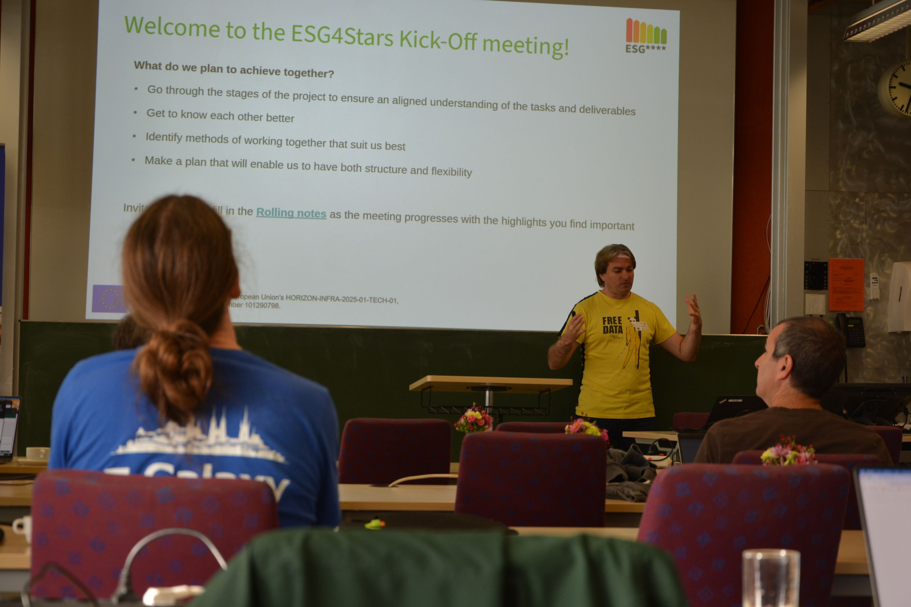
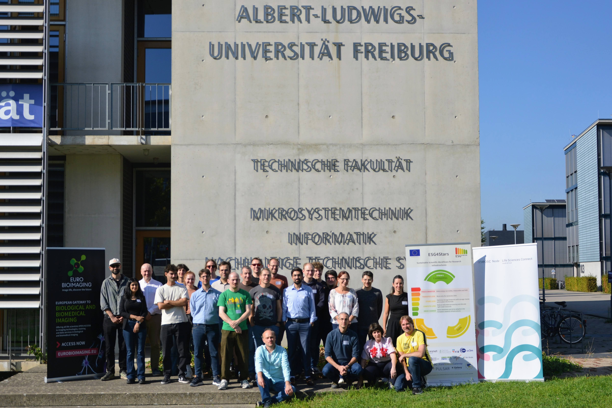

Last week we launched the ESG4Stars project for reducing the environmental impact of research infrastructure - in the efficient manner that, we think, fits a project like this.

We organized the kick-off meeting and the project's first General Assembly as a combined [event](/events/2026-10-05-esg4stars-kickoff/) on Monday/Tuesday,
then used the remaining three days of the week to directly start working on the first project tasks.

This was a *very* busy week with too much going on for full coverage in this short recap, but here are some of the highlights:

**Kick-off meeting**

We were lucky to have in-person presentations for all work streams and packages within the project.

These spawned immediate and productive discussions within and across work streams, and it was great to see a lot of interaction between project participants from the first day!

Day 2 of the meeting brought invited guest presentations about topics adjacent to what this project is trying to do:

- Dominik Schweisgut from the [Exascale Algorithm Engineering research group](https://eae.iti.kit.edu/english/index.php) at the Karlsruhe Institute of Technology (KIT)
  told us about "Carbon-Aware Mapping and Scheduling for Deadline-Constrained Workflows".

- Philipp Thamm from the research group [Knowledge Management in Bioinformatics](https://www.informatik.hu-berlin.de/de/forschung/gebiete/wbi) at the Humboldt-Universität zu Berlin
  gave a talk about his work on "Nf-PEAK: Process-Based Energy Attribution for Nextflow Workflows on Kubernetes Clusters".

- Joachim Wolff, bioinformatics researcher at Hannover Medical School, talked about his experience with "Agent-Driven Modernization of High-Throughput Genomic Tools".

Both Dominik and Philipp are members of [FONDA](https://fonda.hu-berlin.de),
a research programme (CRC 1404) for studying "Foundations of Workflows for Large-Scale Scientific Data Analysis" funded by the [Deutsche Forschungsgemeinschaft](https://galaxyproject.org/hall-of-fame/dfg/).
[Wolfgang Maier](/hall-of-fame/wm75), Galaxy Europe and ESG4Stars member, had given a Galaxy workshop to FONDA members [three months ago](https://fonda.hu-berlin.de/?p=2516) and, on that occasion, got to talk with Dominik and Philipp about their research.
It was a great pleasure to now have them visit Freiburg in return and further explore the overlap between our work.

Joachim did his PhD thesis with the Galaxy Europe Team at the University of Freiburg.
Optimization of tools at their source-code level is one of the options that our project will pursue to achieve higher compute efficiency, and coding agents will certainly play their part in this effort.
It was, thus, interesting to hear about Joachim's hands-on experience and his talk, in particular, spawned an intense follow-up discussion on how ESG4Stars can turn insights into upstream code improvements most effectively.

**Collaborative working days**

The three remaining days of the week were meant to give project participants the chance to start work in the different streams directly and with face-to-face collaboration.
They turned out to be very intense and productive days that yielded progress across all project streams, and helped all participants to find their place in the project and to define how they want to work together.

 Here's an incomplete list of what we got done over the three days:

- set up an ESG4Stars project board to facilitate further collaboration and add some first issues to it
- define queries to extract tool-specific compute and memory metrics from Galaxy server databases
- use these queries to produce preliminary lists of tools that could be prime targets for optimization.

  A so-called hotspots catalogue of tools to optimize is among the first milestones the project aims to achieve and a prerequisite for a lot of further planned work.
  It was, therefore, encouraging to see that even the preliminary version appears to identify real efficiency bottlenecks that also seem to be suitable for substantial optimization.

- advance work on Galaxy's job cache
- discuss some of the complexities around offering temporary storage classes on Galaxy instances that don't offer any yet
- better define the needs of the bioimaging community, in particular, in terms of Galaxy's support for the Zarr data format
- release a first version of a new [energy usage dashboard](https://gxy.io/stats-eu-compute) for Galaxy Europe's compute
- do some first outreach by advertising our upcoming [workshop on sustainable research computing with Galaxy](https://galaxyproject.org/events/2026-10-08-esg4stars-madrid/)

At this impressive speed of progress, we are looking ahead with a lot of confidence to the coming 36 months of this project and to everything we can achieve together.

![The five high-level objectives of ESG4Stars: track smarter, transfer less, store less, compute less and drive change printed in the style of an energy label together with short catch phrases - Make energy use visible, measurable and FAIR; Move only the necessary data; Optimise storage footprints with storage classes and modern file formats; Reduce redundant processing and allocate right-sized resources; Raise awareness and drive adoption into European research infrastructures - explaining each objective](esg4stars_objectives.png)

A really big THANK YOU to all participants for making this possible!
