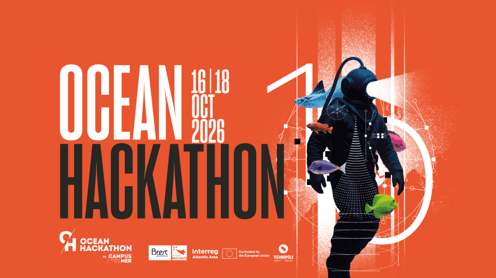
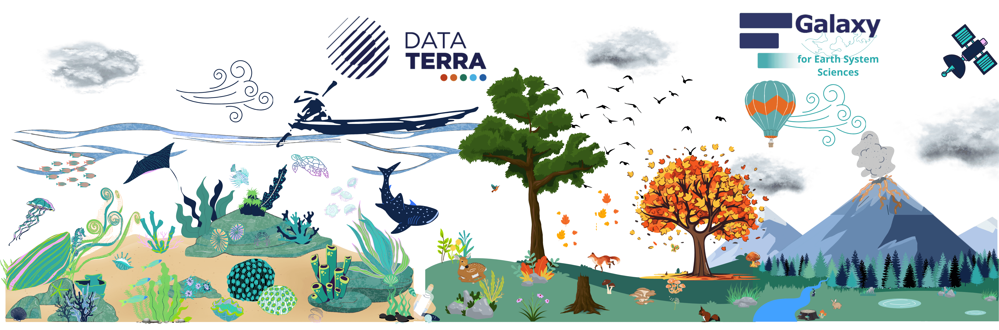
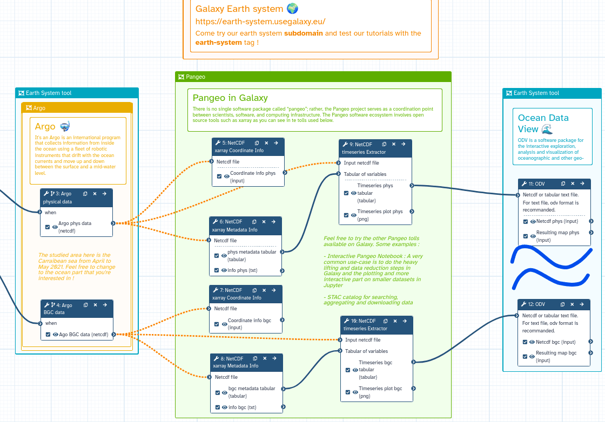

# Galaxy Europe Goes Ocean!

  <small>
    Image credit:
    <a href="https://www.campusmer.fr/">
      Ocean Hackathon / Campus mondial de la mer
    </a>
  </small>

**48 hours, ocean data, fresh ideas and a lot of teamwork!** From October 16 to 18, 2026, Ocean Hackathon will bring together scientists, developers, students and ocean enthusiasts across 11 cities worldwide:

Brest and Toulon (France), Cork (Ireland), Olhao and Peniche (Portugal), Santa Cruz de Tenerife (Spain), Chennai (India), Galle (Sri Lanka), Kuala Lumpur (Malaysia), Salvador (Brazil), and Victoria (Canada).

Quite a journey around the world, all connected by one ocean and a shared passion for innovation!

The challenge? Work in multidisciplinary teams for 48 hours non-stop and turn marine data into innovative digital prototypes. Not much sleep, probably plenty of coffee, but hopefully some great ideas!

## Galaxy Europe Joins the Adventure!

  <small>
    Image source:
    <a href="https://earth-system.usegalaxy.eu/">
      Galaxy Europe - Earth System Sciences
    </a>
  </small>

This year, participants will have the opportunity to discover [Galaxy Europe](https://usegalaxy.eu/) and its shiny [Earth System Sciences subdomain](https://earth-system.usegalaxy.eu/).

The idea is simple: give teams an easy way to explore marine data, run scientific tools and build reproducible workflows, without spending half the hackathon installing software.

With Galaxy, participants can:

- Explore and analyse marine and environmental datasets.
- Use scientific tools and interactive environments.
- Build, share and reuse workflows.
- Work together and keep their analyses reproducible.

More time for science and creativity, less time fighting with software!

  

  <small>
    Example marine data analysis workflow.
    Image source:
    <a href="https://usegalaxy-eu.github.io/assets/media/workflow4.png">
      Galaxy Europe
    </a>
  </small>

*Example of a marine data analysis workflow using Galaxy Europe.*

## Bringing Marine Data and Galaxy Together

This initiative also builds on the work of [ODATIS](https://www.odatis-ocean.fr/), the Ocean Data and Services Cluster of the French [Data Terra Research Infrastructure](https://www.data-terra.org/).

ODATIS helps the marine science community discover, access and reuse oceanographic data and services. It is also one of the data providers for Ocean Hackathon 2026.

Bringing Galaxy Europe closer to this ecosystem opens up interesting opportunities to connect marine data, scientific tools and reproducible analysis.

And what better place to explore these possibilities than a hackathon?

## Let's Hack the Ocean!

Ocean Hackathon is a great opportunity to introduce Galaxy Europe to new users, explore real-world challenges and see what happens when people from different backgrounds work together.

We are excited to see what the teams will come up with!

**Useful links:**

- [Ocean Hackathon](https://www.campusmer.fr/home-4185-0-0-0.html)
- [Galaxy Europe](https://usegalaxy.eu/)
- [Galaxy for Earth System Sciences](https://earth-system.usegalaxy.eu/)
- [ODATIS - Ocean Data and Services Cluster](https://www.odatis-ocean.fr/)
- [Data Terra Research Infrastructure](https://www.data-terra.org/)
  