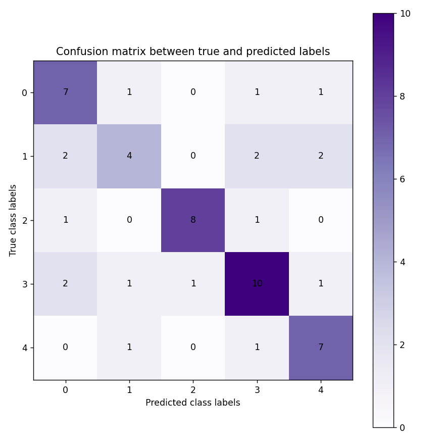

---
subsites:
- all
date: '2026-11-25'
title: Accurate Biomedical Classification with TabICLv2 on Galaxy
tags: [tools, workflow]
tease: "Leverage state-of-the-art TabICLv2 models on the European Galaxy server to classify complex biomedical datasets with high accuracy."
contributions:
  authorship:
    - anuprulez
  funding:
    - uni-freiburg
    - deNBI
---

## New version of TabICL (v2) on European Galaxy server

A newer version of [TabICL](https://doi.org/10.48550/arXiv.2602.11139) tool (v2) using recent models ([v2](https://huggingface.co/jingang/TabICL/tree/main)) has been integrated into the [European Galaxy server](https://usegalaxy.eu/). The choice of pre-trained TabICL models (for both, classification and regression) can be directly selected from the "Select model" dropdown. Just choose the machine learning task, a suitable model and your training/test datasets to achieve an accelerated performance.

**Note**: The TabICL models are under a non-commercial license and should be used for non-commercial purposes only. For commercial purposes, please contact sales@priorlabs.ai.

## Cancer-type classification from platelet RNA expression

This example uses platelet RNA expression to classify cancer types with TabICLv2. [GSE68086](https://www.ncbi.nlm.nih.gov/geo/query/acc.cgi?acc=GSE68086) contains RNA-sequencing data from 283 blood platelet samples, including 228 samples from patients with cancer and 55 healthy controls. The [Galaxy workflow invocation](https://usegalaxy.eu/workflows/invocations/773ee478658c6cd5), run on 24 November 2026, classifies five cancer types from these expression profiles.

### Datasets used

The invocation uses two source data files and a preprocessing notebook:

| Input | Contents and role |
| --- | --- |
| `GSE68086_TEP_data_matrix.txt` | A gene expression matrix with gene identifiers in the first column and samples in the remaining columns. Its expression values provide the predictive features. |
| `GSE68086_series_matrix.txt` | GEO sample metadata, including sample accession identifiers and cancer-type annotations. These annotations supply the target labels. |
| `jl-20260714-145750` | A Jupyter notebook containing the preprocessing code, supplied as an executable workflow input. |

The notebook extracts cancer-type labels from the metadata and associates them with expression columns by position. It selects the five cancer classes below and transposes the expression matrix so that rows represent samples and columns represent genes, with a separate `label` column. This prepared table is saved as `GSE68086_expression_columns`. Healthy controls and hepatobiliary cancer samples are excluded, so this example predicts cancer type among the selected classes rather than whether a sample has cancer.

| Class | Samples |
| --- | ---: |
| Breast | 39 |
| Colorectal cancer (CRC) | 42 |
| Glioblastoma (GBM) | 40 |
| Lung | 60 |
| Pancreas | 35 |
| Total | 216 |

### Workflow

The workflow is named **Cancer prediction using gene expression data by TabICLv2 with feature selection and preprocessing**. Its [invocation](https://usegalaxy.eu/workflows/invocations/773ee478658c6cd5) records 38 steps covering notebook execution, label encoding, data splitting, feature selection, normalisation, prediction, and evaluation.

After encoding the cancer labels, the workflow performs a stratified 75:25 training/test split with random seed 42, producing 162 training samples and 54 test samples. It selects 500 gene features from the training data using `SelectKBest` with the chi-squared score, extracts the corresponding test features, and applies L1 normalisation to each sample. The TabICL tool version `2.2.0+galaxy0` then runs classification with the pretrained `tabicl-classifier-v2-20260212.ckpt` model. SHAP explanations are enabled with a maximum of 10 samples and a beeswarm plot.

### Results

The invocation completed successfully. Its [test performance metrics](https://usegalaxy.eu/api/datasets/40160950115d555e9e0303802743371b/display) report:

| Metric | Test result |
| --- | ---: |
| Accuracy | 66.67% |
| Balanced accuracy | 66.89% |
| Weighted F1 | 0.6628 |

The [prediction table](https://usegalaxy.eu/api/datasets/40160950115d555ec2b244aa815c236b/display) contains the 500 selected features, true labels, and predicted labels for all 54 test samples. Of these, 36 are correctly classified. The confusion matrix below uses encoded labels: 0 = Breast, 1 = CRC, 2 = GBM, 3 = Lung, and 4 = Pancreas.

The invocation’s [precision–recall curve](https://usegalaxy.eu/api/datasets/40160950115d555eaf6ee3c9b3e216fb/display) shows performance across classification thresholds for each cancer class, with a dashed micro-average curve. The legend reports average precision (AP): Breast 0.66, CRC 0.57, GBM 0.92, Lung 0.69, and Pancreas 0.66. Class numbers follow the same encoding as the confusion matrix.

The run also produces the SHAP beeswarm plot below, alongside the prepared expression table (`GSE68086_expression_columns`). The invocation's confusion-matrix output is labelled “TabPFN confusion matrix”, but the executed prediction tool and checkpoint are TabICLv2.

These scores describe one held-out split of five cancer classes in this dataset. They do not measure cancer-versus-healthy detection or establish clinical diagnostic performance.

## References

- [TabICL on Galaxy](https://usegalaxy.eu/?tool_id=tabicl)
- [GSE68086 platelet RNA expression dataset](https://www.ncbi.nlm.nih.gov/geo/query/acc.cgi?acc=GSE68086)
- [Workflow invocation for cancer-type classification with TabICLv2](https://usegalaxy.eu/workflows/invocations/773ee478658c6cd5)
