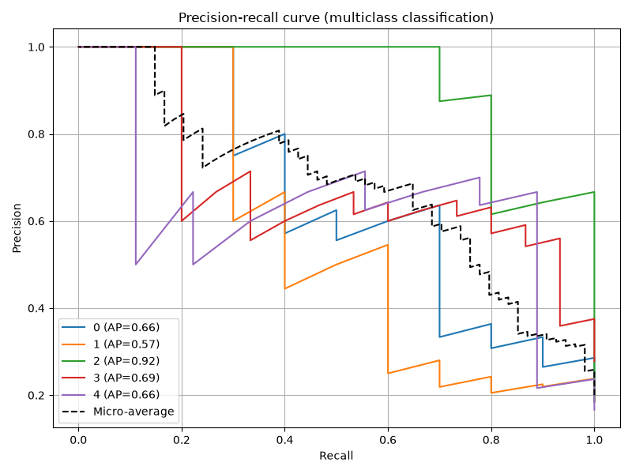
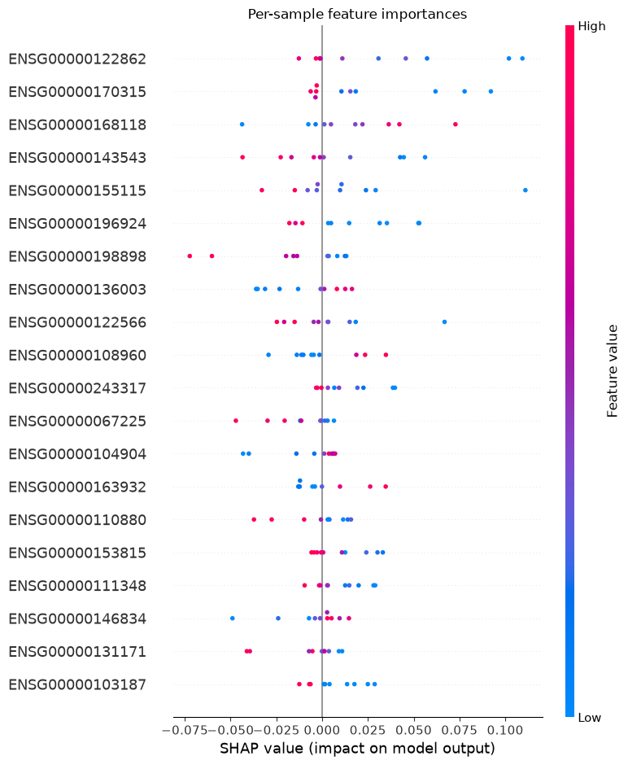

---
subsites:
- all-eu
date: '2026-11-25'
title: Cancer classification on gene expression data with the stateof-the-art TabICL (v2) on Galaxy
tags: [tools, workflow]
tease: "Leverage state-of-the-art TabICL (v2) models on the European Galaxy server to classify complex biomedical tabular datasets."
contributions:
  authorship:
    - anuprulez
  funding:
    - uni-freiburg
    - deNBI
---

## TabICL (v2) on European Galaxy server

[TabICL](https://doi.org/10.48550/arXiv.2602.11139) tool using recent models ([v2](https://huggingface.co/jingang/TabICL/tree/main)) has been integrated into the [European Galaxy server](https://usegalaxy.eu/). The choice of pre-trained TabICL models (for both, classification and regression) can be directly selected from the "Select model" dropdown. Just choose the machine learning task, a suitable model and your training/test datasets to achieve an accelerated performance.

## Cancer-type classification from RNA expression

The example dataset contains RNA expression mapped to six cancer types. [GSE68086](https://www.ncbi.nlm.nih.gov/geo/query/acc.cgi?acc=GSE68086) contains RNA-sequencing data from 283 blood platelet samples: 228 samples from patients with six cancer types - breast, colorectal, lung, pancreatic, glioblastoma, and hepatobiliary cancer. Rest samples belong to 55 healthy controls. In this workflow, we use five of the six available cancer types. The [Galaxy workflow invocation](https://usegalaxy.eu/workflows/invocations/773ee478658c6cd5) classifies five cancer types from these expression profiles using TabICL (v2) after choosing 500 best features.

### Datasets used

The invocation uses two source data files and a preprocessing notebook:

| Input | Contents and role |
| --- | --- |
| `GSE68086_TEP_data_matrix.txt` | A gene expression matrix with gene identifiers in the first column and samples in the remaining columns. Its expression values provide the predictive features. |
| `GSE68086_series_matrix.txt` | GEO sample metadata, including sample accession identifiers and cancer-type annotations. These annotations are the target labels. |
| `data_harmonisation_notebook.ipynb` | A Jupyter notebook containing the preprocessing code. |

The notebook extracts cancer-type labels from the metadata and associates them with expression columns by position. It selects the five cancer classes below and transposes the expression matrix so that rows represent samples and columns represent genes, with a separate `label` column. This prepared table is saved as `GSE68086_expression_columns`. We use 216 samples from five of the six available cancer types, as listed below.

| Class | Samples |
| --- | ---: |
| Breast | 39 |
| Colorectal cancer (CRC) | 42 |
| Glioblastoma (GBM) | 40 |
| Lung | 60 |
| Pancreas | 35 |
| Total | 216 |

### Workflow

The workflow **Cancer prediction using gene expression data by TabICL (v2) with feature selection and preprocessing**. Its [invocation](https://usegalaxy.eu/workflows/invocations/773ee478658c6cd5) has 38 steps covering notebook execution, label encoding, data splitting, feature selection, normalisation, prediction, and evaluation.

After encoding the cancer labels, the workflow performs a stratified 75:25 training/test split with random seed 42 (for reproducibility), producing 162 training samples and 54 test samples. It selects 500 gene features from the training data using `SelectKBest` with the chi-squared score, extracts the corresponding test features, and applies L1 normalisation to each sample. The TabICL Galaxy tool (version `2.2.0+galaxy0`) performs classification with the pretrained `tabicl-classifier-v2-20260212.ckpt` TabICL checkpoint. SHAP explanations are enabled with a maximum of 10 samples and a beeswarm plot.

### Results

The workflow on successful run reports the following [test accuracy metrics](https://usegalaxy.eu/api/datasets/40160950115d555e9e0303802743371b/display):

| Metric | Test result |
| --- | ---: |
| Accuracy | 66.67% |
| Balanced accuracy | 66.89% |
| Weighted F1 | 0.6628 |

#### Confusion matrix

The prediction table contains the 500 selected features, true labels, and predicted labels for all 54 test samples. Of these, 36 are correctly classified. The confusion matrix below uses encoded labels: 0 = Breast, 1 = CRC, 2 = GBM, 3 = Lung, and 4 = Pancreas.

Rows show the true cancer class and columns show the predicted class. Each cell counts test samples: diagonal cells are correct predictions, while off-diagonal cells show which classes the model confuses. The diagonal contains 7 correctly classified Breast samples, 4 CRC, 8 GBM, 10 Lung, and 7 Pancreas samples, giving 36 correct predictions out of 54.

The classes have different numbers of test samples, therefore, the diagonal counts should be read relative to each row total. For example, the model identifies 8 of 10 GBM samples correctly (80% recall), compared with 4 of 10 CRC samples (40% recall). The six misclassified CRC samples are distributed equally across breast, lung, and pancreas predictions. This highlights differences between cancer classes that the overall accuracy alone does not reveal.

#### Precision–recall curves

The precision–recall curve shows performance across classification thresholds for each cancer class, with the micro-average curve shown as a dashed line. The legend highlights average precision (AP): breast 0.66, CRC 0.57, GBM 0.92, lung 0.69, and pancreas 0.66. Class indices follow the same encoding as the confusion matrix.

Each coloured curve treats one cancer class as the positive class and the remaining classes as negative. Recall on the horizontal axis measures the fraction of samples of that cancer type recovered by the model. Precision on the vertical axis measures the fraction of predictions for that cancer type that are correct. Moving along a curve changes the score threshold: accepting more samples can increase recall while introducing more false positives. Curves closer to the upper-right corner indicate stronger performance.

Average precision summarises this trade-off across thresholds; it is different from the fraction of correct classifications at a single decision rule. GBM has the highest AP (0.92), indicating the strongest separation from the other classes in this test set, while CRC has the lowest (0.57). The dashed micro-average pools the class-wise prediction decisions, giving more influence to classes with more positive samples than an equal-weight class average would.

#### SHAP feature contributions

The run also produces the SHAP beeswarm plot below, alongside the prepared expression table (`GSE68086_expression_columns`).

The SHAP plot explains how gene expression features contribute to the model output for the explained samples. Each row is a gene, identified by its Ensembl gene ID, and each dot represents one sample. The displayed genes are ordered by their average absolute SHAP contribution, so genes near the top have larger contributions across these samples. Horizontal distance from zero indicates the size of a contribution: positive values increase the output being explained relative to its baseline, and negative values decrease it. Colour shows the input feature value, from low expression in blue to high expression in pink.

For example, the top-ranked feature, `ENSG00000122862`, has several low-expression blue points with positive contributions and high-expression pink points near or below zero. This shows how the feature's contribution varies between samples. However, the figure does not identify which cancer class its output represents, therefore, the sign should not be interpreted as support for a particular cancer type. These explanations cover at most 10 samples and describe model behaviour; they do not establish that the genes cause cancer or are validated biomarkers. These scores describe one held-out split of five cancer classes in this dataset.

## References

- [TabICL on Galaxy](https://usegalaxy.eu/?tool_id=tabicl)
- [GSE68086 platelet RNA expression dataset](https://www.ncbi.nlm.nih.gov/geo/query/acc.cgi?acc=GSE68086)
- [Workflow invocation for cancer-type classification with TabICL (v2)](https://usegalaxy.eu/workflows/invocations/b101e4b6aaa82071)
