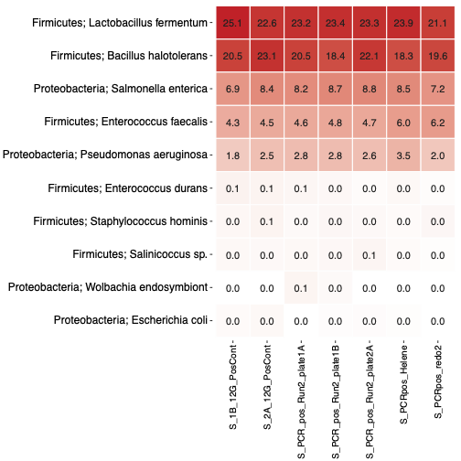
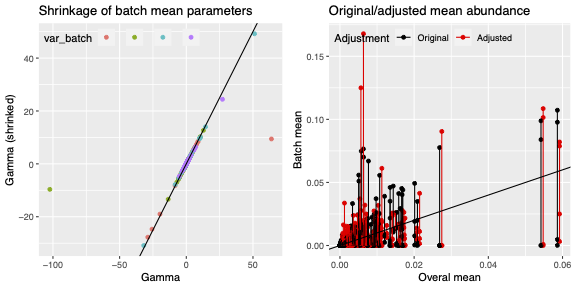

Amplicon sequencing is widely used to characterize microbial communities. After processing the sequencing reads, researchers typically obtain an abundance table of amplicon sequence variants (ASVs) or operational taxonomic units (OTUs), together with taxonomic assignments and sample metadata.

Before testing associations between microbial features and sample characteristics, potential contamination and technical batch effects need to be considered, as they can influence the results.

The new **[Multivariable Association Analysis of Amplicon Data](https://iwc.galaxyproject.org/workflow/multivariable-association-analysis-main/)** workflow from the Intergalactic Workflow Commission (IWC) brings these downstream processing steps together in a reproducible Galaxy workflow.

## Workflow inputs

The workflow takes a **phyloseq object** containing the microbial abundance data and taxonomy, together with a corresponding sample metadata table.

The input data can be generated using existing Galaxy workflows and tools. For example, raw amplicon sequencing reads can 
be processed using **DADA2** workflows or the **LotuS2** tool to obtain ASV/OTU abundance tables and taxonomic assignments. These can then be combined into a phyloseq object for downstream analysis.

## Workflow overview

Depending on the available metadata and controls, the workflow can:

- assess negative and positive sequencing controls
- identify and remove contaminating features using **Decontam**
- remove sequencing-control samples from the biological dataset
- correct technical batch effects using **MMUPHin**
- perform multivariable association analysis using **MaAsLin3**

Sequencing controls and batch correction are optional, so the workflow can also be used when some of this information is unavailable.

### Quality control and decontamination

The workflow generates quality-control plots that help assess the data before downstream analysis. For example, positive-control samples can be compared using a heatmap of their microbial composition.

*Example QC heatmap showing the relative abundance of microbial taxa across positive-control samples.*

The workflow also uses negative controls for decontamination. The prevalence plot below illustrates how Decontam identifies potential contaminants based on their occurrence in negative controls and biological samples.

*Example Decontam prevalence plot. Each point represents a microbial feature, with turquoise points indicating features classified as contaminants.*
### Batch-effect correction

For datasets containing batch information, the workflow uses **MMUPHin** to adjust for technical batch effects. Diagnostic plots allow users to inspect the estimated adjustments.

*Example MMUPHin diagnostic plot generated from a subset of the dataset. The left panel shows shrinkage of estimated batch parameters, while the right panel compares original and adjusted mean abundances.*

### Association analysis with MaAsLin3

The workflow uses **MaAsLin3 (Microbiome Multivariable Association with Linear Models)** to identify associations between microbial features and sample metadata. 
MaAsLin3 models feature prevalence (whether a microbial feature is present or absent) and non-zero abundance (its abundance in samples where it is present) separately.

The plot below shows an example MaAsLin3 result from the workflow, comparing microbial genera across valley regions.

*Example MaAsLin3 summary plot. Circles represent abundance associations, while triangles represent prevalence associations. Colors indicate FDR-adjusted p-values, and horizontal lines show uncertainty intervals around the estimated coefficients.*

The workflow provides quality-control plots, decontaminated data, optional batch-corrected datasets, and association analysis results, which can be used for further investigation.

**[The workflow on the IWC website](https://iwc.galaxyproject.org/workflow/multivariable-association-analysis-main/)**