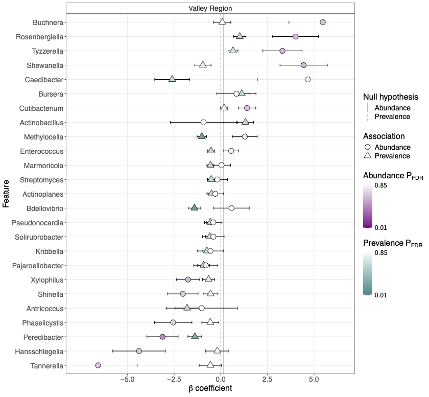

## New Galaxy Workflow for Downstream Amplicon Analysis

Amplicon sequencing is widely used to characterize microbial communities. After processing the sequencing reads, researchers typically obtain an abundance table of amplicon sequence variants (ASVs) or operational taxonomic units (OTUs), together with taxonomic assignments and sample metadata.

Before testing associations between microbial features and sample characteristics, potential contamination and technical batch effects need to be considered, as they can influence the results.

The new **[Multivariable Association Analysis of Amplicon Data](https://iwc.galaxyproject.org/workflow/multivariable-association-analysis-main/)** workflow from the Intergalactic Workflow Commission (IWC) brings these downstream processing steps together in a reproducible Galaxy workflow.

## Workflow overview

The workflow takes a **phyloseq object** containing the microbial abundance data and taxonomy together with a corresponding sample metadata table.

Depending on the available metadata and controls, the workflow can:

- assess negative and positive sequencing controls
- identify and remove contaminating features using **Decontam**
- remove sequencing-control samples from the biological dataset
- correct technical batch effects using **MMUPHin**
- perform multivariable association analysis using **MaAsLin3**

Sequencing controls and batch correction are optional, so the workflow can also be used when some of this information is unavailable.

## Inputs

The workflow starts from processed amplicon data and can therefore be combined with existing Galaxy tools and workflows for upstream sequence processing.

Raw amplicon sequencing reads can, for example, be processed using **DADA2** workflows or the **LotuS2** tool. The resulting abundance and taxonomy information can then be stored as a phyloseq object and used as input for the downstream workflow.

This structure connects established upstream amplicon processing with quality control, technical correction, and statistical analysis in a fully reproducible Galaxy environment.

## Association analysis with MaAsLin3

The workflow uses **MaAsLin3 (Microbiome Multivariable Association with Linear Models)** to identify associations between microbial features and sample metadata. 
MaAsLin3 models feature prevalence (whether a microbial feature is present or absent) and non-zero abundance (its abundance in samples where it is present) separately.

The plot below shows an example MaAsLin3 result from the workflow, comparing microbial genera across valley regions.

*Example MaAsLin3 summary plot. Circles represent abundance associations, while triangles represent prevalence associations. Colors indicate FDR-adjusted p-values, and horizontal lines show uncertainty intervals around the estimated coefficients.*

The workflow provides quality-control plots, decontaminated data, optional batch-corrected datasets, and association analysis results, which can be used for further investigation.

**[The workflow on the IWC website](https://iwc.galaxyproject.org/workflow/multivariable-association-analysis-main/)**