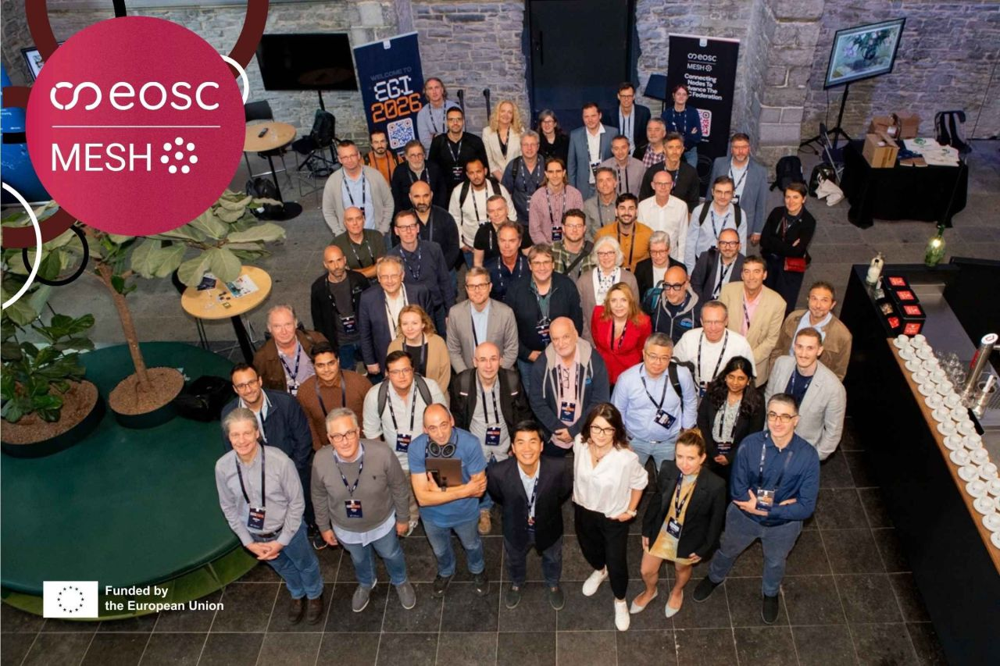

One month ago, from September 24th–25th, Saim and I attended the EOSC-MESH Kickoff meeting in Ghent, Belgium. The event was held in conjunction with the [EGI](https://www.egi.eu/) [conference](https://www.egi.eu/egi-conference) and took place in the venerable halls of Bijloke, a former late-medieval hospital.

  <small>
    Image credit:
    <a href="https://www.egi.eu/article/eosc-mesh-launch">
      EOSC-MESH / EGI Foundation
    </a>
  </small>

Gathered here in the heart of Europe, we met to lay the foundations for a project that will extend the [European Open Science Cloud](https://eosc.eu/eosc-about) (EOSC) by developing a federated network and establishing seven interoperable nodes across various domains. Together, these nodes will provide 25 Federating Capabilities, offering Core, Generic, and Thematic functionalities. Central to this architecture is the new EOSC-MESH hub, which will bridge these nodes with the wider EOSC federation. This creates a seamless continuum of federated data, compute, and storage resources. By implementing robust authentication, cataloging, and federated search, the project ensures that these services and datasets adhere to the FAIR principles—making them truly findable, accessible, interoperable, and reusable for the global research community. 

We are happy to announce that three of the seven nodes will deploy Galaxy as a generic capability. This will enable researchers in fields such as volcanology, oceanography, and the social sciences to analyze their data in a simple and reproducible way.

Work Package 5, led by Saim and me, focuses on the technical implementation of Galaxy, CernVM-FS, and other generic capabilities. During our time in the beautiful city of Ghent, we connected with other project partners, learned about their respective work packages and scientific backgrounds, and attended the first General Assembly.

We are currently preparing for our first bi-weekly work package meeting. As our first milestone, we will demonstrate that the generic federated services are ready for use and integration.

Stay tuned for a demo video and more updates soon!
