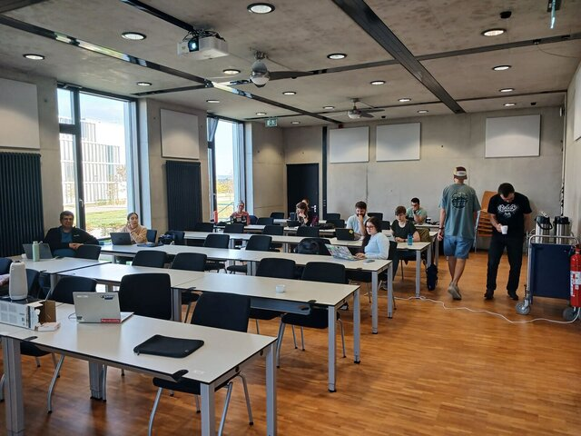
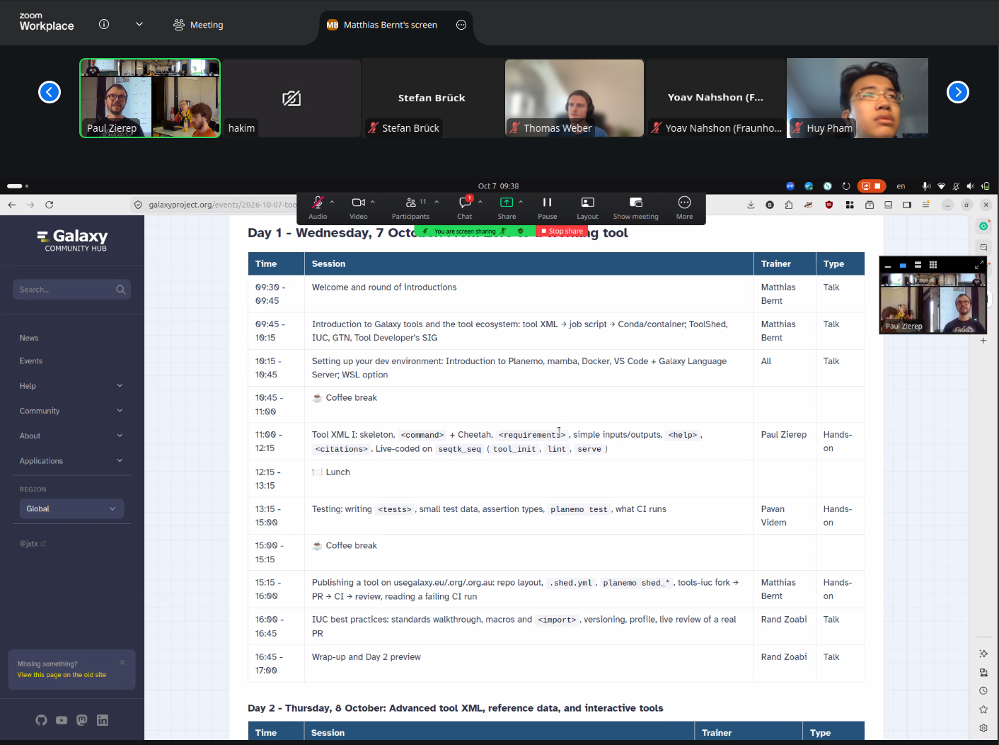
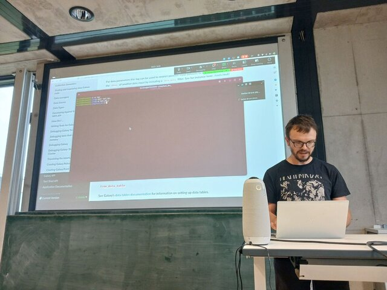
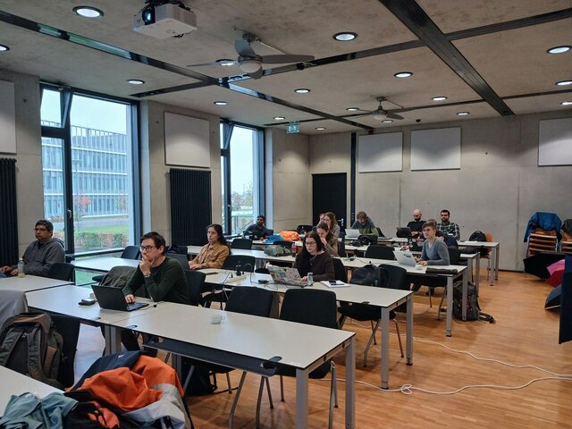

From October 7 to 9, we held the [2nd Galaxy Tool Development Workshop](/events/2026-10-07-tool-dev-workshop/) in Freiburg: three days of hands-on tool wrapping, immediately following the ESG4Stars kick-off. Organised by the [Intergalactic Utilities Commission (IUC)](https://galaxyproject.org/iuc/) and the [Galaxy Tool Developer's SIG](https://galaxyproject.org/community/sig/tool-developers/), the workshop welcomed researchers, bioinformaticians, and developers who wanted to learn how to build, test, and publish tools for Galaxy. In total, 28 people joined us: 14 on site in Freiburg and 14 online.

And “hands-on” really meant hands-on: by the end of the first morning, everyone had a working tool on their laptops.

## Day 1: from zero to a working tool

We started with the big picture: how a tool XML becomes a job, and how Conda and containers fit in. After setting up Planemo, mamba, Docker, and VS Code with the Galaxy Language Server, we live-coded a first wrapper for `seqtk_seq`, from `tool_init` to `lint` and `serve`. The afternoon was all about testing and publishing: writing focused test cases, keeping test data small, and understanding what CI does with a pull request. We closed the day with a walk through the IUC best practices and a live review of a real PR.

## Day 2: advanced XML, reference data, and interactive tools

Day 2 went deeper: conditionals, repeats, and sections; output collections with `discover_datasets`; and data tables for reference data, including how to test them. The last session opened up the world of Galaxy Interactive Tools: how the proxy works, what an interactive tool wrapper looks like, and what to watch out for when deploying one.

## Day 3: wrapping your own tool

The final half-day belonged to the participants: everyone was invited to wrap a tool of their own, or to join the IUC hackathon and work on one of the open tool requests. The round of two-minute updates at the end was one of the highlights of the week: it was great to see how much people had built in just three days, and where they want to take it next.

Here is what people worked on:

- **antiSMASH**: updating the wrapper to the latest upstream release
- **Proteomics tools**: a round of updates
- **Interactive FlexDashboard**: a new interactive tool
- **bigWigAverageOverBed**: a new wrapper for the UCSC genome browser tool, useful for checking read-count evidence in samples
- **Materials science**: a demo tool for evaluating experiments, plus an extension with a user interface
- **Digital Humanities tools**: moving tools into the Digital Humanities ToolShed category, with PRs to [galaxytools](https://github.com/bgruening/galaxytools/pull/2016) and [tools-iuc](https://github.com/galaxyproject/tools-iuc/pull/8508), plus an [FAQ update for interactive tools](https://github.com/galaxyproject/training-material/pull/7146)
- **Cytotable**: converting CellProfiler output into Pycytominer input, based on the [upstream project](https://github.com/cytomining/cytotable)
- **MUSCLE**: a wrapper for the [MUSCLE5](https://drive5.com/muscle5/) aligner
- **CleaveRNA**: updating the existing Galaxy tool

A few of these already produced pull requests during the workshop; others are the first step of contributions that will land in the coming weeks.

## What participants told us

Fourteen participants filled in the feedback form, and the picture is very clear: **everyone would recommend the workshop**, and 13 of 14 rated it Good or better, with 11 saying Very Good or Excellent. What people singled out most was the support from the trainers ("very skilled instructors, loads of help when running into a problem"), the practical, hands-on approach, and the interaction with instructors and other participants.

A few more numbers: all 14 agreed that the lecturers were open to questions, that the work climate was inspiring, and that they felt comfortable during the workshop. Most participants came in new to the tools we covered: only one had used them frequently before, while eight had never used them at all. And 10 of 14 said they will definitely use what they learned again (the other four said maybe).

> "I would like to understand how to create a tool in Galaxy, now I can."

> "The workshop met my expectations and provided useful knowledge that I can apply in my research, teaching, and bioinformatics training activities."

We also asked how to improve the next edition, and we are taking the suggestions seriously: more breaks and more time for the hands-on parts, written documentation to follow along during live coding, an explicit introduction for people completely new to Galaxy, and a more readable setup for hybrid participants. The full feedback is already shaping the plan for edition number three.

## Thank you!

A huge thank you to everyone who made these three days possible: our trainers Matthias Bernt, Pavan Videm, Rand Zoabi, Amirhossein Nilchi, and Paul Zierep, and the organisers Saim Momin, Matthias Bernt, and Paul Zierep. Thanks also to [de.NBI (ELIXIR Germany)](https://www.denbi.de/) for their generous support, and of course to all participants for their curiosity and energy.

If you could not make it this time: the [Galaxy Tool Developer's SIG](https://galaxyproject.org/community/sig/tool-developers/) meets regularly, the community hangs out in the [Galaxy Matrix channels](https://matrix.to/#/#galaxyproject:matrix.org), and the [IUC repository](https://github.com/galaxyproject/tools-iuc) always has open tool requests waiting for a first contribution. We would love to see you at the next edition!
