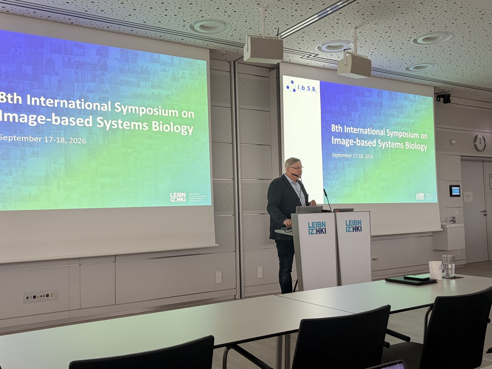
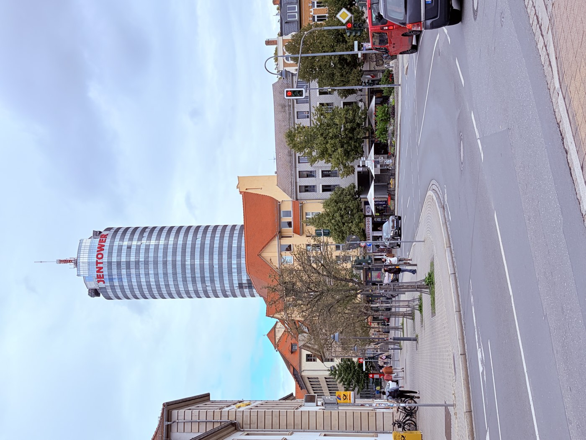

# IBSB 2026 - Bringing Galaxy Bioimage Analysis to Jena

## A warm welcome in the city of Carl Zeiss

Jena, the city where Carl Zeiss built his pioneering optics and microscopy workshop, gave us a very warm welcome at [IBSB 2026](https://asb-conference.hki-jena.de/ibsb2026). It felt fitting to share Galaxy for bioimage analysis in a place with such a long history of making microscopy possible.

In mid-September 2026, the workshop (September 16–17) and the symposium (September 17–18) were hosted at Leibniz-HKI by the Applied Systems Biology research group, and the symposium opened with a welcome from Thilo Figge.

  
   
  Thilo Figge opening the 8th International Symposium on Image-based Systems Biology (IBSB 2026). 📸 Joel Lüthi

  
   
  Jena and the JenTower. 📸 Diana Chiang Jurado

## Symposium talk: FAIR Bioimage Analysis in Galaxy: From Data to Discovery

In the symposium I presented Galaxy as an open-source platform for FAIR bioimage analysis: its interface, the image analysis tools available, and the tutorials and training materials in the [Galaxy Training Network](https://training.galaxyproject.org/training-material/topics/imaging/).

The talk included two imaging use cases:

- **Bringing use cases to Galaxy for FAIR**: a histopathology imaging use case, taken directly from an experimental research lab into Galaxy.
- **Extrapolating imaging workflows from one field to other fields**: a Voronoi segmentation workflow that works for images from four Galaxy communities: astronomy, life science, earth and climate.

The audience was curious about two things: what Galaxy offers as a set of computational tools for imaging, and what sits behind it. We had great conversations about the infrastructure, where the computational resources come from, and how a large international community like Galaxy sustains its services.

## Galaxy workshop: hands-on with imaging tutorials

On Thursday, September 17, eight participants joined the Galaxy session of the workshop "Image analysis with BAND, Nextflow and Galaxy". Working directly in the browser on [usegalaxy.eu](https://usegalaxy.eu/), with no installation and no programming needed, we went through two Galaxy Training Network tutorials:

1. [Introduction to Image Analysis using Galaxy](https://training.galaxyproject.org/training-material/topics/imaging/tutorials/imaging-introduction/tutorial.html)
2. [Analyse HeLa fluorescence siRNA screen](https://training.galaxyproject.org/training-material/topics/imaging/tutorials/hela-screen-analysis/tutorial.html)

## Learning about OME-Zarr

Beyond our own sessions, the talks by Joel Lüthi (University of Zurich) and Christian Tischer (EMBL) were a great opportunity to learn more about data formats such as OME-Zarr. Galaxy is working on adapting its imaging tools so that, in the future, they can support OME-Zarr data.

## Connecting with tool developers

IBSB 2026 was also a good place to meet people who want to bring their tools to Galaxy.

- **BaSiCPy**: a Python implementation of BaSiC for illumination/shading correction in microscopy images, with automatic parameter tuning, foreground-aware correction, and support for large datasets and GPU processing. Its developers are interested in making it available in Galaxy, starting with two operations: estimating illumination profiles and applying previously estimated profiles. See the [preprint](https://www.biorxiv.org/content/10.64898/2026.04.28.721386v1), the [code](https://github.com/peng-lab/BaSiCPy) and the [documentation](https://basicpy.readthedocs.io/en/latest/).
- **Cell Painting workflows**: a collaborator is building an image analysis workflow in Galaxy for Cell Painting assays. Through this collaboration, the [pycytominer](https://github.com/cytomining/pycytominer) tool suite was added to Galaxy, with Riccardo Massei assisting with the integration and then writing a tutorial to support users: [Use Pycytominer in Galaxy for processing high dimensional image-based readouts](https://training.galaxyproject.org/training-material/topics/imaging/tutorials/pycytominer/tutorial.html).

## A growing imaging community

The Galaxy imaging community keeps growing and developing to provide support and resources to the image analysis community, on an open-source, FAIR platform that aims to democratize image data analysis beyond the life sciences.

If you work with images, or have a tool, or workflow you would like to see in Galaxy, you are welcome to:

- Visit the Galaxy [Image Analysis Community](https://galaxyproject.org/community/sig/image-analysis/) (SIG) page
- Join the [Matrix channel](https://matrix.to/#/#galaxyproject_imaging:matrix.org) for live discussions and updates

Many participants at the event suggested that the Galaxy imaging community should also join the [Image.sc forum](https://forum.image.sc/), and we are now discussing how to make that happen.

## Thank you

Thank you to the organizers of IBSB 2026, and especially to Thilo Figge and Lisa Herbich, for the invitation, the hospitality and the organization. It was a pleasure to show Galaxy imaging to the bioimage analysis community in Germany.
