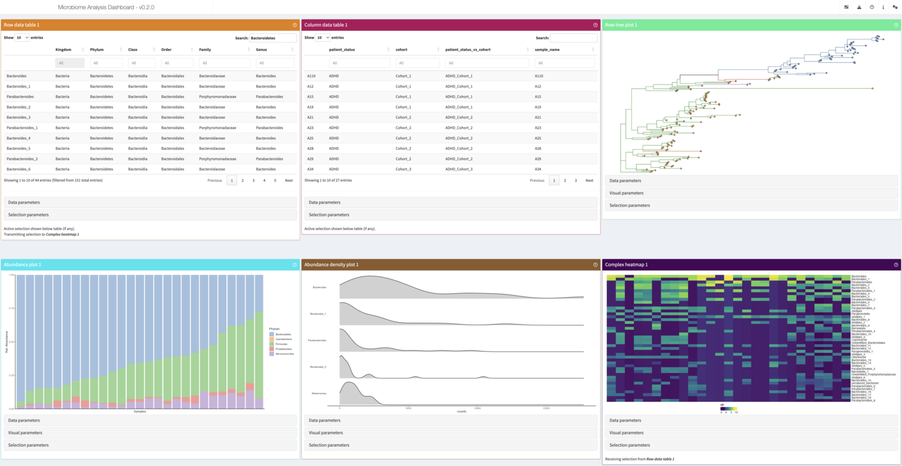

Microbiome data arrives in pieces: an abundance table, sample metadata, a taxonomy, sometimes a phylogenetic tree. Stitching it together usually means an R session before you can even see what you have.

[miaDash](https://github.com/microbiome/miaDash) is now available as an [interactive tool on usegalaxy.eu](https://usegalaxy.eu/?tool_id=interactive_tool_miadash&version=latest). It is the Shiny application from the Bioconductor microbiome team, and it turns those tables into a dashboard you can explore in your browser, no code required.

    <a class="btn btn-primary btn-lg" href="https://usegalaxy.eu/?tool_id=interactive_tool_miadash&version=latest">Start miaDash now</a>

## What is miaDash?

miaDash is a graphical user interface for building and exploring TreeSummarizedExperiment objects, the standard data structure for microbiome data in the Bioconductor ecosystem. It is built on iSEE and the miaverse packages, and it covers the whole path from raw tables to interactive exploration:

* **Import** raw tables, an R object, or one of the built-in example datasets into a TreeSummarizedExperiment
* **Manipulate** them: subset by prevalence, agglomerate by taxonomy rank, transform assays (including PhILR), with every step recorded as a reproducible R script
* **Analyse**: quality control, alpha and beta diversity, clustering, ordination
* **Visualise** the result in the interactive iSEE explorer, with a customisable set of panels, and export it as TreeSE, phyloseq, BIOM, Mothur or QIIME2 formats

## Another option alongside Shiny phyloseq

Galaxy already has [Shiny phyloseq](https://usegalaxy.eu/?tool_id=interactive_tool_phyloseq&version=latest), which we [introduced in 2024](https://galaxyproject.org/news/2024-07-26-shiny-phyloseq-on-eu/). It offers interactive filtering, diversity analysis, ordination, heatmaps and tree plots for amplicon data. miaDash adds another route through the Bioconductor microbiome ecosystem, centred on TreeSummarizedExperiment and the linked iSEE panels. Already working with phyloseq? You can import a phyloseq R object into miaDash, or export one to continue your analysis elsewhere.

## How does it work in Galaxy?

Every input is optional, the tool starts with or without your data. You can pre-load:

* an **abundance table**: tab-separated, taxa in the rows, sample ids in the header
* **sample data** (colData) with the sample variables you care about
* **taxa data** (rowData) with taxonomy ranks or other taxon variables
* a **taxa tree** in Newick format, for the analyses that need the phylogeny

The tables you select are staged and handed to the application at launch, so the session starts from your data. Anything you leave out can still be added inside the app: the Import panel takes browser uploads, either the same table layouts in its *Raw Data* tab, or an .rds file in TreeSE, phyloseq, BIOM or DADA2 format in its *R Object* tab, and the *Dataset* tab offers a set of built-in example datasets.

Results travel back to your history. The export download in the app has a **Send to Galaxy** button, which saves the file into the *miaDash results* collection and starts a direct history upload in the background. The collection becomes available in your history when the interactive job ends, so nothing gets lost along the way.

## Get data to play with

Microbiome workflows produce the building blocks for miaDash. These Galaxy Training Network tutorials are good places to start:

* [Building an amplicon sequence variant (ASV) table from 16S data using DADA2](https://training.galaxyproject.org/training-material/topics/microbiome/tutorials/dada-16S/tutorial.html) produces all three tables miaDash wants: the ASV table as the abundance table, the DADA2 taxonomy table as the taxa data, and the sample metadata table as the sample data.
* [Taxonomic Profiling and Visualization of Metagenomic Data](https://training.galaxyproject.org/training-material/topics/microbiome/tutorials/taxonomic-profiling/tutorial.html) runs Kraken2 and Bracken and compares them with MetaPhlAn, giving you species level abundance reports, one per sample.
* [Metatranscriptomics analysis using microbiome RNA-seq data](https://training.galaxyproject.org/training-material/topics/microbiome/tutorials/metatranscriptomics/tutorial.html) profiles the community with MetaPhlAn and the functions with HUMAnN, ending in a gene family and a pathway abundance table.
* [Calculating α and β diversity from microbiome taxonomic data](https://training.galaxyproject.org/training-material/topics/microbiome/tutorials/diversity/tutorial.html) shows how to analyse Bracken species-level abundance data.
* [16S Microbial Analysis with mothur](https://training.galaxyproject.org/training-material/topics/microbiome/tutorials/mothur-miseq-sop/tutorial.html) ends with an OTU table that already carries the taxonomy of every OTU.
* [QIIME 2 Moving Pictures](https://training.galaxyproject.org/training-material/topics/microbiome/tutorials/qiime2-moving-pictures/tutorial.html) links to the QIIME 2 tutorial covering feature tables, taxonomy and phylogenetic trees. Export the relevant artifacts before preparing them for miaDash.
* [Identifying Mycorrhizal Fungi from ITS2 sequencing using LotuS2](https://training.galaxyproject.org/training-material/topics/microbiome/tutorials/lotus2-identifying-fungi/tutorial.html) produces an OTU abundance matrix and Newick trees.
* Our [FAIRyMAGs workflow](https://github.com/usegalaxy-eu/FAIRyMAGs), available through the [IWC](https://github.com/galaxyproject/iwc/tree/main/workflows/microbiome/mags-building), goes from metagenomic reads to MAGs, with **CoverM** abundance estimates and **GTDB-Tk** taxonomy. The [MAGs-building GTN tutorial](https://training.galaxyproject.org/training-material/topics/microbiome/tutorials/mags-building/tutorial.html) walks through the analysis. Use MAG identifiers to match the abundance table to its taxonomy for exploration in miaDash.

These are starting points, not automatic one-click connections: merge per-sample reports where needed, remove report-specific headers, and arrange the abundance matrix with features in rows and samples in columns. Match feature and sample identifiers across the metadata tables and any tree. HUMAnN rows represent gene families or pathways rather than taxa, so taxonomy- and phylogeny-dependent analyses do not apply unless you supply suitable annotations.

More microbiome tutorials are collected in the [microbiome topic of the GTN](https://training.galaxyproject.org/training-material/topics/microbiome/).

The interactive plot types shown below miaDash are described in the [iSEEtree panel catalogue](https://microbiome.github.io/iSEEtree/articles/panels.html). Available panels depend on the data and analyses in your session.

## A look inside

## Try it out

Interactive tools need a login, so create an account on [usegalaxy.eu](https://usegalaxy.eu) first. Then find miaDash in the tool panel, or go straight to the tool page: [miaDash on usegalaxy.eu](https://usegalaxy.eu/?tool_id=interactive_tool_miadash&version=latest). You can watch the running instances [here](https://usegalaxy.eu/interactivetool_entry_points/list).

## From app to interactive tool in a day

With LLM-assisted development, we can now turn suitable existing applications into [Galaxy interactive tools](https://galaxyproject.org/news/2023-09-15-interactive-tools/) within a day. The assistance speeds up [container setup](https://quay.io/repository/galaxy/miadash-gxit), wrapper code and integration work; human review and testing still matter. miaDash is a nice example: its [integration pull request](https://github.com/usegalaxy-eu/galaxy/pull/417) was opened and merged on the same day. This is about making an existing app accessible in Galaxy, not developing or scientifically validating the underlying software in a day. You can find our wrapping work in the [microbiome-ITs GitHub repository](https://github.com/usegalaxy-eu/microbiome-ITs). For background on the integration approach, see our [guide to hosting Shiny apps on Galaxy Europe](https://galaxyproject.org/news/2024-08-21-hosting-shiny-apps-on-eu/).

## Acknowledgements

miaDash was created by Giulio Benedetti, Akewak Jeba and Leo Lahti, and it builds on iSEE, iSEEtree and the miaverse ecosystem. Giulio requested an interactive tool in the [IUC repository](https://github.com/galaxyproject/tools-iuc/issues/8553), and the wrapper is now live on [usegalaxy.eu](https://github.com/usegalaxy-eu/galaxy/pull/417), running the [miaDash GxIT container](https://quay.io/repository/galaxy/miadash-gxit).
