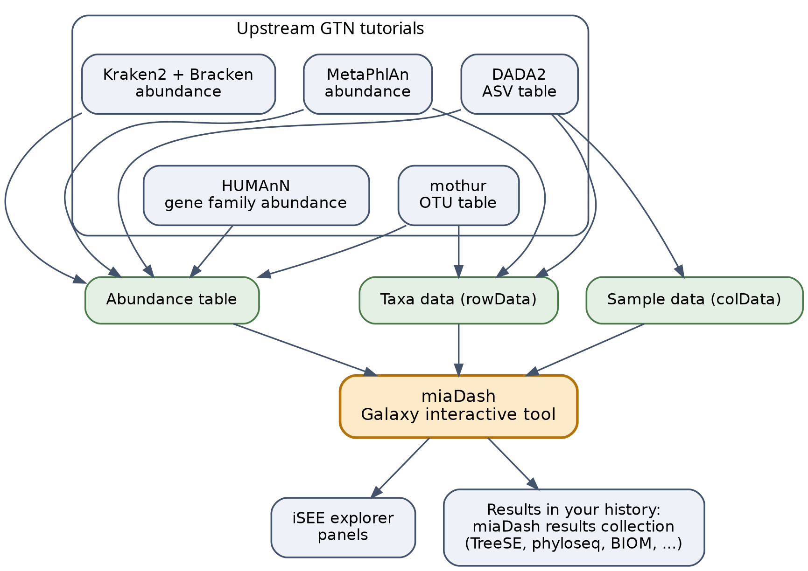
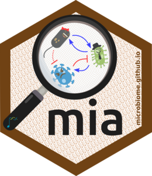
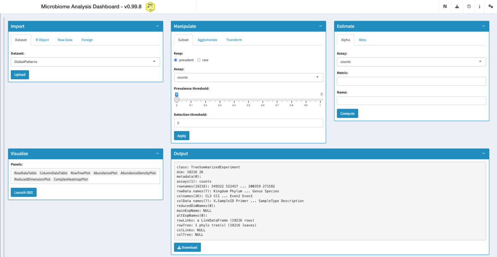

Microbiome data arrives in pieces: an abundance table, sample metadata, a taxonomy, sometimes a phylogenetic tree. Stitching it together usually means an R session before you can even see what you have.

[miaDash](https://github.com/microbiome/miaDash) is now available as an [interactive tool on usegalaxy.eu](https://usegalaxy.eu/?tool_id=interactive_tool_miadash&version=latest). It is the Shiny application from the Bioconductor microbiome team, and it turns those tables into a dashboard you can explore in your browser, no code required.

    <a href="https://usegalaxy.eu/?tool_id=interactive_tool_miadash&version=latest">
      <button type="button" class="btn btn-primary btn-lg">Start miaDash now</button>
    </a>

## What is miaDash?

miaDash is a graphical user interface for building and exploring TreeSummarizedExperiment objects, the standard data structure for microbiome data in the Bioconductor ecosystem. It is built on iSEE and the miaverse packages, and it covers the whole path from raw tables to interactive exploration:

* **Import** raw tables, an R object, or one of the built-in example datasets into a TreeSummarizedExperiment
* **Manipulate** them: subset by prevalence, agglomerate by taxonomy rank, transform assays (including PhILR), with every step recorded as a reproducible R script
* **Analyse**: quality control, alpha and beta diversity, clustering, ordination
* **Visualise** the result in the interactive iSEE explorer, with a customisable set of panels, and export it as TreeSE, phyloseq, BIOM, Mothur or QIIME2 formats

## How does it work in Galaxy?

Every input is optional, the tool starts with or without your data. You can pre-load:

* an **abundance table**: tab-separated, taxa in the rows, sample ids in the header
* **sample data** (colData) with the sample variables you care about
* **taxa data** (rowData) with taxonomy ranks or other taxon variables
* a **taxa tree** in Newick format, for the analyses that need the phylogeny

The tables you select are staged and handed to the application at launch, so the session starts from your data. Anything you leave out can still be added inside the app: the Import panel takes browser uploads, either the same table layouts in its *Raw Data* tab, or an .rds file in TreeSE, phyloseq, BIOM or DADA2 format in its *R Object* tab, and the *Dataset* tab offers a set of built-in example datasets.

Results travel back to your history. The export download in the app has a **Send to Galaxy** button, which saves the file into the *miaDash results* collection and starts a direct history upload in the background. The collection becomes available in your history when the interactive job ends, so nothing gets lost along the way.

## Get data to play with

Most microbiome pipelines end exactly where miaDash starts, and the Galaxy Training Network has tutorials for a few of them:

* [Building an amplicon sequence variant (ASV) table from 16S data using DADA2](https://training.galaxyproject.org/training-material/topics/microbiome/tutorials/dada-16S/tutorial.html) produces all three tables miaDash wants: the ASV table as the abundance table, the DADA2 taxonomy table as the taxa data, and the sample metadata table as the sample data.
* [Taxonomic Profiling and Visualization of Metagenomic Data](https://training.galaxyproject.org/training-material/topics/microbiome/tutorials/taxonomic-profiling/tutorial.html) runs Kraken2 and Bracken and compares them with MetaPhlAn, giving you species level abundance reports, one per sample.
* [Metatranscriptomics analysis using microbiome RNA-seq data](https://training.galaxyproject.org/training-material/topics/microbiome/tutorials/metatranscriptomics/tutorial.html) profiles the community with MetaPhlAn and the functions with HUMAnN, ending in a gene family and a pathway abundance table.
* [Calculating α and β diversity from microbiome taxonomic data](https://training.galaxyproject.org/training-material/topics/microbiome/tutorials/diversity/tutorial.html) works on Bracken species level abundance tables, the same layout miaDash expects for its abundance table.
* [16S Microbial Analysis with mothur](https://training.galaxyproject.org/training-material/topics/microbiome/tutorials/mothur-miseq-sop/tutorial.html) ends with an OTU table that already carries the taxonomy of every OTU.

More microbiome tutorials are collected in the [microbiome topic of the GTN](https://training.galaxyproject.org/training-material/topics/microbiome/).

## A look inside

## Try it out

Interactive tools need a login, so create an account on [usegalaxy.eu](https://usegalaxy.eu) first. Then find miaDash in the tool panel, or go straight to the tool page: [miaDash on usegalaxy.eu](https://usegalaxy.eu/?tool_id=interactive_tool_miadash&version=latest). You can watch the running instances [here](https://usegalaxy.eu/interactivetool_entry_points/list).

    <a href="https://usegalaxy.eu/?tool_id=interactive_tool_miadash&version=latest">
      <button type="button" class="btn btn-primary btn-lg">Start miaDash now</button>
    </a>

## Acknowledgements

miaDash was created by Giulio Benedetti, Akewak Jeba and Leo Lahti, and it builds on iSEE, iSEEtree and the miaverse ecosystem. Giulio requested an interactive tool in the [IUC repository](https://github.com/galaxyproject/tools-iuc/issues/8553), and the wrapper is now live on [usegalaxy.eu](https://github.com/usegalaxy-eu/galaxy/pull/417), running the [miaDash GxIT container](https://quay.io/repository/galaxy/miadash-gxit).

This work was supported by de.NBI and the Ministry of Science, Research and the Arts Baden-Württemberg.
