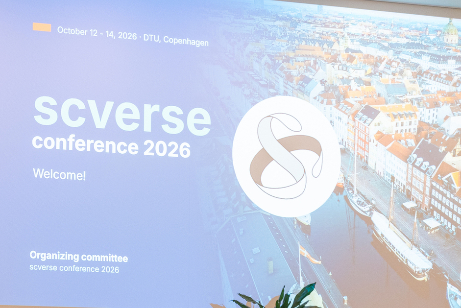
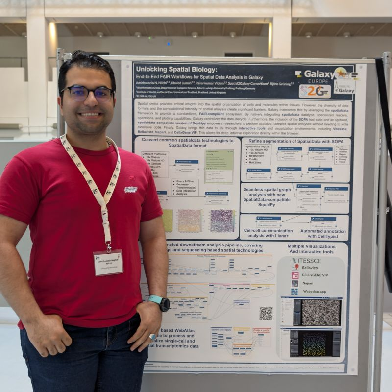

# **Galaxy Team Presents SpatialData Ecosystem at scverse Conference 2026**

  

From October 12–14, 2026, the third scverse conference took place at the Technical University of Denmark (DTU) in Copenhagen, Denmark. After Munich (2024) and Stanford (2025), the conference returned to Europe, bringing together developers, researchers, and users of the scverse ecosystem for three days of keynote talks, contributed talks, posters, and hands-on workshops on single-cell and spatial omics analysis.

Amirhossein Nilchi attended the conference on behalf of the European Galaxy team and presented a poster on **End-to-End FAIR Workflows for Spatial Data Analysis in Galaxy**.

## The Galaxy SpatialData ecosystem

  

Spatial omics technologies are transforming our understanding of cellular organization and tissue microenvironments, yet the volume, complexity, and multi-modal nature of spatial data remain significant barriers to accessible and reproducible analysis. The poster presented a comprehensive spatial data analysis ecosystem integrated into the Galaxy platform, enabling researchers to build robust, scalable, and FAIR workflows without requiring advanced programming expertise.

At the core of this ecosystem is the **Galaxy SpatialData toolsuite**, which provides a unified framework for spatial data handling:

* **spatialdata-io** converts data generated from various spatial technologies (including Xenium, Visium, and MERSCOPE) into a standardized SpatialData object
* **spatialdata-operations** supports complex spatial queries, multi-modal alignments, and data transformations
* **spatialdata-plot** generates high-quality, customizable images from SpatialData objects across different layers, colored by multiple annotations

For MERSCOPE-specific preprocessing, the **Vizgen Post-processing Tool (VPT)** handles transcript coordinate processing and cell boundary segmentation prior to SpatialData conversion, while multiple segmentation tasks with **Cellpose** provide accurate cell segmentation and transcript allocation.

For downstream analysis, **Squidpy** supports spatial correlation and neighborhood graph construction, and **LIANA+** enables comprehensive cell-cell communication modeling, both accessible directly within the Galaxy interface and compatible with the SpatialData framework. For interactive data exploration, **spatialdata-napari** provides a dynamic visualization environment, allowing researchers to inspect and annotate spatial datasets without leaving the pipeline.

## Compatible with the Galaxy Single-Cell Lab

The SpatialData ecosystem is fully compatible with the existing [Galaxy Single-Cell Lab](https://singlecell.usegalaxy.eu/), enabling users to seamlessly combine established single-cell tools and workflows with the newly integrated spatial tool suites. To showcase this, Galaxy workflows were developed inspired by popular spatial analysis workflows such as EISTA and WebAtlas from the Nextflow ecosystem, further improved through enhanced SpatialData integration and the use of alternative, up-to-date tool suites. By adhering to FAIR (Findable, Accessible, Interoperable, and Reusable) principles, these workflows enable easy execution, reuse, and adaptation by users.

We extend our gratitude to the organizers of the scverse conference for hosting such an insightful event and fostering open-source collaboration in the single-cell and spatial omics communities.

To learn more about Galaxy's offerings in the single-cell and spatial omics domains, visit the [Galaxy Single-Cell Lab](https://singlecell.usegalaxy.eu/).