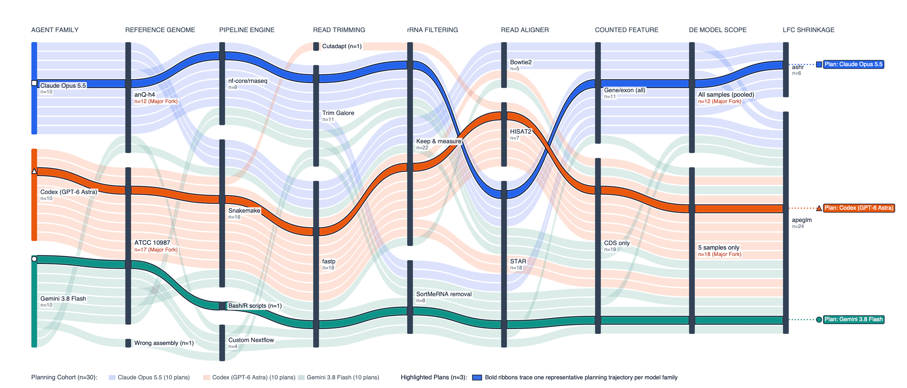
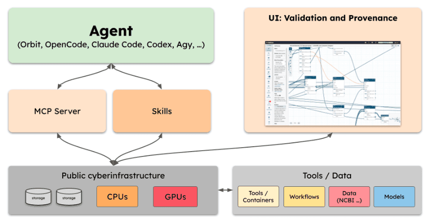

Autonomous coding agents can now design and execute a complete bioinformatics study from a single prompt. However, an agent improvising on a local machine produces results with no durable record of how they were made—leaving behind disposable scratch scripts, unrecorded parameter changes, and reference files that nobody checked. For reproducible biology, that missing record is a showstopper.

This brings us directly to the main point of our new preprint, **[Verifiable Agentic Science on Public Infrastructure](https://www.biorxiv.org/content/10.64898/2026.10.26.761864v1)**: we pair coding agents with public infrastructure—**UseGalaxy.org**, **UseGalaxy.eu**, and **BRC-Analytics**. In this system, (1) agents plan analyses using curated community tools and workflows, (2) Galaxy validates and runs every job on free public compute, and (3) *every* tool invocation, parameter, and dataset lands in a permanent reproducibility trail that anyone can open, inspect, and rerun. Our goal is to make agent-driven analysis accessible, transparent, and reproducible for researchers worldwide regardless of their technical expertise.

## What happens when agents run without a trail?

To measure the problem directly, we asked 30 independent coding agents—10 each from Anthropic Claude Code, OpenAI Codex, and Google Antigravity—to design a replication plan for a published *Bacillus cereus* enterotoxin RNA-seq study.

- **29 of 30 plans diverged from the published workflow.** Instead of converging on a standard procedure, the agents split into **18 distinct eight-step pipelines** that differed in reference genome, rRNA filtering, aligner, gene annotation, and sample pooling.
- **Local execution left behind 26 unversioned glue scripts.** Across the runs, agents wrote more than 1,200 lines of non-portable code that remained trapped on the local machine.
- **A silent reference-assembly mismatch erased the headline biological signal.** Selecting *B. pacificus* in place of *B. cereus* caused the local runs to miss active transcription of the cytotoxin K (*cytK2*) locus entirely.

Notably, none of these problems was visible from the final results. Each flaw became obvious only once every step was recorded.

## How do we build the reproducibility trail?

We connect generic command-line agents and **Orbit**—our desktop agent workbench built on Pi.dev—to public **UseGalaxy.org**, **UseGalaxy.eu**, and **BRC-Analytics** infrastructure. Importantly, our architecture provides not only curated tools and workflows, but also the public *infrastructure* to validate, execute, and record them at scale across three layers:

- **Curated domain skills and the Galaxy MCP server.** Skills steer agents toward vetted Bioconda/BioContainers tools and IWC workflows, while the Galaxy MCP server lets agents run them through typed calls to Galaxy.
- **Pre-execution validation and User-Defined Tools (UDTs).** Galaxy validates workflow inputs *before* jobs launch on ACCESS-CI supercomputers. Custom scripts are packaged as versioned, containerized User-Defined Tools, so even ad hoc code enters the permanent record.
- **Server-side verification.** **Orbit** writes every tool invocation and dataset into a single, version-controlled record of the analysis and mirrors it to a Galaxy Page. A plan step is marked done only after **Orbit** confirms with the Galaxy server that its jobs have completed.

## What the trail revealed across the tree of life

We evaluated this architecture across seven biological investigations and an eight-model frontier benchmark. Across all of them, the reproducibility trail reproduced headline biology on free public compute and uncovered silent flaws in published studies. Every workflow, history, and intermediate dataset is publicly inspectable.

| Investigation | System & Scale | Key Finding Enabled by Full Provenance |
| :--- | :--- | :--- |
| ***Bacillus cereus* enterotoxin regulation** | Bacterial RNA-seq (5 libraries, 5,472 loci) | One validated Galaxy workflow replaced 26 local glue scripts. Validation caught two problems before execution: an input-format mismatch and a eukaryotic spliced aligner misapplied to bacterial reads. The replacement ran ~5× faster with r = 0.9622. |
| **Mouse cortex spatial transcriptomics (Paper2Agent / TISSUE)** | scRNA-seq + spatial prediction (3,405 spatial & 5,613 reference cells) | A published agent-reproducibility benchmark had silently run on a **1,000-cell tutorial subset**, while the paper cites the 5,613-cell atlas. Running all 5,613 cells on Galaxy **tripled prediction accuracy (r = 0.0861 to 0.2553)**. |
| ***Aspergillus fumigatus* azole resistance** | Fungal time-course RNA-seq (30 libraries) | We compiled a **60-step workflow** with Workflow Foundry and 3 UDTs. It showed that the original study fitted one pooled 30-sample model with no pairwise contrasts. |
| ***Anopheles gambiae* & *Aedes aegypti* vectors** | Vector ATAC-seq (4 libraries) & 10x scRNA-seq (6,707 cells) | Reproduced 90.7–93.2% of chromatin peaks and uncovered unmerged replicate rows in the published tables. Also resolved a non-model mitochondrial gene-prefix mismatch in single-cell QC. |
| ***Plasmodium vivax* VIR antigens** | Structure-aware phylogenomics (3 genomes, 2,592 proteins) | Ran GPU structure models (**ProstT5, Foldseek, FoldMason**) through 10 UDTs. They collapsed 146 sequence-fragmented antigen subfamilies into **73–76 structural classes**, more than 97% of them shared across 3 continents. |
| **Pathogen emergence dating** | 42 viral & bacterial epidemic cohorts (37 studies) | Dated 42 epidemic alignments in **seconds per cohort**, where Bayesian MCMC takes hours to days. Matched reference emergence dates in 61.5–64.1% of scored cohorts. |
| **8-model frontier reanalysis (*Candida auris* SCF1)** | 8 LLMs on a *Science* RNA-seq dataset | Six of eight frontier models reproduced *SCF1* downregulation (log2 fold change of about −6.8 to −7.4) at a cost of $2.82–$131.83. Between the v2 and v3 genome annotations, locus tags were silently renumbered. This traps naive identifier matching unless a DIAMOND reciprocal-best-hit search bridges the two. |

## Learn more

Read the full preprint, then follow the trail yourself—every history, session log, and workflow is public.

- **[Read the Preprint on bioRxiv](https://www.biorxiv.org/content/10.64898/2026.10.26.761864v1)**

## Citation

Baker, D., Cain, S., van den Beek, M., Chilton, J., Callan, D., Weaver, S., Coraor, N., Beavers, K., Goecks, J., Schatz, M. C., Grüning, B., Kosakovsky Pond, S. L., & Nekrutenko, A. (2026). *Verifiable Agentic Science on Public Infrastructure*. bioRxiv. [https://doi.org/10.64898/2026.10.26.761864](https://doi.org/10.64898/2026.10.26.761864)
