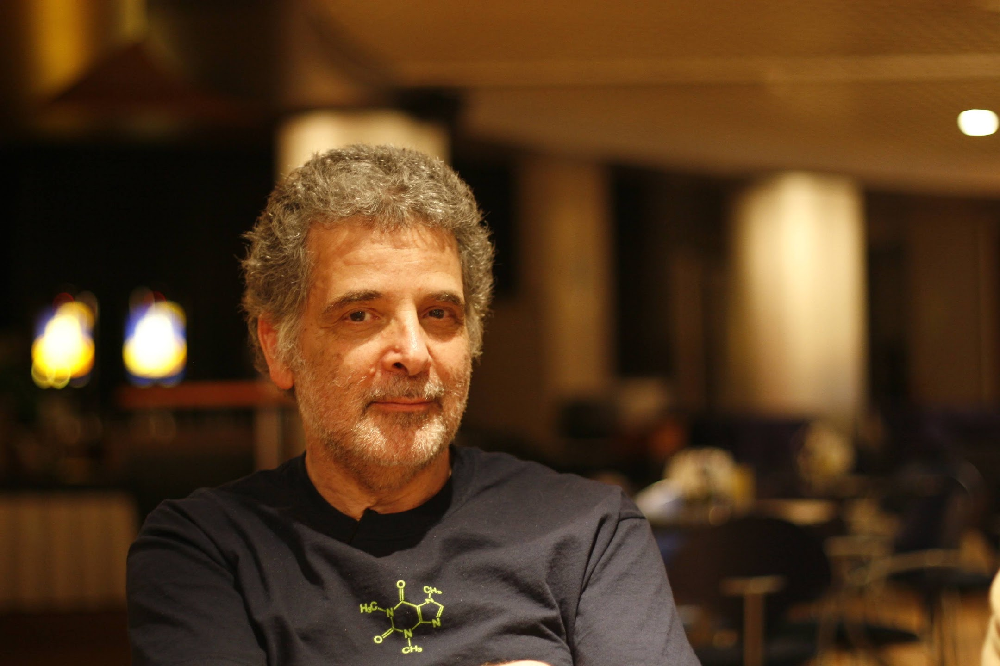
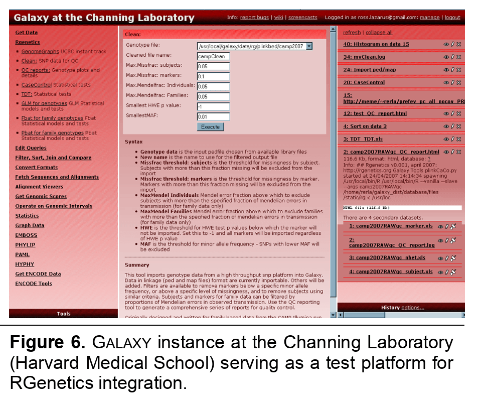
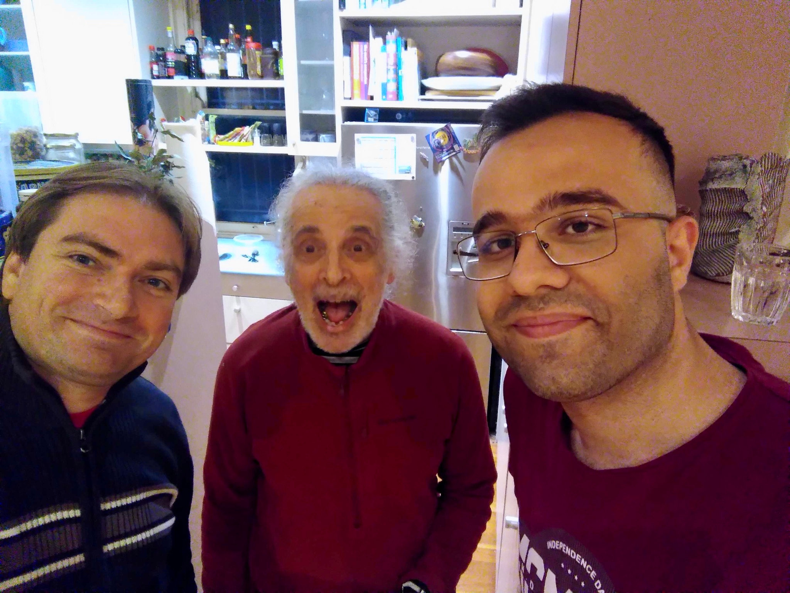

<center>
  
</center>

We lost a friend, mentor and a great human being: Ross Lazarus.

## Early career

Ross had been actively involved in health informatics and bioinformatics for more than 40 years since graduating from the Faculty of Medicine at the University of Melbourne in 1974. Ross really wanted to change the world in profound, measurable ways. This is why early on he decided to do something that would benefit entire global populations: public health and clinical epidemiology. He worked as a general practitioner in Collingwood, studied epidemiology at Monash University and computer science at RMIT, and built health information systems in Victoria, from lung function screening for power station workers to a state-wide register of vacant nursing home beds. In the late 1980s he started teaching undergraduate, graduate and postgraduate medical students at the University of Sydney. A sabbatical at the Channing Laboratory at [Harvard Medical School](https://hms.harvard.edu) in the mid-1990s led to a second, much longer stay: in 2000 he moved to Boston for what was meant to be six months, and stayed for more than a decade as Director of Bioinformatics at the Channing Laboratory.

## The Galaxy years

This was the time he discovered the very early version of Galaxy, back then without a workflow editor, a web application to run bioinformatics applications in a reproducible and transparent way.
In Ross's own telling, his office neighbour Benjamin Raby ran in one day: "You've got to come and look at this!" On Benji's screen was a web tool from Penn State that did what Ross had written custom code for the day before, except that Benji could now do it himself. "I was blown away because this was absolutely brilliant," Ross recalled. He got his own copy, fixed the problems he found, and wrote to the developers: "This is cool. Who are you and can we meet?"
Ross was one of the first Galaxy power users, pushing boundaries of this new Galaxy project. But Ross was more than a user, he became quickly involved in the project, contributed tools, ideas and advice and run his own Galaxy instance.

<center>
  
</center>

He became a mentor for Anton Nekrutenko and James Taylor, who at the time were just starting the Galaxy Project. With his practical advice and involvement, the Galaxy project was able to get funded and lay the foundation for what the project is today. Ross wrote a grant that subcontracted the Penn State group at a time when, as he put it, they were about to run out of money and the lab was about to close.

After his stay at Harvard Medical School Ross went back to Australia and served as Director of Computational Biology at the [Baker Heart and Diabetes Institute](https://baker.edu.au) in Melbourne until 2015.
During this time the [IUC](https://galaxyproject.org/iuc/) was started and Ross was one of the founding members. Without his help and advice the IUC would not be what it is today - a community of more than 400 contributors working on more than 2000 Galaxy tools.
Ross authored and maintained countless computational tools, pipelines, and Galaxy wrappers, many of them still in use. For example, he wrote the early RNA STAR wrapper back when STAR was really new. The RNA STAR tool in Galaxy
alone has more than 1 million executions.

## Retirement and return

In 2015 Ross retired and enjoyed life in Bondi Beach together with Sarah and his two kids. It was hard to have him in such a different time zone, so we reached out and asked where we would need to organize a GCC to get him back. He responded in a very funny email which he ended with:

> Sorry to have drifted off but I seem to be moving out of that Galaxy and into another...

Indeed, he was swimming and hiking a lot. Just enjoying life. Wonderful.

In 2017 we had an Admin training in Melbourne with the Australian Galaxy community and he invited us to his place where we had a wonderful time. Learning about flying foxes and philosophizing about science.

With the sudden death of [James Taylor](/jxtx/) in early 2020 the community was mourning, and Ross, once again, helped us get through that awful time. He knew that the loss of James would be a challenge for the community and he was there to help. We built a more sustainable community governance model and Ross was always there to advise us. During that hard time and during the Pandemic, Ross was back helping in various roles and Galaxy boards.

In 2023, we had our first [GCC in Australia](https://galaxyproject.org/events/gcc2023/) and of course we invited Ross. It was so lovely to see him and Sarah again in Brisbane. A few Europeans stayed a bit longer in Australia and Ross
was so kind to host us in Sydney, showing us around Bondi Beach. We could also use his apartment in Melbourne to work closely with [Galaxy Australia](https://usegalaxy.org.au/). He was so generous, insightful and inspiring to many of us during this time.

And something happened :) I think he was hooked again. From that time onward he was back online. He started to contribute to the IUC again, developed tools and workflows for
the [VGP](https://vertebrategenomesproject.org) and other projects and helped us build the community by serving on different boards. Ross was back and it was wonderful to work with him (again).

Looking back on Galaxy, Ross wrote:

> It's always been about trying to do things for the public good; in the case of Galaxy, to make things a bit better for scientists in, say, Uganda or Jakarta, who don't have access to much in the way of infrastructure or resources. And I'm pleased to say that it's happening. We've done it, we do it, and it works.

## In memory of Ross

A bit nerdy, but we are sure Ross would have liked it. Galaxy servers send a special HTTP header in Ross's honor.

```bash
curl -sI https://usegalaxy.eu/ | grep -i clacks
```

It is the community's tribute to deceased Galaxy community members, a reference to [Terry Pratchett's](https://en.wikipedia.org/wiki/Terry_Pratchett) [Discworld novels](<https://wiki.lspace.org/Clacks>).
So whenever someone opens Galaxy now, Ross's name is traveling through the network forever.

---

Sarah and the family have shared the following:

> Our beloved Ross is now at rest near our house in Waverley Cemetery, Clovelly, which is on the coastal walk from Bondi Beach to Coogee, a well-trodden path loved by our family.
>
> We have created a website in memory of Ross Lazarus. It has:
>  - a biography written by Kirsten Tilgals
>  - a video recording of the celebration of life that took place on Wednesday, September 23, 2026, with a photo slideshow and speeches
>  - a digital photo album
>
> You can access the website here: [rossbiography.vercel.app](https://rossbiography.vercel.app/)

Rest in peace, our dear friend! 🌻

<center>
  
</center>

## Annex

### Galaxy publications

Ross co-authored many papers on Galaxy, from the early days of the project to the most recent community updates:

1. Lazarus R, Taylor J, Qiu W, Nekrutenko A. Toward the commoditization of translational genomic research: design and implementation features of the Galaxy genomic workbench. *Summit Transl Bioinform*. 2008. [PubMed](https://pubmed.ncbi.nlm.nih.gov/21347127/)
2. Blankenberg D, Von Kuster G, Coraor N, Ananda G, Lazarus R, Mangan M, Nekrutenko A, Taylor J. Galaxy: a web-based genome analysis tool for experimentalists. *Curr Protoc Mol Biol*. 2010. [PubMed](https://pubmed.ncbi.nlm.nih.gov/20069535/)
3. Goecks J, Nekrutenko A, Taylor J; Galaxy Team. Galaxy: a comprehensive approach for supporting accessible, reproducible, and transparent computational research in the life sciences. *Genome Biol*. 2010. [PubMed](https://pubmed.ncbi.nlm.nih.gov/20738864/)
4. Blankenberg D, Taylor J, Nekrutenko A; Galaxy Team. Making whole genome multiple alignments usable for biologists. *Bioinformatics*. 2011. [PubMed](https://pubmed.ncbi.nlm.nih.gov/21775304/)
5. Lazarus R, Kaspi A, Ziemann M; Galaxy Team. Creating reusable tools from scripts: the Galaxy Tool Factory. *Bioinformatics*. 2012. [PubMed](https://pubmed.ncbi.nlm.nih.gov/23024011/)
6. Galaxy Community. The Galaxy platform for accessible, reproducible and collaborative biomedical analyses: 2022 update. *Nucleic Acids Res*. 2022. [PubMed](https://pubmed.ncbi.nlm.nih.gov/35446428/)
7. Galaxy Community. The Galaxy platform for accessible, reproducible, and collaborative data analyses: 2024 update. *Nucleic Acids Res*. 2024. [PubMed](https://pubmed.ncbi.nlm.nih.gov/38769056/)

His full publication record, covering decades of epidemiology, genetics and public-health informatics, is on [PubMed](https://pubmed.ncbi.nlm.nih.gov/?term=%22Lazarus+Ross%22%5BFull+Author+Name%5D) and [ORCID](https://orcid.org/0000-0003-3939-1961).

