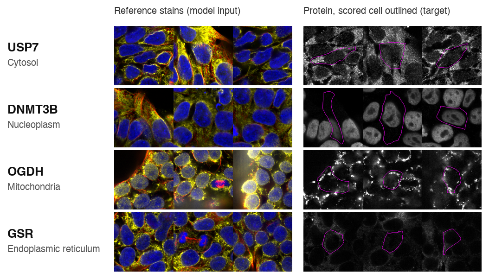
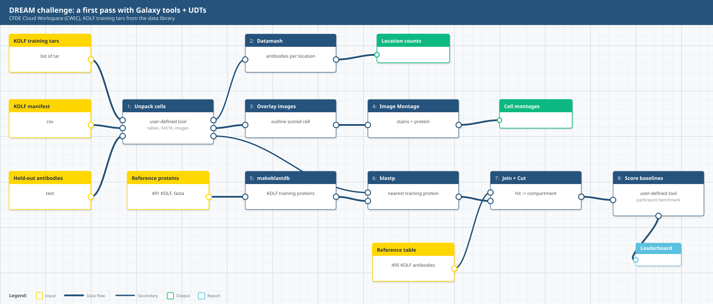

The [CM4AI-AnVIL DREAM Challenge](https://www.synapse.org/Synapse:syn77349038/wiki/643951) asks a simple-sounding question: where in a human cell does a protein sit? Teams get a cell's reference stains (nucleus, microtubules and endoplasmic reticulum) and a protein's amino-acid sequence, and their model has to generate that protein's immunofluorescence image. The Phase 1 deadline is December 1, 2026, and the challenge ends on February 1, 2027. The [participant repository](https://github.com/cm4ai-anvil-dream-challenge/anvil-dream-participant) has the submission format and the evaluation code, and submissions go through Synapse and AnVIL. If you want the organizers' own introduction, Kyle Ellrott walks through the challenge at [AnVIL Demos on November 18](https://help.anvilproject.org/t/anvil-demos-cm4ai-anvil-cell-map-prediction-dream-challenge-on-november-18-2026/437) (10 AM ET, Zoom).

The training data comes to almost 700 GB. On the CFDE Cloud Workspace Galaxy ([CWIC](https://galaxy.cfdeworkspace.org)) you don't have to download any of it.

## The data is already there

CWIC has the full challenge training set in a data library called **CM4AI DREAM Challenge**:

* **HPA-train_v1.0** (609 GB): 15,674 tar files, one per antibody, of Human Protein Atlas images, plus a manifest and the license.
* **KOLF-train_v1.0** (80 GB): 495 tars of KOLF2.1J iPSC cells, the same cell line as the hidden test set, plus a manifest and the license.

Each tar holds the protein's sequence as a FASTA file and, for every cell, 8-bit PNGs of the nucleus, microtubule, ER and protein channels and a cell mask. The manifests are CSV tables with one row per cell, giving the antibody, gene, cell line, annotated locations and the path of each image inside its tar. The library's README describes the layout.

When you add library files to a history, Galaxy links them rather than copying them, so a few dozen tars are ready to use right away, with no upload, and every tool run on them is recorded like any other job.

## A workflow for the first pass

A [published workflow](https://galaxy.cfdeworkspace.org/published/workflow?id=92b2046c750cf0e7) puts a whole first look at the data together. Most of it is Galaxy's installed tools. Datamash counts antibodies per location from the manifest, Overlay images and Image Montage outline the scored cell over its stains, and makeblastdb and blastp search each held-out protein against the 491 other KOLF training proteins. Join and Cut turn the best hit into a guessed compartment.

What Galaxy doesn't have is a tool that understands this challenge's tars, so the workflow fills that gap with two [user-defined tools](https://docs.galaxyproject.org/en/latest/admin/user_defined_tools.html) (UDTs): small tools written as a few lines of YAML that run a command in a container. One unpacks the tars into tables, FASTA and image collections. The other fits simple baselines on the training proteins and scores them on the held-out ones. Both are short enough to read in a minute and change in five, and that's where your own ideas go.

## A tutorial and a reference run

The [hands-on tutorial](https://galaxy.cfdeworkspace.org/u/dbaker/p/cm4ai-dream-tutorial) goes from the library to a leaderboard in about 45 minutes: link the tars into a history, import and run the workflow, read the cells and the BLAST hits, and see how the baselines score on proteins they've never seen. It ends with exercises: change the split, add a baseline, beat nearest-neighbour BLAST. The [reference history](https://galaxy.cfdeworkspace.org/published/history?id=584123ea4ec2d202) holds every expected output, so you can check your run against it or import it and skip straight to the results. There's also a [version driven by Orbit](https://galaxy.cfdeworkspace.org/u/dbaker/p/cm4ai-dream-orbit-tutorial), an [agent](https://github.com/galaxyproject/orbit) that runs Galaxy for you, if you want to try that.

Two results are worth knowing before you start. First, BLAST earns its place: picking a per-compartment channel mix by the BLAST hit's compartment scores 0.609, level with using the protein's annotated location (0.607), and the BLAST version only uses the sequence, as a real entry must. Second, the pixel scorer the participant package ships today is not the challenge formula. On it, "another real cell of the same protein" comes last at 0.51, even though the final evaluation treats that real cell as the gold standard. The final evaluation scores Location, Arrangement, Realism and Variability separately, compares biological (SubCell) embeddings rather than pixels, and runs each model with several seeds. Treat the leaderboard as a starting line.

## Getting started

CWIC signs you in through Tapis with a TACC account. If you don't have one, [create a TACC account](https://accounts.tacc.utexas.edu/register), then choose **Sign in with Tapis** on CWIC's login page.

Once you're logged in, open **Libraries** from the activity bar, find **CM4AI DREAM Challenge**, and follow the [tutorial](https://galaxy.cfdeworkspace.org/u/dbaker/p/cm4ai-dream-tutorial). Questions about the challenge itself go to the forum on [Synapse](https://www.synapse.org/Synapse:syn77349038/wiki/643951), general AnVIL questions to the [AnVIL help forum](https://help.anvilproject.org), and Galaxy questions to [Galaxy Help](https://help.galaxyproject.org).
