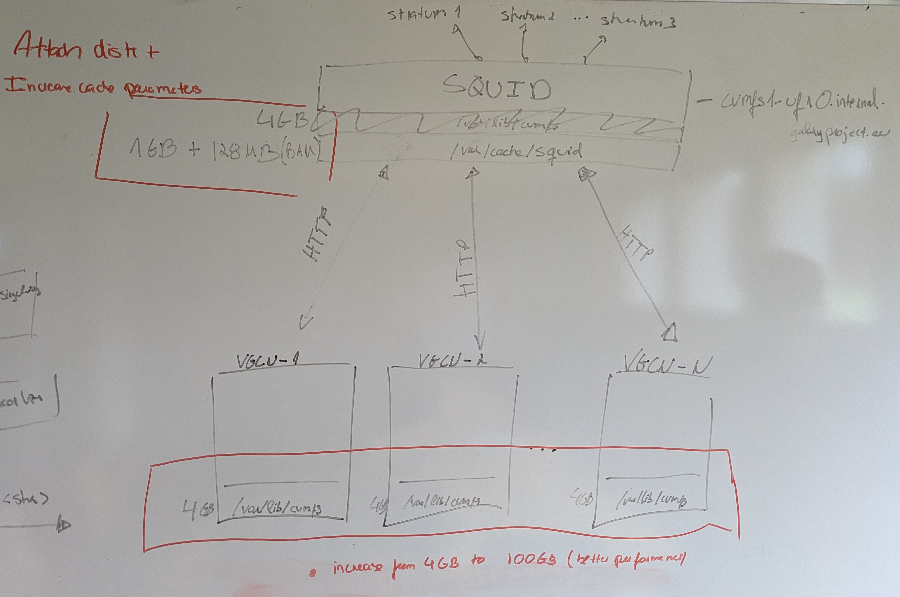
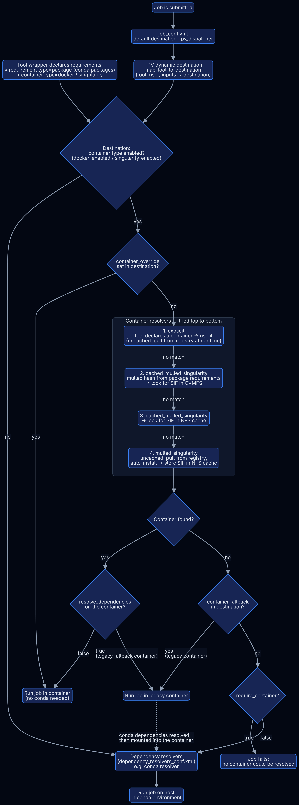
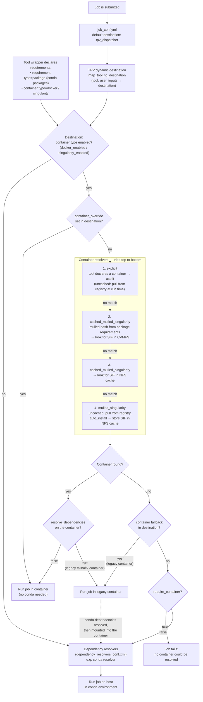

# A story of Conda, CVMFS and Containers
As you may already know, Galaxy Europe runs all its tools in containers. This switch from using conda environments to using Singularity by default had already happened in February this year and we endlessly postponed writing a blog post about it. Since we wanted to cover the whole story and include background knowledge, this post is a bit lengthy. If you are already familiar with basic Galaxy administration, it might even be too detailed. Maybe you could just read the TL;DR summaries in the Galaxy configuration sections. And for the others, for regular users and Galaxy beginners, we hope this contributes to a better understanding of how Galaxy works internally and we hope that the nerdy details don't frighten you off. So in that sense, this post tries to please everyone and might end up pleasing no one – perhaps it can still serve as a guide and background knowledge for other Galaxy admins who consider running everything containerized.

## Conda and NFS – Not exactly a match

Galaxy Europe provides many tools. As many as 4,000. And these tools, in most cases, come in different versions. As you can imagine, something has to manage all this software and its dependencies. By default (since version 17.01), Galaxy uses software called `Conda`, a package manager originally from the Python ecosystem. As you may know, many tools in bioinformatics and biochemical research are distributed via the Bioconda project.

In the default configuration, Galaxy will install tool dependencies in conda environments in a local directory. Environments allow the installation of different versions of software on a single host. This helps solve conflicting requirements the tools may have, for example different Python versions. However – and this is the crucial part – for each installed version of a tool, Galaxy will create a new conda environment in the local directory.

Let's calculate how this scales: a conda environment for one tool version contains a number of files in the range of 10³. Let's just imagine you install 3 versions per tool and, since you are a big public Galaxy server, you install a number of tools in the order of 10³. This results in a directory containing about 10⁶–10⁷ files.

But wait! Doesn't conda use hardlinks to reduce the amount of files written to disk and reuse the same files in multiple environments? Yes, but this does not work on NFS, and if you want to use the local tool dependency installation also to run your tools, you need to share this directory in your cluster. Otherwise, each job would either need to install the dependencies separately, which would be time-consuming, or maintain its own copy of this directory, which would be disk-space intensive and, in case something goes wrong, lead to reproducibility errors that are then very hard to debug.

Accessing or writing many small files on NFS is relatively slow compared to fewer files of the same total size. This phenomenon is explained in this [Broadcom knowledge article](https://knowledge.broadcom.com/external/article/393013/experiencing-latency-issues-on-nfs-file.html) and is rooted in how NFS is designed. If one could reduce the number of files, that would in turn accelerate dependency resolution and keep the NFS share maintainable in the long run.

The other issue with conda, which is even more pressing for Galaxy, is reproducibility, because conda environments can rely on untracked system libraries, which could lead to unpredictable changes in behaviour on different operating systems (or versions).

## Next Level Reproducibility – Containers

Galaxy needed to address these issues in tool dependency resolution and moved from reproducibility level 4 to level 5. That's why, around 2016–2017, Galaxy gained support for running tools in Singularity containers. Singularity, now called Apptainer, is a rootless container runtime that uses the [Singularity Image Format (SIF)](https://github.com/apptainer/sif), which stores images in a single POSIX file.

So the plan was to move from thousands of conda environments to thousands of container files.

The first question that came to our minds was: How do you distribute thousands of containers? Logically, anyone would think of using a container registry. When you think about it, hundreds of containers being pulled across multiple servers in an HPC environment means an enormous amount of network traffic, both on our side and, especially, on the registry's end (big shoutout to the people maintaining Quay.io!). And since usegalaxy.eu is only one Galaxy instance, you could imagine the load the whole Galaxy community would create on Quay.io. So, long story short: we got rate-limited by the Quay.io maintainers for some hours (no hard feelings!) and we needed to find a way to store these containers as close as possible to where the compute actually happens.

## CVMFS as a container cache

That's when Nate, the usegalaxy.org admin, had the idea of using CernVM-FS to distribute all BioContainers Singularity images. He became the curator and maintainer of the stratum 0, the source of truth for all containers, which in turn is distributed across many stratum 1 mirrors, hosted by Galaxy instances around the world. The result is a read-only, HTTP-based file system that can be easily mounted on every compute node.

usegalaxy.eu hosts `cvmfs1-ufr0.galaxyproject.eu/cvmfs/singularity.galaxyproject.org/`, which, by the way, is publicly accessible for many instances. But even with this mirror nearby, our compute nodes would still constantly pull images from it. At peak load we have about 1,000 jobs running in parallel, and every job needs its container image before it can start. With roughly 40,000 jobs processed per day (conservatively speaking), that boils down to about 28 jobs per minute (simplifying with the assumption they are evenly distributed). 28 jobs per minute would then, very simply, mean 28 containers pulled per minute. In the case of the widely used tool *bakta*, the latest image is about 380 MB. This would mean hundreds of GB of traffic every minute in the form of HTTP requests.

Luckily, there's a solution for that: caching! CVMFS provides multiple tiers of cache, which we made use of (see the detailed configuration [here](https://github.com/usegalaxy-eu/vgcn-infrastructure-playbook/blob/46a4e943d2b39472da976075024d95e87f19943f/group_vars/all/cvmfs.yml). The first cache layer is a memory cache. This is too small to fit most images in, but it serves to cache metadata. Then we have a POSIX-type cache on the host, which in our case is on a physical disk on the server and is limited to 100 GB. The lowest cache tier is called the `alien` cache and is shared on NFS for our whole cluster. In practice, this means that CVMFS would fill its local disk cache, then the `alien` cache, and then pull from our stratum 1 server (where it first hits a squid proxy). Since most jobs use the same ~100 tools, the cache hit ratio is quite high after an initial phase. You can track it in this [dashboard](https://stats.galaxyproject.eu/goto/cg3zgat50iupsf?orgId=default). And that's how we achieve high throughput with relatively low latency on all compute nodes.

Of course, all of these configurations took time and great effort from the usegalaxy.eu admins, but we got a smoothly working three-level cached CVMFS system in the end.

The second major challenge was reconfiguring Galaxy to switch from conda dependency resolution to containers, while mitigating the risk of everything breaking in a production environment. (We might write a blog post about why we don't maintain a testing environment and if we should.) There are three Galaxy concepts that need to be deeply understood in order to configure tool dependencies correctly: the job configuration and the dependency and container resolution mechanisms.

## Galaxy configuration – where the switch happened

Job preparation and tool dependency resolution in Galaxy are complex processes that can look utterly baffling to beginners. But it is key if you want to cover all tools in your configuration and ensure nothing goes wrong. Hopefully this diagram becomes clearer as you read the following paragraphs.

Mermaid Flowchart source

## Galaxy configuration part I – One destination to rule them all!

Well, not entirely... One small set of indomitable legacy tools still holds out against containerization. But before we come to this, let me briefly explain the Galaxy parts involved in this.

The job configuration tells Galaxy how to run a specific job, based on e.g. the tool and the user. It also defines the resources and parameters Galaxy should set and the runner Galaxy should use (e.g. an HTCondor cluster). Because the options in the traditional `job_conf.yml` are not dynamic (you would need to hardcode options for each tool), the community (specifically the Australian Galaxy community) developed Total Perspective Vortex (TPV), a Python application imported by the Galaxy job handlers to determine job parameters dynamically. It is based on YAML files defining entities such as tools, rules, users and destinations (entities that reference Galaxy job runners). TPV quickly became the standard used by many Galaxy instances. It's powerful and can very precisely manipulate resource assignment for complex tools based on input files, for example.

Our task was to change our existing TPV configuration so it would run all tools in a container instead of the standard conda environment. Intuitively, you would just need to add `singularity_enabled: true` to your default destination and everything running there should use containers, right? But again, there is always a catch. What happens if the tools have no container? In this case you could let them run in a generic container and mount the necessary conda environment (so you still need conda, at least read-only, for some tools). But what if they cannot run in a container at all, because there is no conda environment and the tools in question are "internal tools" and require the Galaxy Python environment? You need to exclude them and prepare a separate destination. So all in all, this is not as straightforward as one might think in the first place. To untangle and simplify our TPV, we deleted four destinations (`condor_tpv`, `condor_docker`, `condor_singularity`, `condor_gpu_pxe`) and bundled all legacy tools under one destination that resolves a legacy container capable of running old versions of Python (`condor_singularity_with_conda`).

**TL;DR:** To reduce manual runtime routing we decided on creating [one destination to run them all](https://github.com/usegalaxy-eu/infrastructure-playbook/blob/63a8b6714eadc7d401ef11b0b020d65a0dd4305b/files/galaxy/tpv/destinations.yml.j2#L493-L552), i.e. one destination that runs all tools that are neither internal, legacy nor interactive. (In fact we created two destinations, but the second one inherits the first and adds GPU settings and rules to select the appropriate GPU model and because one just sounds so much better.) The result is a destination that enables both docker and singularity. Instead of annotating a tool with its runtime, we let the tool requirements and the resolve policies do the work. And we'll cover these resolve policies in the next section.

## Galaxy configuration part II – Dependency and container resolvers

And how does Galaxy find the containers? Through container resolvers.
This tool dependency resolution happens after TPV has determined the destination, and in order to do this, Galaxy needs to know where to get the dependencies from. This brings us back to the beginning of the blog post: how does Galaxy know what a tool needs to run? Where are its dependencies declared? In a tool wrapper! It can specify two different [types of requirements](https://docs.galaxyproject.org/en/latest/dev/schema.html#tool-requirements):

1. `package`
2. `container`

The second is more intuitive, so I will explain it first. If a tool specifies a container requirement of type `docker` or `singularity`, Galaxy will use the `explicit` container resolver for docker and singularity respectively. Depending on how this resolver is configured, it will pull the image from a container registry (non-cached) or use a local path to check if it is already cached (this can then be the CVMFS).

The other case is when the wrapper specifies more than one package. In this case Galaxy needs to use a "mulled" container. These containers are built in a CI from bioconda recipes and their name is a hash unique for a set of packages and versions. Galaxy uses the same hash mechanism for the tool's requirements and the mulled container resolver searches a registry or local cache for a container named exactly like the generated hash.

The hard part was to ensure containers are resolved in all destinations, including the Pulsar destinations. Let me explain the [`container_resolvers_conf.yml`](https://github.com/usegalaxy-eu/infrastructure-playbook/blob/63a8b6714eadc7d401ef11b0b020d65a0dd4305b/templates/galaxy/config/container_resolvers_conf.yml.j2) we created in order to make use of the images on CVMFS, while maintaining flexibility to pull missing images from Quay.io. Keep in mind that Galaxy will try the resolvers from top to bottom of the file.

1. `explicit`: this resolver has no `singularity` in its name, so it is only responsible for tools that define a container requirement of type `docker`. Since there is also no `cached` in the name, this resolver will add a line to the job script that pulls the container from an online registry. Since only a few tools use it and the images are then stored on the execution node, other jobs can reuse them. It can make sense to have dedicated nodes for docker, so images are cached, which saves the pull time during job execution.
2. `cached_mulled_singularity` is a resolver for tools that provide only `package` type requirements. Since this is a cached singularity resolver, it checks the `cache_directory` for a singularity container file (SIF) named like the resulting hash and returns this file path. Of course, this needs to be available to the execution node to work. Since this one specifies `/cvmfs/singularity.galaxyproject.org/all/` as `cache_directory`, nodes that have a CVMFS client configured will be able to resolve this path. And even better, if they have the file in the above-mentioned `alien` cache, CVMFS does not download it but just returns the cached copy. `cache_directory_cacher_type: dir_mtime` tells Galaxy to keep the CVMFS directory in a memory cache and only update it if it was modified, which significantly reduces I/O overhead during the resolving.
3. The second `cached_mulled_singularity` does the same but with a "normal" POSIX NFS directory, without using CVMFS. This is important, because after an image is built, it might take a while until it is available in CVMFS, and in the meantime Galaxy can use the next resolver to pull the image from an online container registry instead and store it in this NFS directory.
4. `mulled_singularity` does exactly this: it is uncached, so it always pulls a container, and since it has `auto_install: true` it will save this container in the `cache_directory` mentioned in (3). When the same tool (+version) is run for the second time, the order of the resolvers comes into play and resolver 3 will find the downloaded image in the NFS directory.

**TL;DR:** Explicit container resolvers pull the docker image declared in the tool wrapper from a registry. The image is stored on the execution node only and managed by docker. Mulled resolvers use package requirements to locate matching BioContainers images. Multiple packages can resolve to a combined, hash-named mulled image that translates into a path on the filesystem. If the image is not in CVMFS, the last resolver pulls it from Quay.io and stores it on NFS. And for all tools without containers we needed a default fallback that preserves the conda dependencies inside a legacy container environment, which is used when the specified resolvers fail.

## "The Final Switch" and smoothing the edges

After preparing all the above and rereading our TPV files over and over, we created a pull request that would change the default destination to `condor_container`, our all-in-one container destination.
We called this PR "The Final Switch" ([PR #1872](https://github.com/usegalaxy-eu/infrastructure-playbook/pull/1872)) and it was meant to close an issue that had been open for one and a half years by then.
Despite all the careful planning and preparation, the final configuration was trial and error. We made many changes until we finally fixed all edge cases. Not everything fell into place with the resolvers alone. There was the case with locales, where multiple text-manipulating tools suddenly were defaulting to the wrong locale. Another case was Helixer and GROMACS, where GPU allocation was still needed in runtime-specific arguments. I guess we cannot explain these edge cases here, and they might deserve a dedicated blog post... Stay tuned!

Wow! Congratulations – you've made it to the end! If you enjoyed our blog post and it even helped you transition your own Galaxy server to a purely container-based job execution setup, we would love to hear from you [on Matrix](https://app.element.io/#/room/#galaxyproject_admins:gitter.im)!
