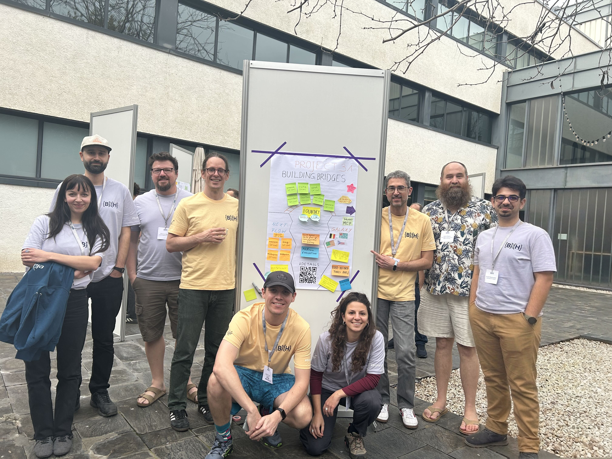
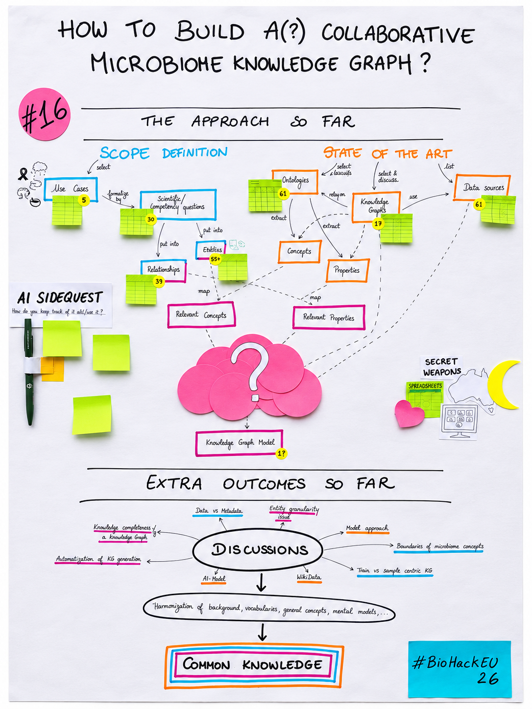
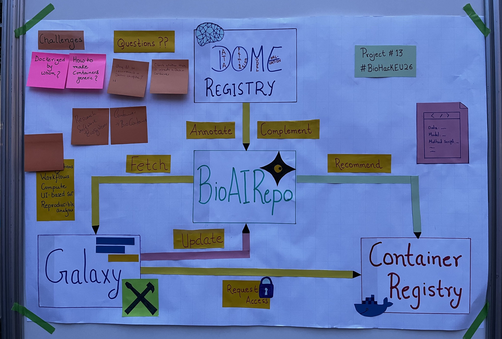
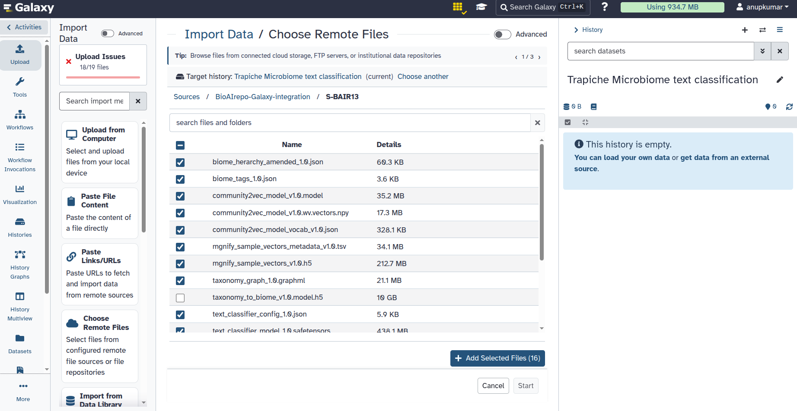
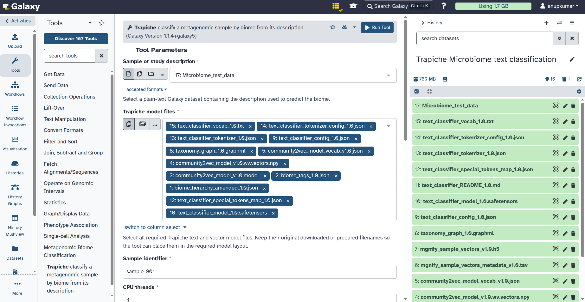
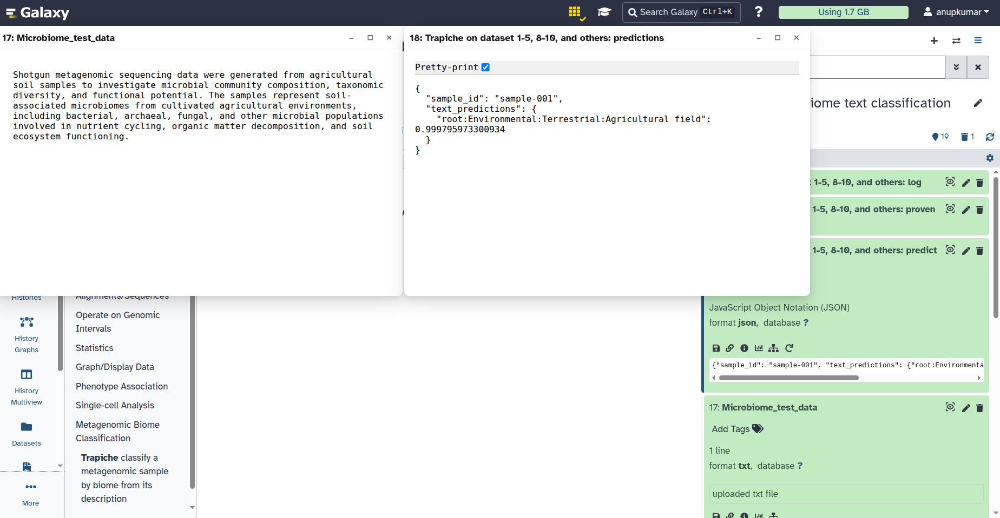

---
subsites:
- all-eu
- all
title: "Projects at BioHackathon Europe 2026"
date: "2026-11-18"
tease: "Three BioHackathon Europe 2026 projects workflow portability, collaborative microbiome knowledge graphs, and AI model repository integration and model execution."
hide_tease: false
tags:
  - tools
  - workflows
contributions:
  authorship:
    - anuprulez
    - arash77
    - Minamehr
    - RZ9082
  funding:
    - elixir-europe
    - elixir-de
    - uni-freiburg
    - deNBI
---

At BioHackathon Europe 2026 (November 9-13, 2026, Campus Belloch, Spain), contributors from across the research software and
life-science communities worked together on three projects. Their work ranged from porting workflows from ecosystem to another, 
laying the foundations for a collaborative microbiome knowledge graph and integrating AI resources for model execution.

## Project 31: Nextflow to Galaxy Workflow Portability and FAIRness via Modular LLM Agent Skills

The [Galaxy Workflow Foundry](https://github.com/galaxyproject/foundry) is a
knowledge base and a set of modular LLM agent skills for converting workflows
from other systems, such as Nextflow pipelines, papers, and CWL workflows, into
Galaxy workflows that are checked with Galaxy's own validation and testing
tools.

During the BioHackathon, the team used the Foundry to convert pipelines, fully
or in part, including nf-core/demo, bamtofastq, rnaseq, sarek, scrnaseq, mag,
atacseq, ampliseq, nanoseq, and oncoanalyser, as well as pipelines from outside
nf-core such as OceanOmics-amplicon-nf and CSP2. The team compared the resulting
Galaxy workflows with real Nextflow runs. The runs were shared openly in
[IWC Lab](https://github.com/galaxyproject/iwc-lab).

Problems found along the way were fed back as issues and fixes to the Foundry
and to Galaxy's workflow tooling, many of them from first-time contributors. A
second track reviewed how FAIR existing IWC workflows are, as a basis for a FAIR
review checklist.

**Participants:** Nicola Soranzo, Martin Čech, Marius van den Beek, John
Chilton, Dannon Baker, Arash Kadkhodaei, Michael R. Crusoe, Franziska Nicolaus,
Pavel Abramau, Maria Tsontaki, Emmi Rehn, Rand Zoabi, Shubh Sharma, Ivy Chen,
Egor Fedosov, Anastasia Ermolova, Anna Syme, Halimat Chisom Atanda, Adam
Bennett, Gareth Price, Jaskirat Singh, Ziad Al Bkhetan, and George He.

## Project 16: MiCoKnowGraph—Building Common Knowledge for a Collaborative Microbiome Knowledge Graph

How can we build a collaborative microbiome knowledge graph?

During BioHackathon Europe 2026, the MiCoKnowGraph team brought together
researchers from different backgrounds and areas of expertise to address this
challenge. The aim was to establish a common understanding of microbiome
knowledge and explore how existing standards and resources could support a
collaborative knowledge graph across different research domains.

Throughout the five-day hackathon, the team worked on defining scientific use
cases and competency questions to identify what the knowledge graph should be
able to answer and which biological entities and relationships would be needed.
In parallel, the team identified, collected, and reviewed existing ontologies,
knowledge graphs, and data sources, examining relevant concepts and properties
and their suitability for the different research questions.

These activities also led to discussions about harmonizing terminology,
connecting knowledge across domains, representing complex biological
observations, and choosing suitable graph-modelling approaches. By bringing
together different scientific perspectives, the team made progress toward a
shared vocabulary and a common understanding of the requirements for a
collaborative microbiome knowledge graph.

The hackathon provided a foundation for continued collaboration, supported by
the collected resources, documented use cases, and ongoing discussions. The
team has also started preparing a collaborative manuscript for submission to
BioHackrXiv to document the project's approach and findings. Building on this
initial work, the next steps will focus on further harmonizing concepts and
relationships and developing and evaluating a common knowledge graph model.

**On-site participants:** Bérénice Batut, Iphigénie Gonnet, Giuseppe Defazio,
Sebastian Jünemann, Mina Hojat Ansari, and Brieuc Quemeneur.

Additional participants joined remotely, including members of the Australian
BioHackathon outpost.

## Project 13: ELIXIR AI Ecosystem Integration: Bridging DOME, BioAIrepo and Galaxy

Machine learning is transforming life-science research, but discovering a model
does not necessarily make it easy to reproduce or run. The
[BioHackathon project](https://github.com/elixir-europe/biohackathon-projects-2026/blob/main/13.md)
set out to close this gap by connecting complementary parts of the ELIXIR AI
ecosystem: the DOME Registry for transparent method reporting, BioAIrepo for
depositing models and associated data, and Galaxy for accessible and
reproducible execution.

[BioAIrepo](https://www.ebi.ac.uk/biostudies/BioAIrepo) is an AI model
repository implemented as a collection within EMBL-EBI's BioStudies database.
It allows life scientists to share model metadata, weights and other files, as
well as links to the datasets used to build, test and validate models. Project
13 explored how these deposited assets could become actionable: instead of
ending the journey at a catalogue record, a researcher should be able to bring
the asset into Galaxy and run it through a standard interface.

During the BioHackathon, the team developed a BioAIrepo file source plugin for
Galaxy. This proof of concept lets Galaxy connect to BioAIrepo and access its
resources directly, providing a reusable path from model discovery to analysis.
It also contributes to the project's broader goals of improving links among
DOME, and BioAIrepo, and of producing clearer guidance
for model submission, discovery and execution.

The team used
[BioAIrepo record S-BAIR13](https://www.ebi.ac.uk/biostudies/bioairepo/studies/S-BAIR13),
**Trapiche—Multi-source biome classification from text and taxonomy**, as a
practical demonstrator. Trapiche is an open-source tool for classifying the
biome of origin of metagenomic studies and samples. It combines predictions
derived from project or sample descriptions with taxonomic community profiles:
a fine-tuned language model can infer candidate biome labels from text, while a
taxonomy-vectorization model uses taxonomic profiles to predict deeper biome
lineages. Bringing these complementary signals together improves the context
available for biome classification.

To make the text-classification component executable and portable, the project
produced container images:

- [trapiche-inference](https://hub.docker.com/r/jhoanmanuelms/trapiche-inference)
- [trapiche-text-s-bair13](https://hub.docker.com/r/anupkumar/trapiche-text-s-bair13)

A [Galaxy tool for making predictions](https://github.com/anuprulez/galaxy/blob/bdab9bdd6b861158f4802f7e56807de9bcc9c5d0/tools/biomodelsML/trapiche.xml)
was also created. Together, the BioAIrepo file source, containers and Galaxy
tool demonstrate an end-to-end route in which a deposited model can be found,
retrieved and executed in a reproducible analysis environment. This moves the
ELIXIR AI ecosystem toward the project's longer-term goal: cross-linked AI
resources that are not only findable and documented, but readily reusable by
the scientific community.

#### Integration of BioAIrepo with Galaxy

#### Tool for making text-based biome predictions in Galaxy

#### Tool outputs

**Participants:** Omar Attafi (UNIPD-it), Anup Kumar (UFR), Mauricio Martinez
(EMBL-EBI), and Jhoan Serrano (EMBL-EBI).

## Acknowledgements

We would like to thank ELIXIR, BioHackathon Europe 2026 organizers, sponsors, and participants for their support and contributions to these projects. The collaborative efforts of the Galaxy community and the broader life-science research community continue to drive innovation and reproducibility in computational biology.