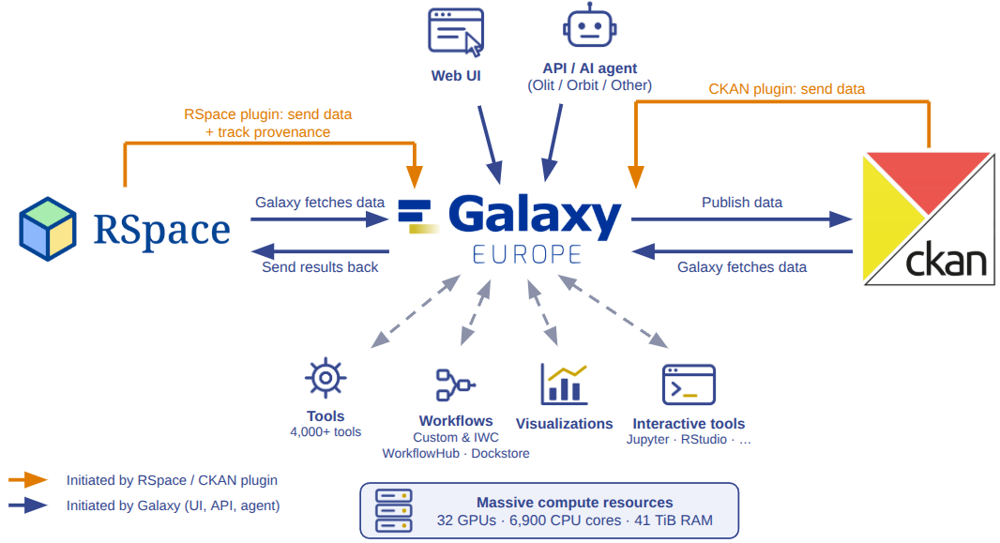

## Outline

On 24 November 2026, the MaterialVital-Digital (MVD) workshop in Freiburg demonstrated how Galaxy can connect
experimental documentation, data repositories, and reproducible analysis. The Freiburg Galaxy team presented
**data exchange and analysis between RSpace, Galaxy, and CKAN**, alongside approaches for developing Galaxy tools and workflows.

Building on the work showcased during the [July workshop at IWM Freiburg](/news/2026-07-13-mvd-second-workshop/), the workshop presentations and demonstrations focused on practical approaches from generated experimental data to scientific data analysis and back to the systems used by researchers.

## Connecting RSpace, Galaxy and CKAN

RSpace, Galaxy, and CKAN support complementary parts of the data journey: documenting experiments, analysing
data, and making datasets available through a data portal. The integration presentation described how data can
be sent from RSpace or CKAN to Galaxy, processed with tools or workflows, and returned with analysis results.

Galaxy's integrated **file source plugin** methodology provides a common interface for accessing data repositories such as RSpace and CKAN. The talks
illustrated adding an RSpace connection through **Manage Your Repositories**, selecting the RSpace template, and entering the endpoint and API key. Researchers can then browse and import data through Galaxy's interface. Results can also be exported to connected file sources that support writing. The presentation covered several ways to initiate analysis: through the Galaxy web interface, through its API, or with an AI agent ([Olit](https://usegalaxy.eu/visualizations/create/olit)). These entry points connect to the same analysis environment, including tools, workflows, visualisations, and interactive environments such as Jupyter and RStudio.

## RSpace to Galaxy and back

The RSpace demonstration followed a materials-science example involving [**scanning electron microscopy SEM
fibre analysis**](https://usegalaxy.eu/root?tool_id=sem_analysis) tool. An image and a JSON file containing analysis parameters were brought into Galaxy from an
RSpace document. The demo video also showed a request to Galaxy's integrated AI assistant, Olit, to run the
SEM fibre analysis tool using those parameters in an automatic manner filling out all essential parameters of the SEM tool, followed by a return to the RSpace notebook to document results. This illustrates how experimental records can provide both the data and the context needed for analysis, while the notebook's experiment is enriched with its computational results.

<iframe width="560" height="315" src="https://www.youtube-nocookie.com/embed/kK84sfytbbc" title="RSpace–Galaxy–RSpace demonstration" frameborder="0" allow="accelerometer; autoplay; clipboard-write; encrypted-media; gyroscope; picture-in-picture; web-share" referrerpolicy="strict-origin-when-cross-origin" allowfullscreen></iframe>

## CKAN to Galaxy and back

The CKAN demonstration illustrated the corresponding cycle of the **MVD data portal** and Galaxy. This develops the July workshop's idea of a Galaxy entry point in CKAN into a practical demonstration of data exchange between the repository and the analysis platform.

<iframe width="560" height="315" src="https://www.youtube-nocookie.com/embed/ifD6e0h3JLo" title="CKAN–Galaxy–CKAN demonstration" frameborder="0" allow="accelerometer; autoplay; clipboard-write; encrypted-media; gyroscope; picture-in-picture; web-share" referrerpolicy="strict-origin-when-cross-origin" allowfullscreen></iframe>

## Galaxy tool for materials-science data analysis

The tools presentation introduced the European Galaxy server and its range of analysis tools and interactive environments. **ImageJ/DiameterJ fibre analysis** provided a materials-science example, connecting the platform's capabilities to the Electrospinning use case discussed at the July workshop.

The presentation also outlined how a command-line program becomes a Galaxy tool. A tool includes an XML description, supporting Python scripts, software requirements supplied through Conda or containers, and automated tests. Contributions via GitHub tool repositories are submitted for peer review through a pull request. Deployment, resource allocation, and subsequent upgrades form part of maintaining the tool on a Galaxy server. Tool-development tutorials and workshops provide a route for researchers to contribute their own analysis methods. The slides also highlighted that language models can also assist with tool development.

## Reusable workflows and analysis provenance

Galaxy workflows connect individual analysis steps into reusable pipelines. The presentation covered the workflow
editor, running workflows, and inspecting workflow invocations, including execution metrics and export options.
It also introduced the **Intergalactic Workflow Commission ([IWC](https://iwc.galaxyproject.org/))** workflow library and **[WorkflowHub](https://workflowhub.eu/)** as resources
for discovering and reusing workflows with documentation and example data.

RSpace and CKAN presentations highlighted **RO-Crate** as a way to package research outputs with machine-readable metadata. Workflow Run RO-Crate extends this approach to describe computational executions, including their inputs, outputs, software, and execution context.

The integration slides illustrated the provenance available in Galaxy exports: tool identifiers and versions,
parameters, command lines, job outputs and exit codes, input-to-output relationships, timestamps, and workflow
definitions and invocation parameters. Keeping this information with exported results helps researchers trace
how an analysis was performed when moving between platforms.

## Resources

- [Galaxy tool and workflows generation](https://zenodo.org/records/24560212/files/Galaxy-Tools-Workflows.pdf?download=1)
- [RSpace → Galaxy → CKAN](https://zenodo.org/records/24560212/files/RSpace-CKAN-Galaxy-Integration.pdf?download=1)
- [European Galaxy server](https://usegalaxy.eu/)
- [Scanning electron microscopy (SEM) fibre analysis tool](https://usegalaxy.eu/root?tool_id=sem_analysis)
- [Image analysis history](https://usegalaxy.eu/u/kumara/h/ckan-galaxy-demo)
- [Galaxy tool-development tutorials](https://galaxyproject.github.io/training-material/topics/dev/#st-tooldev)
- [Planemo: writing standalone Galaxy tools](https://planemo.readthedocs.io/en/master/writing_standalone.html)
- [IWC workflow library](https://iwc.galaxyproject.org/)
- [WorkflowHub](https://workflowhub.eu/)